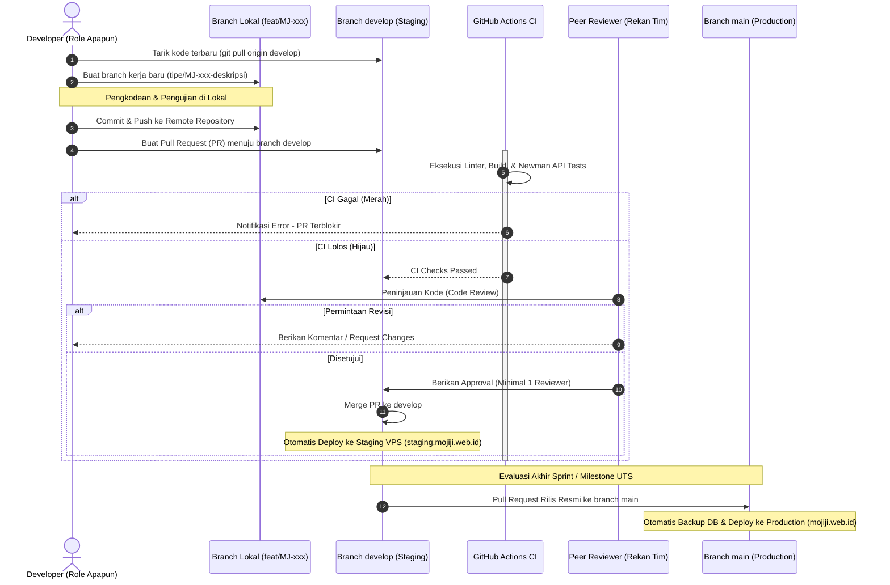

# Panduan Kontribusi Tim Pengembang Mojiji AnimeList

Dokumen ini merupakan panduan rekayasa dan konvensi standar (*Engineering Guidelines*) yang wajib dipatuhi oleh seluruh anggota tim pengembang proyek **Mojiji AnimeList** (Aji, Syafii, Andika, Ryan, Ichsan, Nadia). Kepatuhan terhadap panduan ini menjamin konsistensi kode, integritas riwayat git, keamanan rahasia sistem, serta kesiapan otomatisasi pengujian dan peluncuran layanan.

---

## 1. Prinsip Utama Kolaborasi

1. **Berbasis Tiket (Ticket-Driven):** Seluruh pekerjaan wajib mengacu pada tiket yang terdaftar di GitHub Projects ("Mojiji Kanban") dengan format ID `MJ-xxx`. ID tiket wajib disertakan pada nama branch, judul commit, dan Pull Request.
2. **Perlindungan Branch Utama:** Dilarang melakukan *direct push* ke branch `develop` maupun `main`. Seluruh perubahan kode hanya dapat masuk melalui mekanisme Pull Request (PR) yang telah disetujui.
3. **Keamanan Rahasia (Zero Secret Leak):** Dilarang keras mengunggah berkas rahasia (`.env`, token API, kunci privat SSH, string koneksi database, atau kunci JWT) ke repositori publik.
4. **Disiplin Kontrak Antar-Peran:** Perubahan yang mempengaruhi kontrak API, skema database, atau rute frontend wajib dikomunikasikan secara formal (*HANDOFF* / *Change Request*) kepada rekan tim terkait sebelum kode di-merge.

---

## 2. Alur Kerja Git & Siklus Rilis (Git Workflow)

Proyek ini menerapkan model percabangan berbasis integrasi berkelanjutan (*Git Flow Integration*):



### Status Progres & Lingkungan Aktif

Per Milestone UTS (Minggu 8), proyek telah mencapai tonggak rilis resmi:
* **Increment 1 (Sprint 1 - Rilis MVP `v1.0.0-mvp`):**
  * Seluruh fitur inti MVP (Autentikasi Pengguna dengan cookie `HttpOnly`, Pencarian Anime & Manga dengan Debounce + Upstash Redis Cache, Halaman Detail Terpadu, dan Tracker Watchlist) telah selesai diuji dan dirilis live.
  * **Lingkungan Produksi:** Aktif di **`https://mojiji.web.id`** (basis branch `main`).
  * **Lingkungan Staging:** Aktif di **`https://staging.mojiji.web.id`** (basis branch `develop`).
* **Increment 2 (Sprint 2 - Pasca-UTS):**
  * Fokus pada pengembangan fitur tambahan: Komentar Komunitas, Profil Pengguna, Toggle Tema Dark/Light Mode, dan Sistem Notifikasi/Reminder.
  * Seluruh kontributor wajib membuat branch fitur baru dari branch `develop` terbaru (`git pull origin develop`).

---

## 3. Aturan Penamaan Branch

Semua branch pengembangan dibuat dari branch `develop` dengan siklus hidup pendek (*short-lived feature branches*). Dilarang membuat branch permanen berbasis nama peran (misal: branch `frontend` atau `backend`).

### Format Baku:
```text
<tipe>/MJ-xxx-<deskripsi-singkat-kebab-case>
```

### Kategori Tipe Branch:
* `feat`: Pengembangan fitur baru aplikasi.
  * *Contoh:* `feat/MJ-060-halaman-detail-anime-dan-manga`
* `fix`: Perbaikan bug atau galat pada kode yang sudah ada.
  * *Contoh:* `fix/MJ-097-perketat-keamanan-akses-data`
* `test`: Penambahan skenario pengujian unit, integrasi, atau laporan QA.
  * *Contoh:* `test/MJ-086-regression-register-sampai-detail`
* `docs`: Pembaruan atau penambahan dokumentasi teknis.
  * *Contoh:* `docs/MJ-098-dokumentasi-api-final-mvp`
* `chore`: Penyetelan infrastruktur, konfigurasi build, skrip operasional, atau dependensi.
  * *Contoh:* `chore/MJ-091-latihan-rollback-skrip-staging-on`
* `refactor`: Restrukturisasi kode tanpa mengubah fungsionalitas eksternal.
  * *Contoh:* `refactor/MJ-081-standarisasi-format-error`

*Catatan:* Hapus branch kerja Anda setelah Pull Request berhasil di-merge ke branch `develop`.

---

## 4. Konvensi Pesan Commit (Conventional Commits)

Format pesan commit wajib mengikuti standar baku agar mudah ditelusuri pada riwayat git dan *changelog* otomatis:

### Format Baku:
```text
<tipe>(<scope>): <deskripsi tindakan dalam huruf kecil> [MJ-xxx]
```

### Panduan Ruang Lingkup (*Scope*):
* `web`: Perubahan pada aplikasi antarmuka pengguna (`apps/web`).
* `gateway`: Perubahan pada API Gateway (`services/api-gateway`).
* `user`: Perubahan pada User Service (`services/user-service`).
* `catalog`: Perubahan pada Catalog Service (`services/catalog-service`).
* `tracker`: Perubahan pada Tracker Service (`services/tracker-service`).
* `db`: Perubahan skema DDL atau seeder database (`database/`).
* `infra`: Perubahan konfigurasi Docker, Caddy, atau skrip peladen (`infra/`).
* `ci`: Perubahan pada alur kerja GitHub Actions (`.github/workflows/`).
* `qa`: Penambahan koleksi pengujian atau laporan verifikasi (`tests/`, `docs/qa/`).

### Contoh Pesan Commit yang Benar:
```text
feat(web): tambahkan komponen pencarian dengan jeda ketik [MJ-059]
fix(tracker): perbaiki validasi status enum pada update progress [MJ-080]
chore(infra): tambahkan timeout 60 detik pada healthcheck deploy [MJ-091]
docs(api): perbarui kontrak respon katalog pada skema swagger [MJ-098]
```

> [!WARNING] Larangan Pesan Commit:
> Dilarang menggunakan pesan commit ambigu tanpa referensi tiket, seperti: `update`, `fix bug`, `revisi`, `done`, `final`, atau `test commit`.

---

## 5. Protokol Pull Request (PR) & Tinjauan Kode

1. **Target Base Branch:** Selalu pastikan base branch yang dituju adalah **`develop`** (bukan `main`).
2. **Judul PR:** Gunakan format yang sama dengan pesan commit utama (misal: `feat(web): halaman detail anime dan manga [MJ-060]`).
3. **Pengisian Formulir Deskripsi:** Isi seluruh poin pada template PR (`.github/pull_request_template.md`):
   * Tiket ID
   * Apa yang berubah dan alasan teknis perubahan
   * Komponen terdampak
   * Bukti langkah pengujian (*Cara tes*)
   * Kriteria Penerimaan (*Acceptance Criteria*) yang terpenuhi
   * Ketergantungan antar-peran (*HANDOFF*)
4. **Syarat Penggabungan (Merge Requirements):**
   * **Lolos CI Otomatis:** Seluruh tahapan GitHub Actions CI wajib berstatus hijau (*Passed*).
   * **Minimal 1 Approval:** Mendapatkan persetujuan minimal satu pengembang lain. Pembuat PR dilarang menyetujui PR miliknya sendiri.
   * **Resolusi Komentar:** Seluruh catatan revisi dari *reviewer* wajib diselesaikan (*Resolved*).

---

## 6. Kepemilikan Modul & Batasan Peran (Code Ownership)

Untuk menjaga akuntabilitas, setiap direktori dalam repositori memiliki penanggung jawab utama:

| Direktori Repositori | Pemilik Utama | Penanggung Jawab | Tanggung Jawab Review |
| :--- | :--- | :--- | :--- |
| `apps/web/` | Frontend Developer | Andika | Review perubahan antarmuka, komponen React, styling Tailwind, dan performa client-side. |
| `services/` | Backend Developer | Syafii | Review logika bisnis Express.js, arsitektur routing API Gateway, keamanan sesi, dan integrasi API eksternal. |
| `database/` | Database Administrator (DBA) | Ryan | Review integritas DDL migrasi Dbmate, indexing query, dan kompatibilitas skema PostgreSQL. |
| `tests/`, `docs/qa/` | Quality Assurance (QA) | Nadia | Review cakupan skenario pengujian, koleksi Postman/Newman, dan verifikasi kriteria penerimaan (AC). |
| `infra/`, `.github/`, `docs/deployment/` | DevOps Engineer & Admin | Aji | Review konfigurasi Docker, Caddyfile, alur CI/CD GitHub Actions, alokasi memori, dan keamanan server VPS. |
| Desain & Mockup (Figma / `docs/`) | UI/UX Designer | Ichsan | Review keselarasan antarmuka visual, user flow, sistem desain, dan kepatuhan prototipe di Figma. |

*Catatan:* Anggota tim diperbolehkan membantu pengerjaan pada direktori di luar peran utamanya, namun perubahan tersebut **wajib** disetujui (*approved*) oleh pemilik direktori terkait sebelum di-merge.

---

## 7. Standar Dokumentasi Siap Docusaurus (Docusaurus-Ready)

Seluruh berkas dokumentasi yang diletakkan di dalam folder `docs/` wajib mematuhi standar industri berikut agar siap dikonversi otomatis menjadi portal dokumentasi web resmi pada Sprint 3 / UAS:

1. **Penamaan Berkas Bersih (*Clean Slugs*):**
   * Gunakan format huruf kecil dengan tanda hubung (*kebab-case*).
   * **Dilarang** menyertakan prefiks tiket sementara pada nama berkas.
   * *Contoh Benar:* `docs/deployment/domain-https.md` (Bukan: `MJ-054-domain-https.md`).
2. **Wajib Metadata Frontmatter YAML di Baris 1:**
   Setiap berkas markdown wajib diawali blok frontmatter:
   ```yaml
   ---
   title: "Judul Resmi Dokumen"
   sidebar_position: 1
   tags: [kategori1, kategori2]
   ---
   ```
3. **Pengayaan Visual (*Visual-First with Mermaid*):**
   Setiap dokumen teknis sangat disarankan memuat minimal 1-2 diagram Mermaid (`flowchart`, `sequenceDiagram`, `graph`, atau `erDiagram`) untuk memvisualisasikan alur proses tanpa membebani pembaca dengan teks yang terlalu padat.
4. **Bahasa Baku & Pembersihan Karakter:**
   Gunakan bahasa Indonesia teknis yang formal dan baku. Hindari dekorasi emoji berlebihan pada judul serta bersihkan karakter rusak akibat ketidakcocokan enkoding editor.

---

## 8. Kebijakan Keamanan Kredensial & Manajemen Rahasia

Pelanggaran terhadap keamanan kredensial merupakan kesalahan fatal:
* Berkas `.env` telah dimasukkan ke dalam `.gitignore` dan dilarang keras di-commit ke repositori.
* Seluruh penambahan variabel lingkungan baru wajib didaftarkan pada template [`.env.example`](.env.example) dengan nilai kosong (*placeholder*) disertai dokumentasi fungsinya.
* Jika terjadi kebocoran kunci rahasia (*secret leak*) secara tidak sengaja:
  1. Segera laporkan kepada DevOps (Aji).
  2. Lakukan rotasi kunci (*key rotation*) seketika pada layanan penyedia (Supabase, Upstash, atau JWT).
  3. Menghapus commit saja tidak cukup karena jejak riwayat git tetap menyimpan data tersebut; riwayat commit yang terpapar wajib dibersihkan menggunakan pembersihan history.

---

## 9. Protokol Komunikasi & Serah Terima (HANDOFF)

Untuk mencegah asumsi sepihak, tim menggunakan tag komunikasi standar pada diskusi Issue dan PR:
* `[CONFIRMED]`: Kesepakatan teknis yang telah disetujui lintas peran.
* `[PROPOSAL]`: Usulan solusi teknis baru yang membutuhkan masukan tim.
* `[BLOCKED]`: Pekerjaan terhenti akibat menunggu deliverable dari peran lain.
* `[DECISION NEEDED]`: Membutuhkan keputusan arsitektural dari Tech Lead / DevOps.

### Format Standar Serah Terima Tugas (HANDOFF):
Jika suatu pekerjaan selesai dan menjadi prasyarat bagi pekerjaan rekan lain:
> **HANDOFF:** Dari [Role A] kepada [Role B]  
> **Tiket Dependen:** [MJ-xxx]  
> **Artefak yang Diserahkan:** [Tautan berkas / URL staging / branch]  
> **Catatan Penting:** [Konfigurasi khusus, variabel baru, atau batasan sistem]

---

## 10. Otomasi Operasional Peladen (Ops Workflows via GitHub Actions)

Untuk memudahkan anggota tim melakukan pemeliharaan server tanpa memerlukan akses terminal SSH atau kredensial langsung ke VPS, repositori menyediakan alur kerja manual berbasis `workflow_dispatch` di tab **Actions**:

| Nama Workflow | Berkas Konfigurasi | Kapan Digunakan | Cara Menjalankan |
| :--- | :--- | :--- | :--- |
| **Staging Environment Toggle** | `.github/workflows/staging-toggle.yml` | Menghemat RAM VPS (2 GB) saat staging tidak dipakai. Mematikan 4 mikroservis backend (`DOWN`) atau menyalakannya kembali saat pengujian (`UP`). | Tab **Actions** &rarr; Pilih *Staging Environment Toggle* &rarr; Klik **Run workflow** &rarr; Pilih aksi `UP` atau `DOWN`. |
| **Ops - Caddy Server Control** | `.github/workflows/ops-restart-caddy.yml` | Menyegarkan reverse proxy Caddy secara instan (mengatasi desinkronisasi berkas mount/inode) atau memuat ulang konfigurasi *zero-downtime*. | Tab **Actions** &rarr; Pilih *Ops - Caddy Server Control* &rarr; Klik **Run workflow** &rarr; Pilih opsi `restart` (default) atau `reload`. |
| **Production Pipeline (Manual)** | `.github/workflows/production.yml` | Memicu alur rilis produksi secara manual jika diperlukan (backup DB, migrasi, dan deployment microservices port 5000–5003). | Tab **Actions** &rarr; Pilih *Production Pipeline* &rarr; Klik **Run workflow** (mengarah ke branch `main`). |

*Catatan Keamanan & Arsitektur:* Alur kerja operasional di atas dirancang dengan pengenalan kontainer dinamis (*Dynamic Auto-Detect*) sehingga aman dijalankan dan tetap kompatibel saat struktur Caddy dipindahkan ke `mojiji-infra` pada Sprint 2.
