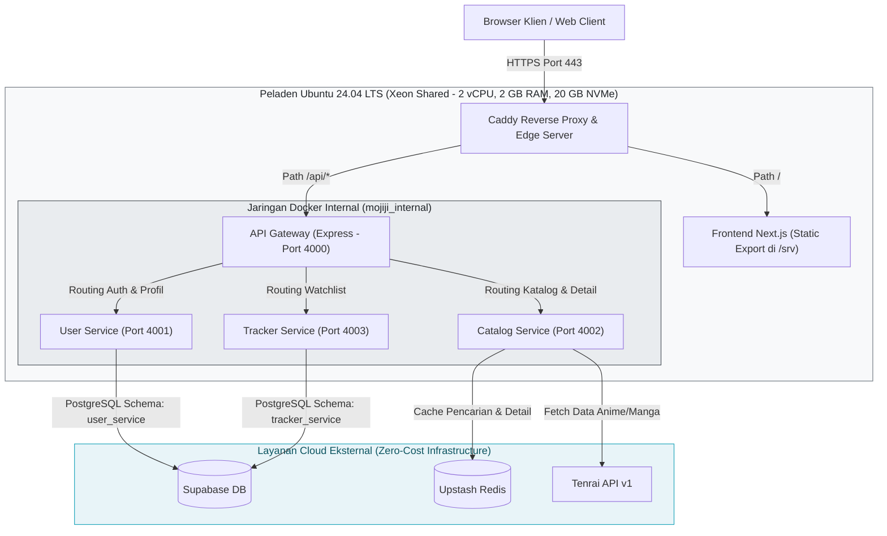

<div align="center">
  <h1>Mojiji AnimeList</h1>
  <p><strong>Platform Pencatatan dan Pelacakan Anime & Manga Terpadu Berbasis Microservices</strong></p>
  <p>Aplikasi web modern berkinerja tinggi yang dirancang untuk memantau, mengkurasi, dan mengelola daftar tontonan anime serta bacaan manga secara terpadu, aman, dan efisien.</p>

  <!-- Frontend Stack -->
  <a href="https://nextjs.org/docs" target="_blank"></a>
  <a href="https://react.dev/" target="_blank"></a>
  <a href="https://tailwindcss.com/docs" target="_blank"></a>
  <a href="https://ui.shadcn.com/" target="_blank"></a>
  <a href="https://zustand.docs.pmnd.rs/" target="_blank"></a>

  <br />

  <!-- Backend & Database Stack -->
  <a href="https://expressjs.com/" target="_blank"></a>
  <a href="https://nodejs.org/docs/latest-v20.x/api/" target="_blank"></a>
  <a href="https://www.postgresql.org/docs/15/" target="_blank"></a>
  <a href="https://supabase.com/docs" target="_blank"></a>
  <a href="https://upstash.com/docs" target="_blank"></a>

  <br />

  <!-- DevOps & Infrastructure Stack -->
  <a href="https://caddyserver.com/docs/" target="_blank"></a>
  <a href="https://docs.docker.com/" target="_blank"></a>
  <a href="https://docs.github.com/en/actions" target="_blank"></a>
  <a href="https://github.com/amacneil/dbmate" target="_blank"></a>
  <a href="https://ubuntu.com/server/docs" target="_blank"></a>
</div>

---

## Tentang Proyek

Mojiji AnimeList adalah aplikasi web full-stack modern yang dibangun untuk memenuhi standar rekayasa perangkat lunak pada mata kuliah Pemrograman Web Framework. Proyek ini mengimplementasikan pola arsitektur **microservices terdistribusi** yang berjalan di atas infrastruktur awan berbasis biaya nol (*zero-cost cloud infrastructure*).

Sistem ini memisahkan secara tegas tanggung jawab antarmuka pengguna, gerbang routing (*API gateway*), dan layanan mikro domain bisnis. Dengan menerapkan optimasi runtime Node.js dan kompilasi statis Next.js, seluruh ekosistem aplikasi dapat beroperasi secara simultan di atas server VPS Xeon Shared berkapasitas 2 GB RAM dan 20 GB NVMe dengan tingkat stabilitas tinggi dan konsumsi memori fisik kontainer di bawah 100 MB.

*Pernyataan Kepatuhan Konten:* Mojiji berfokus sepenuhnya pada fungsi manajemen katalog, pencatatan progres daftar pantau (*watchlist tracker*), dan interaksi personal penggemar. Platform ini **tidak menyediakan fasilitas penayangan video streaming maupun pembacaan manga secara ilegal**, melainkan memanfaatkan metadata legal dari Tenrai API v1.

---

## Status Rilis & Akses Lingkungan

| Lingkungan | Status Operasional | Tautan URL Publik | Tahap Milestone |
| :--- | :--- | :--- | :--- |
| **Staging** | **Online (Always-On)** | [staging.mojiji.web.id](https://staging.mojiji.web.id) | Sprint 1 Increment 1 (Stabilisasi & Uji Regresi) |
| **Production** | **Siap Diluncurkan** | [mojiji.web.id](https://mojiji.web.id) | Target Evaluasi Milestone UTS (Minggu 8) |
| **Dokumentasi** | **Docusaurus-Ready** | Direktori `docs/` | Navigasi Terstruktur (Posisi 1 s.d. 9) & Diagram Mermaid |

---

## Arsitektur Sistem

Aplikasi mengadopsi pola arsitektur **API Gateway Microservices** dengan pemisahan jaringan kontainer internal dan edge reverse proxy:



---

## Fitur Utama MVP (Increment 1)

1. **Autentikasi & Manajemen Sesi Pengguna:**
   * Registrasi akun pengguna dengan enkripsi sandi hash bcrypt.
   * Login aman dengan sesi berbasis cookie `HttpOnly`, `SameSite=Lax`, dan `Secure`.
   * Pengecekan sesi terpusat di API Gateway dan penerusan identitas via header internal `x-user-id` dan `x-username`.
2. **Katalog Anime & Manga Terpadu:**
   * Pencarian judul anime dan manga secara instan dengan debounce jeda ketik (*typing debounce*).
   * Halaman detail lengkap memuat sinopsis, genre, episode/bab, studio, dan rating skor.
   * Lapisan caching cepat menggunakan Upstash Redis untuk mereduksi latensi dan melindungi kuota API pihak ketiga.
3. **Pelacak Daftar Pantau (Tracker Watchlist):**
   * Penambahan judul ke daftar pantau pengguna dengan status: *Watching / Reading*, *Completed*, *On Hold*, *Dropped*, dan *Plan to Watch*.
   * Pembaruan progres episode/bab secara bertahap (*incremental counter*).
   * Pengelolaan dan penghapusan item daftar pantau dengan verifikasi hak kepemilikan data.

---

## Rincian Tumpukan Teknologi & Dokumentasi Resmi

| Komponen | Teknologi | Versi | Peran & Dokumentasi Resmi |
| :--- | :--- | :--- | :--- |
| **Frontend Framework** | [Next.js](https://nextjs.org/docs) | 15.x | Antarmuka web responsif dengan ekspor statis (`output: "export"`). |
| **UI Library** | [React](https://react.dev/) | 19.x | Library dasar komponen antarmuka pengguna. |
| **Styling Engine** | [Tailwind CSS](https://tailwindcss.com/docs) | 3.4.x | Utilitas CSS modern untuk desain antarmuka dark glow. |
| **UI Components** | [shadcn/ui](https://ui.shadcn.com/) | Radix UI | Komponen antarmuka modular, aksesibel, dan konsisten. |
| **Client State** | [Zustand](https://zustand.docs.pmnd.rs/) | 5.x | State management client-side ringan tanpa overhead render ulang. |
| **Backend Microservices** | [Express.js](https://expressjs.com/) | 5.x | Framework backend minimalis dan andal dengan alokasi memori sangat rendah (~15-20 MB/service). |
| **Runtime Engine** | [Node.js](https://nodejs.org/) | 20 LTS | Lingkungan eksekusi backend berbasis image ringan `node:20-alpine`. |
| **Relational Database** | [PostgreSQL](https://www.postgresql.org/docs/15/) | 15.x | Basis data relasional dengan isolasi skema per service (*Multi-Schema*). |
| **Database Cloud Provider** | [Supabase](https://supabase.com/docs) | Hosted | Penyedia PostgreSQL cloud terkelola dengan session pooler IPv4. |
| **In-Memory Cache** | [Upstash Redis](https://upstash.com/docs) | Serverless | Penyimpanan cache cepat dengan prefix `stg:` dan `prod:` untuk mencegah bentrokan data. |
| **Reverse Proxy & TLS** | [Caddy](https://caddyserver.com/docs/) | 2.x | Manajemen sertifikat SSL otomatis Let's Encrypt dan reverse proxy internal. |
| **Database Migrations** | [Dbmate](https://github.com/amacneil/dbmate) | 2.x | Manajemen migrasi DDL skema database yang independen dari ORM. |
| **Kontainerisasi** | [Docker](https://docs.docker.com/) | 27.x | Isolasi lingkungan pengembangan lokal dan server produksi. |
| **Otomatisasi CI/CD** | [GitHub Actions](https://docs.github.com/en/actions) | Cloud | Pipeline pengujian unit, linter, Newman API test, dan deploy otomatis. |
| **Sistem Operasi Server** | [Ubuntu Server](https://ubuntu.com/server/docs) | 24.04 LTS | Host VPS Xeon Shared (2 vCPU, 2 GB RAM, 2 GB Swap, 20 GB NVMe, SSH NAT Port 20125). |

---

## Struktur Repositori Monorepo

```text
mojiji-animelist/
├── apps/
│   └── web/                     # Aplikasi Frontend Next.js 15
├── services/                    # Kumpulan Microservices Backend (Express.js v5)
│   ├── api-gateway/             # Resepsionis, verifikasi cookie, & routing
│   ├── user-service/            # Registrasi, autentikasi, & profil user
│   ├── catalog-service/         # Integrasi Tenrai API & Upstash cache
│   └── tracker-service/         # Logika bisnis pelacakan watchlist
├── database/                    # Berkas DDL Dbmate & migrasi skema
│   └── migrations/
├── infra/                       # Konfigurasi infrastruktur peladen
│   ├── caddy/                   # Konfigurasi Caddyfile & reverse proxy
│   ├── compose/                 # docker-compose.dev.yml & docker-compose.server.yml
│   └── scripts/                 # Skrip otomasi deploy.sh, rollback.sh, staging-up/down
├── tests/                       # Koleksi Postman & pengujian otomatis Newman
├── docs/                        # Dokumentasi teknis terstruktur (Docusaurus-Ready)
│   ├── api/                     # Kontrak API, payload, & endpoints
│   ├── architecture/            # Catatan teknis & arsitektur monorepo
│   ├── deployment/              # Panduan VPS, RAM, CI/CD, & SOP Operasional
│   ├── prd/                     # Product Requirement Document (PRD)
│   └── qa/                      # Skenario tes, DoD, & log regresi
└── .github/
    └── workflows/               # Pipeline GitHub Actions (CI & Deploy)
```

---

## Panduan Pengembangan Lokal (Quickstart)

### Prasyarat Perangkat Lunak
* [Docker Desktop](https://www.docker.com/products/docker-desktop/) (versi 24.0+)
* [Node.js](https://nodejs.org/) (versi 20 LTS) & npm (opsional jika menjalankan langsung via Docker)

### Langkah Pemasangan & Menjalankan Sistem

1. **Kloning Repositori:**
   ```bash
   git clone https://github.com/aji-banyu/mojiji-animelist.git
   cd mojiji-animelist
   ```

2. **Penyetelan Variabel Lingkungan:**
   Salin berkas template environment ke root proyek:
   ```bash
   cp .env.example .env
   ```
   *Catatan:* Konfigurasi bawaan `.env.example` telah disesuaikan untuk pengembangan lokal via Docker Compose tanpa perlu mengubah kredensial database.

3. **Menjalankan Seluruh Layanan Lokal:**
   Eksekusi perintah Docker Compose:
   ```bash
   docker compose --env-file .env -f infra/compose/docker-compose.dev.yml up --build -d
   ```

4. **Verifikasi Titik Akhir Layanan (Healthcheck):**
   Pastikan seluruh service menjawab status sehat:
   * **Frontend Web:** `http://localhost:3000`
   * **API Gateway:** `http://localhost:4000/health`
   * **User Service:** `http://localhost:4001/health`
   * **Catalog Service:** `http://localhost:4002/health`
   * **Tracker Service:** `http://localhost:4003/health`

5. **Menghentikan Layanan:**
   Untuk menghentikan kontainer tanpa menghapus data database lokal:
   ```bash
   docker compose --env-file .env -f infra/compose/docker-compose.dev.yml down
   ```

---

## Kebijakan Operasional Server & Deployment

Infrastruktur Mojiji dirancang dengan kepatuhan terhadap prinsip rekayasa sistem yang andal:
* **Zero-Build on VPS:** Peladen VPS dilarang keras menjalankan kompilasi berat seperti `docker build` atau `npm run build`. Seluruh proses build diselesaikan oleh runner GitHub Actions di cloud, dan VPS hanya bertindak sebagai runtime penarik image matang dari GitHub Container Registry (GHCR).
* **Alokasi Memori Efisien:** Setiap kontainer backend dibatasi `mem_limit: 96m` pada level cgroup Docker dan batas heap V8 `NODE_OPTIONS="--max-old-space-size=64"`. Berdasarkan pengukuran empiris live di VPS, total konsumsi seluruh kontainer hanya menyentuh **~91.6 MB** dari kapasitas 2 GB RAM fisik.
* **Zero Data Loss Rollback:** Skrip rollback (`deploy.sh` dan `rollback.sh`) dirancang untuk tidak pernah menjalankan pembatalan migrasi `dbmate down` secara otomatis guna mencegah hilangnya data pengguna. Seluruh perubahan skema DDL wajib bersifat kompatibel maju (*backward-compatible*).

---

## Indeks Dokumentasi Terstandarisasi

Seluruh berkas dokumentasi di folder `docs/` telah dipasangi metadata frontmatter seragam dan siap dirender oleh framework Docusaurus:

* **Infrastruktur & Deployment:**
  * [Peta Environment & Manajemen Rahasia](docs/deployment/environment.md) (Posisi 1 - MJ-035)
  * [Panduan Docker Dev Lokal & Konvensi Peran Tim](docs/deployment/panduan-docker-tim.md) (Posisi 2 - MJ-051)
  * [Setup, Hardening & Keamanan Peladen VPS](docs/deployment/setup-vps.md) (Posisi 3 - MJ-053)
  * [Konfigurasi Domain, Caddy & HTTPS Otomatis](docs/deployment/domain-https.md) (Posisi 4 - MJ-054)
  * [Laporan Pengukuran RAM Empiris & Mode Always-On](docs/deployment/ram.md) (Posisi 5 - MJ-089)
  * [Panduan Deployment CI/CD Zero-Build & SOP Server](docs/deployment/deployment.md) (Posisi 6 - MJ-090)
  * [Inventaris Batasan Free Hosting & Mitigasi Risiko](docs/deployment/batas-hosting.md) (Posisi 7 - MJ-090 & MJ-164)
  * [Panduan Skrip Operasional & Auto-Rollback](docs/deployment/operasional-skrip-rollback.md) (Posisi 8 - MJ-091)
  * [Handoff Konfigurasi Produksi Backend](docs/deployment/konfigurasi-produksi.md) (Posisi 9 - MJ-099)
* **API & Arsitektur:**
  * [Kontrak API Final MVP](docs/api/api-contract-mvp.md)
  * [Ringkasan Arsitektur Sistem](docs/architecture/ringkasan-arsitektur.md)
* **Kualitas & Pengujian (QA):**
  * [Skenario Pengujian MVP & Definition of Done](docs/qa/skenario-mvp.md)
  * [Laporan Regresi Otomatis MVP](docs/qa/hasil-regression.md)

---

## Tim Pengembang & Struktur Peran

Proyek ini dikembangkan secara kolaboratif oleh tim mahasiswa mata kuliah Pemrograman Web Framework dengan struktur peran utama (*Primary Role*) dan peran pendukung (*Secondary Role*):

| Anggota Tim | Peran Utama (Primary) | Peran Pendukung (Secondary) | Tanggung Jawab Inti |
| :--- | :--- | :--- | :--- |
| **Aji** | DevOps | Frontend | Provisioning VPS, otomatisasi pipeline CI/CD GitHub Actions, reverse proxy Caddy HTTPS, manajemen kontainer Docker, serta perbantuan integrasi frontend Next.js. |
| **Syafii** | Backend | DevOps | Arsitektur microservices Express.js, API Gateway, autentikasi sesi cookie aman, routing service, serta perbantuan konfigurasi deployment dan Docker. |
| **Andika** | Frontend | DBA | Pengembangan antarmuka web Next.js 15, komponen antarmuka, konsumsi API client-side, state management Zustand, serta perbantuan perancangan skema dan query database. |
| **Ryan** | DBA | Backend | Perancangan skema relasional multi-schema PostgreSQL, migrasi Dbmate, optimasi indexing query Supabase, serta perbantuan logika endpoint backend. |
| **Ichsan** | UI/UX | Tester | Perancangan desain antarmuka, wireframe, user flow, dan mockup sistem di Figma, serta perbantuan pengujian antarmuka dan pengujian fungsional aplikasi. |
| **Nadia** | QA | UI/UX | Perancangan skenario pengujian (test cases), smoke testing, otomatisasi pengujian API Postman/Newman, validasi Acceptance Criteria, serta perbantuan review estetika desain UI/UX. |

---

## Lisensi & Kontribusi

Seluruh kontribusi kode internal wajib mengikuti protokol yang tercantum dalam panduan [CONTRIBUTING.md](CONTRIBUTING.md). Proyek ini dilindungi di bawah lisensi institusional untuk keperluan akademik mata kuliah Pemrograman Web Framework.
