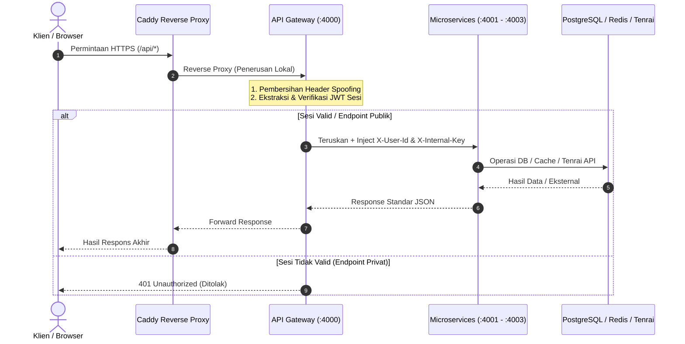

# API Contract MVP — Mojiji AnimeList

* **Status:** Final MVP (Terverifikasi & Sesuai Kode Produksi)
* **Scope:** Authentication, User Profile, Catalog Discovery, Tracker Service, dan Health Check
* **Acuan:** Mojiji PRD Revisi 4, bagian 18 — API Overview & Tiket MJ-098
* **Pemilik Dokumen:** Syafii (Backend)
* **Reviewer:** Andika (Frontend), Nadia (QA)

---

## 1. Konvensi Umum



> [!IMPORTANT]
> Seluruh endpoint privat (`/api/users/me`, `/api/tracker/*`) wajib melalui verifikasi sesi terpusat di API Gateway. Klien eksternal dilarang memanipulasi header identitas (`X-User-Id`) secara langsung.


1. **Prefix API:** Seluruh endpoint publik disajikan melalui API Gateway dengan prefix `/api`.
2. **Format Data:** Request body dan response body selalu menggunakan format `application/json` berkarakter UTF-8 (kecuali `DELETE /api/tracker/:id` yang mengembalikan `204 No Content` tanpa body).
3. **Pemisahan Identitas (Header Sanitization & Anti-Spoofing):**
   * Gateway secara otomatis membuang header eksternal `X-User-Id`, `X-User-Name`, `X-User-Email`, dan `X-Internal-Key` dari request klien eksternal.
   * Hanya Gateway yang berhak menyuntikkan header identitas tersebut ke downstream microservice setelah memverifikasi sesi login JWT yang sah.
4. **Isolasi Data (Multi-tenancy):** Seluruh data personal (profil dan tracker) diverifikasi berdasarkan identitas `user_id` milik pengguna yang sedang login. Upaya mengakses atau memanipulasi data pengguna lain mengembalikan status `404 Not Found` (mencegah enumerasi data).
5. **Standar Keamanan Kata Sandi:** Disimpan dalam bentuk hash `bcryptjs` (salt cost 10). `password_hash` tidak pernah dikembalikan ke respons publik maupun log.
6. **Query Database Berparameter:** 100% kueri database menggunakan parameterized queries (`$1, $2, ...`) untuk mencegah SQL Injection.

### 1.1 Format Respons Sukses

Untuk respons sukses yang memiliki isi (*body*):
```json
{
  "success": true,
  "data": {}
}
```

Untuk respons sukses berupa daftar (*array*):
```json
{
  "success": true,
  "data": [],
  "meta": {
    "page": 1,
    "limit": 20,
    "total": 31
  }
}
```
*Catatan: Objek `meta` hanya disertakan jika endpoint mendefinisikan metadata atau paginasi.*

### 1.2 Format Respons Error Terstandarisasi

Semua service (API Gateway, User Service, Catalog Service, Tracker Service) mengembalikan format respons error yang seragam:
```json
{
  "success": false,
  "error": {
    "code": "VALIDATION_ERROR",
    "message": "Pesan deskriptif yang aman untuk pengguna",
    "details": []
  }
}
```

Aturan Response Error:
* `success` selalu bernilai `false`.
* `error.code`: Kode string huruf kapital terstandarisasi untuk memudahkan penanganan di frontend dan pengujian QA.
* `error.message`: Pesan singkat dan ramah dalam bahasa Indonesia yang aman ditampilkan kepada klien.
* `error.details`: Array berisi rincian validasi per-field. Berisi `[]` jika tidak ada detail tambahan.
* Stack trace sistem, file path server, atau detail koneksi database **tidak pernah dibocorkan** ke klien publik.

### 1.3 Daftar Standar Kode HTTP dan Error Code

| Status HTTP | Error Code | Deskripsi & Kasus Penggunaan |
|---|---|---|
| `200 OK` | - | Permintaan pembacaan atau pembaruan berhasil dengan payload response. |
| `201 Created` | - | Sumber daya baru berhasil dibuat (registrasi atau pembuatan tracker). |
| `204 No Content` | - | Operasi penghapusan berhasil tanpa body respons. |
| `400 Bad Request` | `VALIDATION_ERROR` | Format body JSON rusak atau validasi input Zod gagal. |
| `401 Unauthorized` | `UNAUTHORIZED` | Kredensial login salah atau cookie/token sesi tidak ditemukan/kedaluwarsa. |
| `403 Forbidden` | `FORBIDDEN` | Akses ditolak (misal: pemanggilan internal tanpa `X-Internal-Key` yang sah). |
| `404 Not Found` | `NOT_FOUND` | Rute URL tidak ada, item katalog tidak ditemukan, atau item tracker bukan milik pengguna. |
| `409 Conflict` | `CONFLICT` | Bentrok integritas data (email/username sudah terdaftar, atau judul sudah ada di tracker). |
| `429 Too Many Requests` | `RATE_LIMITED` | Batas kuota permintaan terlampaui (brute force login limiter atau batas rate Tenrai). |
| `502 Bad Gateway` | `BAD_GATEWAY` / `UPSTREAM_ERROR` | Layanan downstream atau provider eksternal (Tenrai) offline atau merespons tidak valid. |
| `504 Gateway Timeout` | `GATEWAY_TIMEOUT` | Permintaan ke layanan upstream mengalami timeout. |
| `500 Internal Server Error` | `INTERNAL_SERVER_ERROR` | Kesalahan internal server yang tidak terduga. |

---

## 2. Authentication & User Profile

Base URL:
* Melalui API Gateway (Rute Publik): `http://localhost:4000/api/auth` & `http://localhost:4000/api/users`
* Direct Service (Lokal Development): `http://localhost:4001`
* Staging / Production: `https://staging.<domain>/api/*` / `https://<domain>/api/*`

### 2.1 POST /api/auth/register

* **Tujuan:** Mendaftarkan akun pengguna baru.
* **Autentikasi:** Publik (tanpa login).

#### Request Headers
| Header | Nilai | Keterangan |
| :--- | :--- | :--- |
| `Content-Type` | `application/json` | Wajib |

#### Request Body Schema (JSON)
| Field | Tipe | Wajib— | Aturan Validasi |
| :--- | :--- | :--- | :--- |
| `username` | `string` | Ya | 3–50 karakter, alfanumerik dan underscore |
| `email` | `string` | Ya | Format email valid, maksimal 255 karakter |
| `password` | `string` | Ya | Minimal 8 karakter (sesuai AC US-007) |

Contoh Request:
```json
{
  "username": "syafii_dev",
  "email": "syafii@example.com",
  "password": "Password123!"
}
```

#### Status HTTP & Response
* **`201 Created`** — Akun berhasil dibuat:
```json
{
  "success": true,
  "data": {
    "id": "e4b2d56a-1f87-4948-a0c5-343219488a01",
    "username": "syafii_dev",
    "email": "syafii@example.com",
    "createdAt": "2026-11-03T10:00:00.000Z"
  }
}
```
* **`400 Bad Request`** (`VALIDATION_ERROR`):
```json
{
  "success": false,
  "error": {
    "code": "VALIDATION_ERROR",
    "message": "Validasi input registrasi gagal",
    "details": [
      "Password minimal terdiri dari 8 karakter"
    ]
  }
}
```
* **`409 Conflict`** (`CONFLICT`):
```json
{
  "success": false,
  "error": {
    "code": "CONFLICT",
    "message": "Email atau username sudah digunakan",
    "details": [
      "Email sudah digunakan"
    ]
  }
}
```

---

### 2.2 POST /api/auth/login

* **Tujuan:** Mengautentikasi pengguna dan menerbitkan cookie sesi JWT HTTP-Only.
* **Autentikasi:** Publik.
* **Proteksi:** Rate limited maksimal 15 percobaan per 15 menit per IP.

#### Request Body Schema (JSON)
| Field | Tipe | Wajib— | Aturan Validasi |
| :--- | :--- | :--- | :--- |
| `email` | `string` | Ya | Format email valid |
| `password` | `string` | Ya | Minimal 1 karakter |

Contoh Request:
```json
{
  "email": "syafii@example.com",
  "password": "Password123!"
}
```

#### Status HTTP & Response
* **`200 OK`** — Login berhasil. Header `Set-Cookie` mengirimkan `mojiji_session=<jwt>; HttpOnly; SameSite=Lax; Path=/; Max-Age=604800` (disertai `Secure` pada staging/production):
```json
{
  "success": true,
  "data": {
    "id": "e4b2d56a-1f87-4948-a0c5-343219488a01",
    "username": "syafii_dev",
    "email": "syafii@example.com"
  }
}
```
* **`401 Unauthorized`** (`UNAUTHORIZED`):
```json
{
  "success": false,
  "error": {
    "code": "UNAUTHORIZED",
    "message": "Email atau password salah",
    "details": []
  }
}
```
* **`429 Too Many Requests`** (`RATE_LIMITED`):
```json
{
  "success": false,
  "error": {
    "code": "RATE_LIMITED",
    "message": "Terlalu banyak percobaan login. Silakan coba lagi beberapa saat kemudian.",
    "details": [
      "Batas percobaan login tercapai (maksimal 15 kali per 15 menit)."
    ]
  }
}
```

---

### 2.3 POST /api/auth/logout

* **Tujuan:** Menghapus cookie sesi login pengguna di peramban.
* **Autentikasi:** Publik / Sesi opsional.

#### Status HTTP & Response
* **`200 OK`** — Header `Set-Cookie` mengirimkan instruksi invalidasi cookie (`Expires=Thu, 01 Jan 1970 00:00:00 GMT`):
```json
{
  "success": true,
  "data": {
    "message": "Logout berhasil"
  }
}
```

---

### 2.4 GET /api/users/me

* **Tujuan:** Mengambil data profil pengguna yang sedang login.
* **Autentikasi:** Wajib (Cookie sesi `mojiji_session` atau header `Authorization: Bearer <token>`).

#### Status HTTP & Response
* **`200 OK`** — Data profil pengguna:
```json
{
  "success": true,
  "data": {
    "id": "e4b2d56a-1f87-4948-a0c5-343219488a01",
    "username": "syafii_dev",
    "email": "syafii@example.com",
    "createdAt": "2026-11-03T10:00:00.000Z"
  }
}
```
* **`401 Unauthorized`** (`UNAUTHORIZED`):
```json
{
  "success": false,
  "error": {
    "code": "UNAUTHORIZED",
    "message": "Sesi tidak ditemukan atau telah berakhir. Silakan login kembali.",
    "details": []
  }
}
```

---

## 3. Catalog Service

Base URL:
* Melalui API Gateway: `http://localhost:4000/api/catalog`
* Direct Service: `http://localhost:4002/api/catalog`
* Internal Microservice (Private): `http://catalog-service:4002/internal/catalog`

### 3.0 Kebijakan Caching Redis & Ketahanan Upstream (Tiket MJ-079)
* **Header `X-Cache`:** Mengembalikan `HIT` (data dari cache memori < 15 ms), `MISS` (data dari Tenrai API), atau `STALE` (fallback salinan lama jika Tenrai 429/502).
* **TTL:** Search = 1 jam (3600s), Detail = 24 jam (86400s), Backup Stale = 7 hari.
* **Throttling:** Dibatasi maksimal 4 permintaan per detik ke Tenrai API.

### 3.1 GET /api/catalog/search—type=anime&q=naruto

* **Tujuan:** Mencari anime atau manga berdasarkan kata kunci.
* **Autentikasi:** Publik.

#### Query Parameters
| Parameter | Tipe | Wajib— | Keterangan |
| :--- | :--- | :--- | :--- |
| `type` | `string` | Ya | `anime` atau `manga` |
| `q` | `string` | Ya | Kata kunci pencarian (minimal 1 karakter) |
| `page` | `integer` | Tidak | Halaman hasil (default: 1) |
| `limit` | `integer` | Tidak | Hasil per halaman (default: 20, max: 25) |

#### Status HTTP & Response
* **`200 OK`** — Daftar hasil (array kosong `[]` jika tidak ada judul cocok):
```json
{
  "success": true,
  "data": [
    {
      "id": 20,
      "malId": 20,
      "type": "anime",
      "title": "Naruto",
      "image": "https://cdn.myanimelist.net/images/anime/1141/142503l.jpg",
      "score": 8.03,
      "synopsis": "Moments prior to Naruto Uzumaki's birth...",
      "status": "Finished Airing",
      "totalEpisodes": 220
    }
  ],
  "meta": {
    "page": 1,
    "limit": 20,
    "total": 31
  }
}
```
* **`400 Bad Request`** (`VALIDATION_ERROR`):
```json
{
  "success": false,
  "error": {
    "code": "VALIDATION_ERROR",
    "message": "Parameter pencarian tidak valid",
    "details": [
      "Parameter 'type' wajib bernilai 'anime' atau 'manga'"
    ]
  }
}
```
* **`429 Too Many Requests`** (`RATE_LIMITED`):
```json
{
  "success": false,
  "error": {
    "code": "RATE_LIMITED",
    "message": "Batas permintaan ke provider katalog tercapai. Silakan coba sebentar lagi.",
    "details": []
  }
}
```

---

### 3.2 GET /api/catalog/:type/:malId

* **Tujuan:** Mengambil detail satu anime atau manga berdasarkan MAL ID.
* **Autentikasi:** Publik.

#### Path Parameters
| Parameter | Tipe | Wajib— | Keterangan |
| :--- | :--- | :--- | :--- |
| `type` | `string` | Ya | `anime` atau `manga` |
| `malId` | `integer` | Ya | Bilangan bulat positif |

#### Status HTTP & Response
* **`200 OK`**:
```json
{
  "success": true,
  "data": {
    "id": 20,
    "malId": 20,
    "type": "anime",
    "title": "Naruto",
    "image": "https://cdn.myanimelist.net/images/anime/1141/142503l.jpg",
    "score": 8.03,
    "synopsis": "Twelve years ago, a colossal demon fox terrorized...",
    "status": "Finished Airing",
    "totalEpisodes": 220
  }
}
```
* **`404 Not Found`** (`NOT_FOUND`):
```json
{
  "success": false,
  "error": {
    "code": "NOT_FOUND",
    "message": "Anime dengan ID 99999999 tidak ditemukan di katalog.",
    "details": []
  }
}
```

---

### 3.3 GET /internal/catalog/:type/:malId (Internal Microservice Endpoint)

* **Tujuan:** Digunakan oleh Tracker Service untuk memverifikasi dan menarik metadata judul secara otomatis saat `POST /api/tracker`.
* **Autentikasi:** Header `X-Internal-Key` (`process.env.INTERNAL_KEY`).
* **Proteksi:** Ditolak dengan `403 Forbidden` jika `X-Internal-Key` tidak cocok.

---

## 4. Tracker Service

Base URL:
* Melalui API Gateway: `http://localhost:4000/api/tracker`
* Direct Service: `http://localhost:4003/api/tracker`
* Staging / Production: `https://staging.<domain>/api/tracker` / `https://<domain>/api/tracker`

Pemberlakuan Keamanan: Seluruh endpoint pelacakan wajib membawa cookie sesi `mojiji_session` atau header `Authorization: Bearer <token>`. Gateway memverifikasi sesi dan menyuntikkan header `X-User-Id` ke Tracker Service.

### 4.1 GET /api/tracker—status=watching

* **Tujuan:** Mengambil daftar anime/manga yang dilacak pengguna (dapat disaring berdasarkan status).
* **Autentikasi:** Wajib.

#### Query Parameters
| Parameter | Tipe | Wajib— | Keterangan |
| :--- | :--- | :--- | :--- |
| `status` | `string` | Tidak | Pilihan: `plan`, `watching`, `reading`, `completed`, `on_hold`, `dropped` |

#### Status HTTP & Response
* **`200 OK`**:
```json
{
  "success": true,
  "data": [
    {
      "id": "c1f7a8b2-5e4d-4e2b-9a8c-7f6e5d4c3b2a",
      "userId": "e4b2d56a-1f87-4948-a0c5-343219488a01",
      "mediaType": "anime",
      "malId": 20,
      "title": "Naruto",
      "imageUrl": "https://cdn.myanimelist.net/images/anime/1141/142503l.jpg",
      "total": 220,
      "status": "watching",
      "progress": 5,
      "createdAt": "2026-11-01T10:00:00.000Z",
      "updatedAt": "2026-11-03T11:00:00.000Z"
    }
  ]
}
```
* **`400 Bad Request`** (`VALIDATION_ERROR`):
```json
{
  "success": false,
  "error": {
    "code": "VALIDATION_ERROR",
    "message": "Parameter filter tidak valid",
    "details": [
      "Filter status tidak valid. Pilihan: plan, watching, reading, completed, on_hold, dropped"
    ]
  }
}
```
* **`401 Unauthorized`** (`UNAUTHORIZED`):
```json
{
  "success": false,
  "error": {
    "code": "UNAUTHORIZED",
    "message": "Sesi tidak ditemukan atau telah berakhir. Silakan login kembali.",
    "details": []
  }
}
```

---

### 4.2 POST /api/tracker

* **Tujuan:** Menambahkan anime atau manga ke daftar pelacakan pengguna. Metadata judul, gambar, dan total episode/chapter ditarik otomatis dari Catalog Service.
* **Autentikasi:** Wajib.

#### Request Body Schema (JSON)
| Field | Tipe | Wajib— | Keterangan |
| :--- | :--- | :--- | :--- |
| `mediaType` / `type` | `string` | Ya | `anime` atau `manga` |
| `malId` / `mal_id` | `integer` | Ya | MAL ID bilangan bulat positif |
| `status` | `string` | Tidak | Pilihan: `plan`, `watching`, `reading`, `completed`, `on_hold`, `dropped` (default: `plan`) |
| `progress` | `integer` | Tidak | Progres awal (default: `0`, maksimal sebesar total episode/chapter) |

Contoh Request:
```json
{
  "mediaType": "anime",
  "malId": 20,
  "status": "watching",
  "progress": 5
}
```

#### Status HTTP & Response
* **`201 Created`**:
```json
{
  "success": true,
  "data": {
    "id": "c1f7a8b2-5e4d-4e2b-9a8c-7f6e5d4c3b2a",
    "userId": "e4b2d56a-1f87-4948-a0c5-343219488a01",
    "mediaType": "anime",
    "malId": 20,
    "title": "Naruto",
    "imageUrl": "https://cdn.myanimelist.net/images/anime/1141/142503l.jpg",
    "total": 220,
    "status": "watching",
    "progress": 5,
    "createdAt": "2026-11-03T11:00:00.000Z",
    "updatedAt": "2026-11-03T11:00:00.000Z"
  }
}
```
* **`409 Conflict`** (`CONFLICT`):
```json
{
  "success": false,
  "error": {
    "code": "CONFLICT",
    "message": "Item ini sudah ada di daftar pelacakan kamu.",
    "details": [
      "Item dengan mediaType dan malId tersebut sudah tersimpan di daftar pelacakan Anda."
    ]
  }
}
```
* **`404 Not Found`** (`NOT_FOUND`): Item tidak ada di katalog eksternal.
* **`502 Bad Gateway`** (`BAD_GATEWAY`): Gagal menghubungi Catalog Service internal.

---

### 4.3 PATCH /api/tracker/:id/status (dan alias PATCH /api/tracker/:id)

* **Tujuan:** Mengubah status pelacakan item (misal dari `watching` menjadi `completed`).
* **Autentikasi:** Wajib.

#### Path Parameters
| Parameter | Tipe | Wajib— | Keterangan |
| :--- | :--- | :--- | :--- |
| `id` | `string` | Ya | UUID item tracker |

#### Request Body Schema (JSON)
| Field | Tipe | Wajib— | Keterangan |
| :--- | :--- | :--- | :--- |
| `status` | `string` | Ya | `plan`, `watching`, `reading`, `completed`, `on_hold`, `dropped` |

Contoh Request:
```json
{
  "status": "completed"
}
```

#### Status HTTP & Response
* **`200 OK`** — Status berhasil diperbarui (jika status diubah ke `completed` dan total diketahui serta progress 0, progress otomatis disamakan dengan total):
```json
{
  "success": true,
  "data": {
    "id": "c1f7a8b2-5e4d-4e2b-9a8c-7f6e5d4c3b2a",
    "userId": "e4b2d56a-1f87-4948-a0c5-343219488a01",
    "mediaType": "anime",
    "malId": 20,
    "title": "Naruto",
    "imageUrl": "https://cdn.myanimelist.net/images/anime/1141/142503l.jpg",
    "total": 220,
    "status": "completed",
    "progress": 220,
    "createdAt": "2026-11-01T10:00:00.000Z",
    "updatedAt": "2026-11-03T11:15:00.000Z"
  }
}
```
* **`400 Bad Request`** (`VALIDATION_ERROR`): Status tidak valid atau ID bukan UUID.
* **`401 Unauthorized`** (`UNAUTHORIZED`): Belum login.
* **`404 Not Found`** (`NOT_FOUND`): Item tracker tidak ditemukan atau milik pengguna lain.

---

### 4.4 POST /api/tracker/:id/increment

* **Tujuan:** Menambah progres tontonan (episode) atau bacaan (chapter) sebesar +1 (mendukung tombol quick +1).
* **Autentikasi:** Wajib.

#### Path Parameters
| Parameter | Tipe | Wajib— | Keterangan |
| :--- | :--- | :--- | :--- |
| `id` | `string` | Ya | UUID item tracker |

#### Aturan Bisnis & Auto-Status Transition
1. Nilai `progress` bertambah 1.
2. Jika total episode/chapter diketahui (`total > 0`) dan progres sudah mencapai total, penambahan ditolak dengan HTTP `400 Bad Request`.
3. Jika penambahan progres mencapai total, status otomatis beralih menjadi `completed`.
4. Jika status sebelumnya `plan`, penambahan progres otomatis mengalihkan status menjadi `watching` (anime) atau `reading` (manga).

#### Status HTTP & Response
* **`200 OK`**:
```json
{
  "success": true,
  "data": {
    "id": "c1f7a8b2-5e4d-4e2b-9a8c-7f6e5d4c3b2a",
    "userId": "e4b2d56a-1f87-4948-a0c5-343219488a01",
    "mediaType": "anime",
    "malId": 20,
    "title": "Naruto",
    "imageUrl": "https://cdn.myanimelist.net/images/anime/1141/142503l.jpg",
    "total": 220,
    "status": "watching",
    "progress": 6,
    "createdAt": "2026-11-01T10:00:00.000Z",
    "updatedAt": "2026-11-03T11:20:00.000Z"
  }
}
```
* **`400 Bad Request`** (`VALIDATION_ERROR`):
```json
{
  "success": false,
  "error": {
    "code": "VALIDATION_ERROR",
    "message": "Progres sudah mencapai batas maksimal total episode (220).",
    "details": [
      "Progres tidak dapat ditambah karena sudah mencapai batas maksimal (220)"
    ]
  }
}
```
* **`404 Not Found`** (`NOT_FOUND`): ID tidak ditemukan atau milik akun lain.

---

### 4.5 DELETE /api/tracker/:id

* **Tujuan:** Menghapus item dari daftar pelacakan pengguna.
* **Autentikasi:** Wajib.

#### Path Parameters
| Parameter | Tipe | Wajib— | Keterangan |
| :--- | :--- | :--- | :--- |
| `id` | `string` | Ya | UUID item tracker |

#### Status HTTP & Response
* **`204 No Content`** — Berhasil dihapus. Tidak ada response body.
* **`401 Unauthorized`** (`UNAUTHORIZED`): Belum login.
* **`404 Not Found`** (`NOT_FOUND`): Item tracker tidak ditemukan atau bukan milik pengguna yang sedang login.

---

### 4.6 GET /health & GET /api/health

* **Tujuan:** Endpoint pemantauan kesehatan layanan (*health check*) untuk Caddy, Docker Compose, dan deployment pipeline.
* **Autentikasi:** Publik.

#### Status HTTP & Response
* **`200 OK`**:
```json
{
  "status": "ok",
  "service": "api-gateway",
  "message": "API Gateway is running"
}
```

---

## 5. Ringkasan Pengamanan dan Arsitektur

Dokumentasi audit keamanan lengkap tersedia pada [docs/api/keamanan.md](file:///s:/kuliah/mojiji-animelist/docs/api/keamanan.md). Poin-poin utama:
1. **Header Anti-Spoofing:** Klien eksternal tidak dapat menyuntikkan `X-User-Id` palsu; Gateway memfilter semua header identitas sebelum meneruskan request ke microservices.
2. **Kunci Internal Antar-Layanan:** Seluruh komunikasi privat dilindungi header `X-Internal-Key` (`process.env.INTERNAL_KEY`).
3. **Cookie Sesi Aman:** Menggunakan `HttpOnly`, `SameSite=Lax`, dan `Secure` pada koneksi produksi HTTPS.
4. **Rate Limiting:** Proteksi login aktif (15x percobaan per 15 menit per IP).
5. **Bidirectional Status Adapter:** Tracker Service secara otomatis menyinkronkan format status API Contract (`plan`, `watching`, `reading`, `completed`, `on_hold`, `dropped`) dengan PostgreSQL Check Constraint (`PLAN_TO_WATCH`, `WATCHING`, `COMPLETED`, `DROPPED`, `PAUSED`).

---

## 6. Koleksi Postman & Panduan Pengujian

Koleksi Postman resmi untuk seluruh endpoint MVP tersimpan pada:
`tests/api/MOJIJI-MVP.postman_collection.json`

Environment Postman:
* `tests/api/MOJIJI-local.postman_environment.json` (`baseUrl`: `http://localhost:4000`)
* `tests/api/MOJIJI-staging.postman_environment.json` (`baseUrl`: `https://staging.<domain>`)
* `tests/api/MOJIJI-production.postman_environment.json` (`baseUrl`: `https://<domain>`)

### Contoh Perintah cURL untuk Pengujian Cepat

#### 1. Registrasi Akun
```bash
curl -X POST http://localhost:4000/api/auth/register \
  -H "Content-Type: application/json" \
  -d '{"username":"syafii_dev","email":"syafii@example.com","password":"Password123!"}'
```

#### 2. Login dan Simpan Cookie
```bash
curl -X POST http://localhost:4000/api/auth/login \
  -c cookies.txt \
  -H "Content-Type: application/json" \
  -d '{"email":"syafii@example.com","password":"Password123!"}'
```

#### 3. Cek Profil (Menggunakan Cookie)
```bash
curl -X GET http://localhost:4000/api/users/me \
  -b cookies.txt
```

#### 4. Cari Judul Anime
```bash
curl -X GET "http://localhost:4000/api/catalog/search—type=anime&q=naruto"
```

#### 5. Tambah Judul ke Tracker
```bash
curl -X POST http://localhost:4000/api/tracker \
  -b cookies.txt \
  -H "Content-Type: application/json" \
  -d '{"mediaType":"anime","malId":20,"status":"watching","progress":1}'
```

#### 6. Tambah Progres +1
```bash
curl -X POST http://localhost:4000/api/tracker/<TRACKER_UUID>/increment \
  -b cookies.txt
```

#### 7. Hapus Tracker
```bash
curl -X DELETE http://localhost:4000/api/tracker/<TRACKER_UUID> \
  -b cookies.txt
```

---

## 7. Status Sign-Off dan Persetujuan Tim

* [x] **Format Respons & Kode Error:** Disepakati seragam di seluruh service (MJ-081 & MJ-098).
* [x] **Mekanisme Autentikasi & Cookie:** JWT dalam cookie HTTP-Only terverifikasi (MJ-042 & MJ-044).
* [x] **Isolasi Data & Anti-Spoofing:** Diuji dan lulus verifikasi (MJ-064 & MJ-097).
* [x] **Caching Redis & Upstream:** Diuji dan lulus verifikasi (MJ-079).
* [x] **Koleksi Postman:** Tersedia dan tervalidasi pada `tests/api/` (MJ-098).
