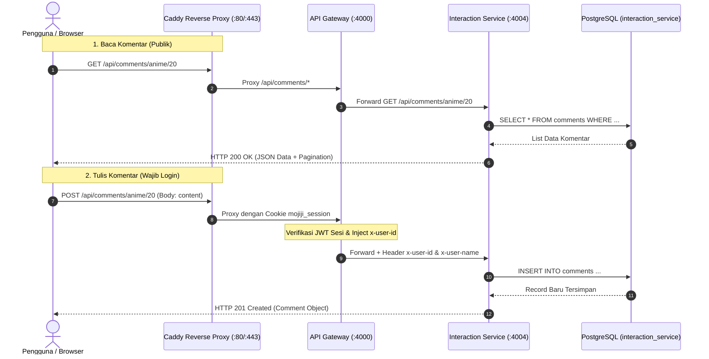

# Kontrak API Interaction Service — Komentar

* **Tiket Terkait:** MJ-116 — AC US-006 dan Kontrak API Sprint 2
* **Fitur / Lingkup:** US-005 (Komentar & Ulasan Judul Anime/Manga)
* **Status Dokumen:** Draft Kontrak Sprint 2 (Siap Direview Frontend & QA)
* **Pemilik Dokumen:** Syafii (Backend)
* **Reviewer:** Dika (Frontend), Nadia (QA), Ryan (DBA)
* **Port Layanan (Lokal):** `services/interaction-service` (Port `4004`), diakses publik via API Gateway pada rute `/api/comments/*`

---

## 1. Latar Belakang & Ruang Lingkup



Dokumen ini mendefinisikan kontrak antarmuka pemrograman aplikasi (API Contract) untuk **Interaction Service** pada Sprint 2 (Minggu 9 s.d. 11). Layanan ini menangani fitur diskusi dan ulasan komunitas pada halaman detail anime dan manga (User Story **US-005**).

> [!NOTE]
> **Prinsip Hak Akses:**
> - **Membaca Komentar:** Bersifat **Publik**. Pengunjung yang belum login tetap dapat melihat diskusi dan komentar pengguna lain pada halaman detail judul.
> - **Menulis & Menghapus Komentar:** Bersifat **Terlindungi (Privat)**. Wajib memiliki sesi login aktif (`mojiji_session` / `mj_session`).

---

## 2. Standar Respons Bersama

Semua respons mengikuti konvensi seragam Mojiji AnimeList:
* **Respons Sukses:** `{ "success": true, "data": ... }`
* **Respons Error:** `{ "success": false, "error": { "code": "...", "message": "...", "details": [] } }`
* **Respons Tanpa Isi:** HTTP `204 No Content` (untuk operasi DELETE sukses tanpa body).

---

## 3. Rincian Endpoint API

### 3.1 GET `/api/comments/:mediaType/:malId`
Mengambil daftar komentar publik pada suatu judul anime atau manga, diurutkan dari yang terbaru (*descending*).

* **Metode HTTP:** `GET`
* **Autentikasi:** Publik (Tanpa Sesi)
* **Parameter Path:**
  * `mediaType` *(string, wajib)*: Jenis media, hanya menerima `'anime'` atau `'manga'`.
  * `malId` *(integer, wajib)*: ID MyAnimeList numerik positif (contoh: `20` untuk Naruto).
* **Parameter Query:**
  * `page` *(integer, opsional, default: `1`)*: Nomor halaman.
  * `limit` *(integer, opsional, default: `20`, maksimum: `50`)*: Jumlah komentar per halaman.

#### Respons Berhasil (HTTP 200 OK)
```json
{
  "success": true,
  "data": {
    "comments": [
      {
        "id": "7b8e1f2a-9c4d-4a1e-8b5a-3f2d1e0c9b8a",
        "userId": "e4b2d56a-1f87-4948-a0c5-343219488a01",
        "username": "syafii_dev",
        "mediaType": "anime",
        "malId": 20,
        "content": "Pertarungan Naruto vs Sasuke di Lembah Akhir bener-bener legendaris!",
        "createdAt": "2026-11-18T10:30:00.000Z",
        "updatedAt": "2026-11-18T10:30:00.000Z"
      }
    ],
    "pagination": {
      "page": 1,
      "limit": 20,
      "total": 45,
      "totalPages": 3
    }
  }
}
```

#### Respons Jika Belum Ada Komentar (HTTP 200 OK)
```json
{
  "success": true,
  "data": {
    "comments": [],
    "pagination": {
      "page": 1,
      "limit": 20,
      "total": 0,
      "totalPages": 0
    }
  }
}
```

#### Respons Error Validasi Parameter (HTTP 400 Bad Request)
```json
{
  "success": false,
  "error": {
    "code": "VALIDATION_ERROR",
    "message": "Parameter permintaan tidak valid",
    "details": [
      "mediaType harus bernilai 'anime' atau 'manga'",
      "malId harus berupa bilangan bulat positif"
    ]
  }
}
```

---

### 3.2 POST `/api/comments/:mediaType/:malId`
Menambahkan komentar baru pada judul anime atau manga.

* **Metode HTTP:** `POST`
* **Autentikasi:** Wajib Login (Cookie `mojiji_session` aktif)
* **Header yang Diteruskan Gateway:** `x-user-id`, `x-user-name`, `x-internal-key`
* **Parameter Path:**
  * `mediaType` *(string, wajib)*: `'anime'` atau `'manga'`
  * `malId` *(integer, wajib)*: ID MyAnimeList judul terkait
* **Request Body (JSON):**
```json
{
  "content": "Arc Chunin Exam adalah salah satu arc turnamen terbaik sepanjang masa."
}
```

#### Aturan Validasi Input:
* `content` *(string, wajib)*:
  * Minimal panjang: **1 karakter** (setelah di-*trim* spasi).
  * Maksimal panjang: **500 karakter**.
  * Dilarang hanya berisi karakter spasi kosong (*whitespace only*).
  * Karakter berbahaya disanitasi untuk mencegah injeksi XSS.
* **Rate Limiting:** Maksimal **5 komentar per menit per pengguna** guna mencegah spamming bot.

#### Respons Berhasil Dibuat (HTTP 201 Created)
```json
{
  "success": true,
  "data": {
    "id": "8c9f2e3b-0d5e-5b2f-9c6b-4e3f2a1d0c9b",
    "userId": "e4b2d56a-1f87-4948-a0c5-343219488a01",
    "username": "syafii_dev",
    "mediaType": "anime",
    "malId": 20,
    "content": "Arc Chunin Exam adalah salah satu arc turnamen terbaik sepanjang masa.",
    "createdAt": "2026-11-18T10:35:12.000Z",
    "updatedAt": "2026-11-18T10:35:12.000Z"
  }
}
```

#### Respons Belum Login (HTTP 401 Unauthorized)
```json
{
  "success": false,
  "error": {
    "code": "UNAUTHENTICATED",
    "message": "Anda harus login terlebih dahulu untuk menulis komentar",
    "details": []
  }
}
```

#### Respons Konten Kosong / Melampaui Batas (HTTP 400 Bad Request)
```json
{
  "success": false,
  "error": {
    "code": "VALIDATION_ERROR",
    "message": "Validasi komentar gagal",
    "details": [
      "Panjang komentar minimal 1 karakter dan maksimal 500 karakter"
    ]
  }
}
```

#### Respons Melebihi Batas Laju / Spam (HTTP 429 Too Many Requests)
```json
{
  "success": false,
  "error": {
    "code": "RATE_LIMITED",
    "message": "Terlalu banyak komentar dalam waktu singkat. Silakan tunggu 1 menit.",
    "details": []
  }
}
```

---

### 3.3 DELETE `/api/comments/:id`
Menghapus komentar milik pengguna sendiri (*Strict Ownership Deletion*).

* **Metode HTTP:** `DELETE`
* **Autentikasi:** Wajib Login
* **Parameter Path:**
  * `id` *(UUID string, wajib)*: ID komentar yang akan dihapus.
* **Logika Keamanan Kepemilikan:**
  * Kueri SQL: `DELETE FROM interaction_service.comments WHERE id = $1 AND user_id = $2`
  * Jika komentar bukan milik user yang sedang login atau tidak ditemukan, server merespons `HTTP 404 NOT_FOUND` guna mencegah enumerasi ID komentar.

#### Respons Berhasil Dihapus (HTTP 204 No Content)
* Status: `204 No Content`
* Response Body: *Kosong (0 bytes)*

#### Respons Komentar Tidak Ditemukan / Bukan Milik Pengguna (HTTP 404 Not Found)
```json
{
  "success": false,
  "error": {
    "code": "NOT_FOUND",
    "message": "Komentar tidak ditemukan",
    "details": []
  }
}
```

---

## 4. Rencana Skema Basis Data (Koordinasi DBA — Ryan)

Layanan `interaction-service` akan menggunakan skema PostgreSQL terisolasi:

```sql
CREATE SCHEMA IF NOT EXISTS interaction_service;

CREATE TABLE IF NOT EXISTS interaction_service.comments (
    id UUID PRIMARY KEY DEFAULT gen_random_uuid(),
    user_id UUID NOT NULL,
    username VARCHAR(50) NOT NULL,
    media_type VARCHAR(10) NOT NULL CHECK (media_type IN ('anime', 'manga')),
    mal_id INTEGER NOT NULL,
    content VARCHAR(500) NOT NULL,
    created_at TIMESTAMPTZ NOT NULL DEFAULT NOW(),
    updated_at TIMESTAMPTZ NOT NULL DEFAULT NOW()
);

-- Indeks performa untuk kueri daftar komentar per judul
CREATE INDEX IF NOT EXISTS idx_comments_media_mal_created 
ON interaction_service.comments (media_type, mal_id, created_at DESC);

-- Indeks kepemilikan untuk operasi delete
CREATE INDEX IF NOT EXISTS idx_comments_user_id 
ON interaction_service.comments (user_id);
```

---

## 5. Pertimbangan Performa & Batasan VPS 2 GB

1. **Connection Pooling:** Pool database dibatasi maksimal `max: 3` koneksi aktif.
2. **Memory Footprint:** Heap Node.js dibatasi `NODE_OPTIONS='--max-old-space-size=64'`, dan container dibatasi `mem_limit: 96m`.
3. **Paginasi Wajib:** Endpoint GET dibatasi maksimal `limit: 50` untuk mencegah lonjakan alokasi buffer memori JSON.
