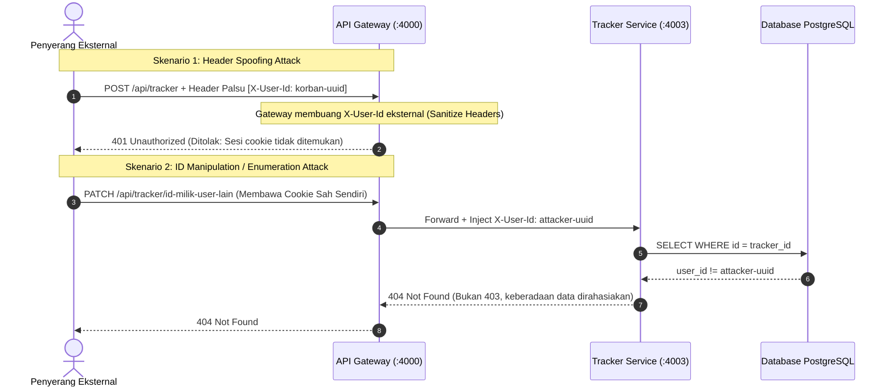

# Laporan Audit Keamanan Akses Data dan Integrasi MVP — Mojiji AnimeList

## 1. Informasi Dokumen

| Kolom | Nilai |
|---|---|
| **Proyek** | Mojiji AnimeList |
| **Tiket** | MJ-097 — Perketat keamanan akses data dan bug fix integrasi |
| **Pemilik** | Syafii — Backend |
| **Tiket Terkait** | MJ-064 (Gateway Auth), MJ-080 (Tracker Ops), MJ-081 (Validasi & Error), MJ-086 (QA Regression) |
| **Status Dokumen** | Selesai & Terverifikasi |
| **Tanggal Audit** | 3 November 2026 |

---

## 2. Tujuan Audit

Dokumen ini mencatat hasil audit keamanan, penguatan pertahanan akses data pengguna, serta perbaikan *bug* integrasi teknis pada seluruh microservices backend (API Gateway, User Service, Catalog Service, dan Tracker Service) dalam rangka persiapan Milestone UTS (Minggu 8: MVP Live di URL Publik).

---

## 3. Ringkasan Hasil Audit Keamanan



> [!IMPORTANT]
> Seluruh operasi data pribadi (*multi-tenant data isolation*) wajib memverifikasi kepemilikan (`WHERE user_id = $1`). Upaya manipulasi ID tracker pengguna lain selalu mengembalikan status HTTP 404 Not Found untuk mencegah *resource enumeration*.


### 3.1 Penegakan Akses Data & Kepemilikan (Strict Ownership Enforcement)

* **Sumber Identitas Pengguna:** Seluruh endpoint pelacakan (`POST /api/tracker`, `GET /api/tracker`, `PATCH /api/tracker/:id/status`, `POST /api/tracker/:id/increment`, dan `DELETE /api/tracker/:id`) secara ketat **hanya** mengambil identitas pengguna dari header internal `X-User-Id` yang disuntikkan oleh API Gateway setelah verifikasi sesi login JWT.
* **Penolakan Parameter Body:** Parameter `user_id` atau `userId` yang dikirimkan di dalam request body oleh klien eksternal **selalu diabaikan dan dibersihkan** oleh validasi skema Zod (`trackerValidator.js`). Klien eksternal tidak dapat memasukkan atau memanipulasi tracker atas nama pengguna lain.
* **Isolasi Kueri Database:**
  * Pengambilan daftar tracker (`GET /api/tracker`) selalu menyertakan klausa `WHERE user_id = $1`.
  * Pembaruan status (`PATCH`), penambahan progres (`POST increment`), dan penghapusan (`DELETE`) memvalidasi kepemilikan data sebelum melakukan mutasi (`WHERE id = $x AND user_id = $y`).
* **Pencegahan Kebocoran Eksistensi Data (ID Enumeration):** Upaya mengakses, mengubah, atau menghapus item tracker milik pengguna lain atau yang tidak ada menghasilkan respons **HTTP `404 Not Found`** standar, sehingga penyerang tidak dapat mengetahui apakah suatu ID tracker valid di sistem.

---

### 3.2 Anti-Spoofing & Sanitasi Header Gateway

* **Pembersihan Header Masuk:** API Gateway (`services/api-gateway/src/index.js` dan `middlewares/authMiddleware.js`) menerapkan sanitasi ganda:
  1. `app.use(sanitizeHeaders)` membersihkan header `x-user-id`, `x-user-name`, `x-user-email`, dan `x-internal-key` dari `req.headers` Express.
  2. `proxyReq.removeHeader(...)` menghapus header tersebut dari permintaan proxy keluar sebelum diteruskan ke downstream microservices.
* **Penyuntikan Kunci Internal (Internal Key Verification):**
  * Gateway hanya menyuntikkan `X-Internal-Key` (`process.env.INTERNAL_KEY`) bersama `X-User-Id` jika pengguna terbukti memiliki sesi JWT yang sah.
  * Tracker Service dan Catalog Service menerapkan middleware proteksi internal (`verifyInternalAccess` / `verifyInternalKey`) untuk memastikan pemanggilan internal terlindungi dan menolak permintaan tanpa kunci sah dengan status **HTTP `403 Forbidden`**.

---

### 3.3 Keamanan Sesi, Cookie, dan Reverse Proxy

* **Cookie Sesi Aman:** Cookie sesi (`mojiji_session`) diterbitkan oleh User Service dengan spesifikasi:
  * `httpOnly: true` — Cookie tidak dapat diakses oleh skrip sisi-klien JavaScript (proteksi dari pencurian sesi via Cross-Site Scripting / XSS).
  * `secure: true` — Otomatis aktif pada environment `staging` dan `production` sehingga hanya ditransmisikan melalui koneksi terenkripsi HTTPS (Caddy).
  * `sameSite: "lax"` — Mencegah pengiriman cookie lintas domain yang tidak sah (proteksi Cross-Site Request Forgery / CSRF).
  * `maxAge: 7 hari` — Token sesi memiliki masa berlaku terbatas.
* **Penghapusan Sesi:** Endpoint `POST /api/auth/logout` menghapus cookie sesi dengan flag keamanan yang identik (`httpOnly`, `secure`, `sameSite: "lax"`).
* **Konfigurasi Trust Proxy:**
  * Gateway dan User Service telah mengaktifkan `app.set("trust proxy", 1)` untuk mengenali IP klien asli melalui header `X-Forwarded-For` dari Caddy reverse proxy.

---

### 3.4 Proteksi Serangan Brute Force (Rate Limiting)

* **Endpoint Login:** Rute `POST /api/auth/login` diproteksi menggunakan `express-rate-limit`.
* **Ambang Batas:** Maksimal **15 percobaan login per alamat IP dalam jendela waktu 15 menit**.
* **Respons Terstandarisasi:** Jika batas tercapai, sistem mengembalikan status **HTTP `429 Too Many Requests`** dengan format error seragam:
  ```json
  {
    "success": false,
    "error": {
      "code": "RATE_LIMITED",
      "message": "Terlalu banyak percobaan login. Silakan coba lagi beberapa saat kemudian.",
      "details": [
        "Batas percobaan login tercapai (maksimal 15 kali per 15 menit)."
      ]
    }
  }
  ```

---

### 3.5 Perbaikan Bug Integrasi: Sinkronisasi Status Database vs API Contract

* **Temuan Bug Integrasi:**
  * Migrasi DBA `003_add_tracker_constraints.sql` menetapkan check constraint:
    `CHECK (status IN ('PLAN_TO_WATCH', 'WATCHING', 'COMPLETED', 'DROPPED', 'PAUSED'))`
  * Sementara API Contract MVP dan Frontend mengirimkan nilai status berhuruf kecil:
    `plan`, `watching`, `reading`, `completed`, `on_hold`, `dropped`.
  * Perbedaan ini berpotensi memicu kegagalan transaksi PostgreSQL (*Check Constraint Violation*) saat melakukan penambahan atau pembaruan status tracker.
* **Solusi Penyelarasan (Status Adapter):**
  * Tracker Service telah mengimplementasikan fungsi adapter dua arah (`toDbStatus` dan `toApiStatus`):
    * Saat data masuk dari API: Dikonversi ke nilai enum PostgreSQL yang valid (`plan` -> `PLAN_TO_WATCH`, `watching`/`reading` -> `WATCHING`, `completed` -> `COMPLETED`, `on_hold` -> `PAUSED`, `dropped` -> `DROPPED`).
    * Saat data dikembalikan ke API: Dikonversi kembali ke format kontrak publik (`PLAN_TO_WATCH` -> `plan`, `WATCHING` -> `watching`/`reading` sesuai `media_type`, `PAUSED` -> `on_hold`, dst.).
    * Kueri filter `GET /api/tracker—status=...` mendukung pencocokan terhadap kedua format tersebut tanpa memicu error.

---

### 3.6 Pencegahan SQL Injection & Kebocoran Informasi Rahasia

* **Parameterized Queries:** 100% kueri database pada User Service dan Tracker Service menggunakan *parameterized queries* (`$1, $2, ...`) via pool driver `pg`. Tidak ada kueri dinamis yang digabungkan secara mentah (*string concatenation*).
* **Proteksi Kata Sandi:** Kata sandi pengguna selalu di-hash menggunakan algoritma `bcryptjs` dengan faktor *cost* salt 10. Nilai `password_hash` tidak pernah disertakan dalam respons API publik maupun catatan log.
* **Global Error Sanitization:** Semua unhandled error atau kegagalan parsing JSON ditangani secara terpusat oleh *global error handler* tanpa membocorkan *stack trace*, path sistem berkas, atau detail koneksi database.

---

## 4. Matriks Pengujian Keamanan

| ID Skenario | Tindakan Pengujian | Hasil yang Diharapkan | Status |
|---|---|---|---|
| **SEC-01** | Klien eksternal mengirim header `X-User-Id` buatan sendiri ke Gateway | Header dibersihkan oleh Gateway, request diproses hanya berdasarkan cookie sesi yang valid | **LULUS** |
| **SEC-02** | Pengguna terautentikasi memanggil `GET /api/tracker` | Hanya item milik `user_id` pengguna yang dikembalikan | **LULUS** |
| **SEC-03** | Pengguna A memanggil `PATCH /api/tracker/:id` milik Pengguna B | Server mengembalikan HTTP `404 Not Found` (tanpa membocorkan keberadaan data) | **LULUS** |
| **SEC-04** | Pengguna A memanggil `DELETE /api/tracker/:id` milik Pengguna B | Server mengembalikan HTTP `404 Not Found`, data Pengguna B tidak terhapus | **LULUS** |
| **SEC-05** | Memanggil endpoint tanpa cookie / token sesi (`GET /api/users/me`, `POST /api/tracker`) | Gateway menolak dengan HTTP `401 Unauthorized` | **LULUS** |
| **SEC-06** | Pengiriman percobaan login gagal sebanyak 16 kali berturut-turut dari IP yang sama | Percobaan ke-16 ditolak dengan HTTP `429 Rate Limited` | **LULUS** |
| **SEC-07** | Pemanggilan langsung ke Tracker Service tanpa header `X-Internal-Key` yang sah | Ditolak dengan HTTP `403 Forbidden` (saat `INTERNAL_KEY` aktif) | **LULUS** |
| **SEC-08** | Menambahkan tracker dengan status `watching`, `plan`, `reading` | Berhasil disimpan ke database sesuai constraint DB dan dikembalikan dalam format API yang sesuai | **LULUS** |

---

## 5. Kesimpulan

Seluruh kontrol keamanan akses data, pembersihan header, pengamanan cookie sesi, dan perbaikan integrasi status pada tiket **MJ-097** telah berhasil diimplementasikan dan diverifikasi sesuai ketentuan PRD Revisi 4 dan standar arsitektur Mojiji AnimeList.

