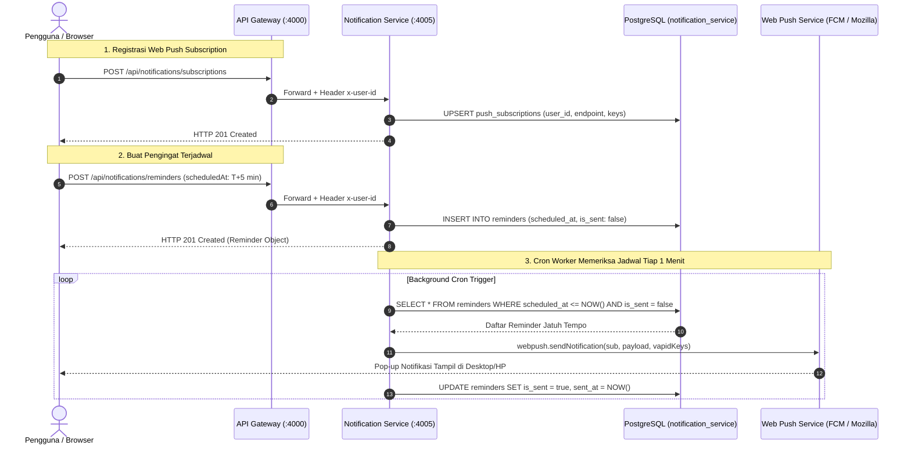

# Kontrak API Notification Service & AC Reminder

* **Tiket Terkait:** MJ-116 — AC US-006 dan Kontrak API Sprint 2
* **Fitur / Lingkup:** US-006 (Pengingat Manual / Manual Reminder & Web Push Notification)
* **Status Dokumen:** Draft Kontrak Sprint 2 (Siap Direview Frontend & QA)
* **Pemilik Dokumen:** Syafii (Backend)
* **Reviewer:** Dika (Frontend), Nadia (QA), Aji (DevOps)
* **Port Layanan (Lokal):** `services/notification-service` (Port `4005`), diakses publik via API Gateway pada rute `/api/notifications/*`

---

## 1. Kriteria Penerimaan (Acceptance Criteria) US-006 — Manual Reminder

> **Formulasi User Story:**  
> *"Sebagai pengguna, saya ingin mengatur pengingat manual, sehingga saya tidak lupa jadwal menonton anime atau membaca komik manga."*

Berikut adalah kriteria penerimaan terukur yang disepakati untuk memverifikasi fitur pengingat (Reminder):

### 1.1 Kasus Positif (Positive Scenarios)

* **AC-006-01 (Permintaan Izin Notifikasi Browser):**  
  * **Given:** Pengguna yang telah login membuka modal/dialog *"Atur Pengingat"* pada halaman detail anime/manga.
  * **When:** Pengguna mengklik tombol *"Aktifkan Notifikasi"*.
  * **Then:** Browser menampilkan dialog sistem perizinan notifikasi (`Notification.requestPermission()`).
  * **And:** Jika pengguna memilih *"Allow / Izinkan"*, Frontend memperoleh objek `PushSubscription` dan mengirimkannya ke `POST /api/notifications/subscriptions`. Server merespons `201 Created` dan menyimpan token endpoint tersebut.

* **AC-006-02 (Penjadwalan Pengingat Sukses):**  
  * **Given:** Izin notifikasi browser telah aktif (`Notification.permission === 'granted'`).
  * **When:** Pengguna memilih tanggal dan jam di masa depan (misal: 1 menit, 1 jam, atau 1 hari ke depan) serta mengisi catatan opsional (misal: *"Nonton Episode 25"*), lalu mengklik tombol *"Simpan Pengingat"*.
  * **Then:** Permintaan dikirim ke `POST /api/notifications/reminders` dan server mengembalikan HTTP `201 Created` dengan objek data pengingat berstatus `'active'`.

* **AC-006-03 (Trigger Notifikasi Tepat Waktu):**  
  * **Given:** Pengingat telah dijadwalkan dengan waktu `scheduledAt`.
  * **When:** Waktu server mencapai `scheduledAt` (toleransi pengecekan cron 1 menit).
  * **Then:** Notification Service mendeteksi pengingat jatuh tempo, mengirim payload Web Push menggunakan kunci VAPID ke endpoint browser pengguna, dan mengubah status pengingat menjadi `'sent'`.
  * **And:** Notifikasi visual muncul di sistem operasi / browser pengguna menampilkan judul anime, poster, dan catatan pengingat.
  * **And:** Saat notifikasi diklik oleh pengguna, peramban otomatis membuka tab baru mengarah ke halaman detail judul anime terkait.

---

### 1.2 Kasus Negatif (Negative Scenarios)

* **AC-006-04 (Izin Notifikasi Ditolak / Diblokir):**  
  * **Given:** Pengguna memilih *"Block / Tolak"* pada dialog izin peramban (`Notification.permission === 'denied'`).
  * **When:** Pengguna mencoba mengatur pengingat.
  * **Then:** Antarmuka menampilkan pesan peringatan ramah: *"Izin notifikasi diblokir oleh browser. Silakan aktifkan izin notifikasi pada setelan situs browser Anda untuk menerima pengingat."* Tombol simpan pengingat dinonaktifkan secara aman.

* **AC-006-05 (Waktu Pengingat di Masa Lalu):**  
  * **Given:** Pengguna memasukkan waktu `scheduledAt` yang sama dengan atau lebih lampau dari waktu saat ini (`scheduledAt <= NOW()`).
  * **When:** Form dikirim ke server.
  * **Then:** Server menolak permintaan dengan HTTP `400 Bad Request` dan kode error `VALIDATION_ERROR`, disertai pesan: *"Waktu pengingat harus berada di masa depan (minimal 1 menit dari sekarang)"*. Data tidak disimpan ke database.

* **AC-006-06 (Akses Tanpa Autentikasi):**  
  * **Given:** Pengunjung belum melakukan login (tidak memiliki cookie sesi `mojiji_session`).
  * **When:** Mencoba mengakses endpoint pengingat (`/api/notifications/*`).
  * **Then:** API Gateway langsung menolak permintaan dengan HTTP `401 Unauthorized` (`UNAUTHENTICATED`).

---

## 2. Arsitektur Web Push & Alur Notifikasi



---

## 3. Rincian Endpoint API

### 3.1 GET `/api/notifications/public-key`
Mengambil VAPID Public Key yang dibutuhkan oleh peramban klien untuk mengonversi ke `Uint8Array` saat memanggil `serviceWorkerRegistration.pushManager.subscribe()`.

* **Metode HTTP:** `GET`
* **Autentikasi:** Publik

#### Respons Berhasil (HTTP 200 OK)
```json
{
  "success": true,
  "data": {
    "publicKey": "BEl62iUYgUivxIkv69yViEuiBIa-Ib9-SkvH9K0Nq09W61K9K201K..."
  }
}
```

---

### 3.2 POST `/api/notifications/subscriptions`
Mendaftarkan atau memperbarui token langganan Web Push perangkat peramban pengguna.

* **Metode HTTP:** `POST`
* **Autentikasi:** Wajib Login (Cookie `mojiji_session`)
* **Request Body (Standar W3C PushSubscription JSON):**
```json
{
  "endpoint": "https://fcm.googleapis.com/fcm/send/dK10a...",
  "expirationTime": null,
  "keys": {
    "p256dh": "BNcRdreALRFXTkOOUHK1dLK2o5882830...",
    "auth": "tBHItJI5svb..."
  }
}
```

#### Respons Berhasil (HTTP 201 Created)
```json
{
  "success": true,
  "data": {
    "message": "Langganan notifikasi berhasil didaftarkan"
  }
}
```

---

### 3.3 GET `/api/notifications/reminders`
Mengambil daftar pengingat yang telah dijadwalkan oleh pengguna yang sedang login.

* **Metode HTTP:** `GET`
* **Autentikasi:** Wajib Login
* **Parameter Query:**
  * `status` *(string, opsional, default: `'active'`)*: Pilihan: `'active'` (belum terkirim), `'sent'` (sudah dikirim), atau `'all'`.

#### Respons Berhasil (HTTP 200 OK)
```json
{
  "success": true,
  "data": [
    {
      "id": "4a1e9b8a-7b8e-4a1e-8b5a-3f2d1e0c9b8a",
      "userId": "e4b2d56a-1f87-4948-a0c5-343219488a01",
      "mediaType": "anime",
      "malId": 20,
      "title": "Naruto",
      "scheduledAt": "2026-11-18T18:00:00.000Z",
      "note": "Nonton bareng episode 25",
      "isSent": false,
      "sentAt": null,
      "createdAt": "2026-11-18T12:00:00.000Z"
    }
  ]
}
```

---

### 3.4 POST `/api/notifications/reminders`
Menjadwalkan pengingat baru untuk suatu judul anime atau manga.

* **Metode HTTP:** `POST`
* **Autentikasi:** Wajib Login
* **Request Body (JSON):**
```json
{
  "mediaType": "anime",
  "malId": 20,
  "title": "Naruto",
  "scheduledAt": "2026-11-18T18:00:00.000Z",
  "note": "Nonton bareng episode 25"
}
```

#### Aturan Validasi Input:
* `mediaType` *(string, wajib)*: `'anime'` atau `'manga'`.
* `malId` *(integer, wajib)*: ID MyAnimeList numerik.
* `title` *(string, wajib)*: Judul anime/manga (maksimal 200 karakter).
* `scheduledAt` *(ISO 8601 string, wajib)*: Waktu harus **minimal +1 menit** di masa depan dari waktu saat request diterima server.
* `note` *(string, opsional)*: Catatan khusus (maksimal 250 karakter).

#### Respons Berhasil (HTTP 201 Created)
```json
{
  "success": true,
  "data": {
    "id": "4a1e9b8a-7b8e-4a1e-8b5a-3f2d1e0c9b8a",
    "userId": "e4b2d56a-1f87-4948-a0c5-343219488a01",
    "mediaType": "anime",
    "malId": 20,
    "title": "Naruto",
    "scheduledAt": "2026-11-18T18:00:00.000Z",
    "note": "Nonton bareng episode 25",
    "isSent": false,
    "createdAt": "2026-11-18T12:00:00.000Z"
  }
}
```

#### Respons Waktu Masa Lalu (HTTP 400 Bad Request)
```json
{
  "success": false,
  "error": {
    "code": "VALIDATION_ERROR",
    "message": "Waktu pengingat harus berada di masa depan (minimal 1 menit dari sekarang)",
    "details": [
      "scheduledAt tidak boleh bernilai di masa lampau"
    ]
  }
}
```

---

### 3.5 DELETE `/api/notifications/reminders/:id`
Menghapus atau membatalkan pengingat yang telah dijadwalkan.

* **Metode HTTP:** `DELETE`
* **Autentikasi:** Wajib Login
* **Parameter Path:** `id` *(UUID string, wajib)*
* **Logika Keamanan:** Hanya pengguna pemilik pengingat (`WHERE id = $1 AND user_id = $2`) yang dapat menghapus.

#### Respons Berhasil (HTTP 204 No Content)
* Status: `204 No Content`
* Response Body: *Kosong (0 bytes)*

---

## 4. Skema Basis Data PostgreSQL (Koordinasi DBA — Ryan)

```sql
CREATE SCHEMA IF NOT EXISTS notification_service;

-- Tabel token langganan Web Push peramban
CREATE TABLE IF NOT EXISTS notification_service.push_subscriptions (
    id UUID PRIMARY KEY DEFAULT gen_random_uuid(),
    user_id UUID NOT NULL,
    endpoint TEXT NOT NULL UNIQUE,
    p256dh TEXT NOT NULL,
    auth TEXT NOT NULL,
    created_at TIMESTAMPTZ NOT NULL DEFAULT NOW(),
    updated_at TIMESTAMPTZ NOT NULL DEFAULT NOW()
);

-- Tabel data pengingat terjadwal
CREATE TABLE IF NOT EXISTS notification_service.reminders (
    id UUID PRIMARY KEY DEFAULT gen_random_uuid(),
    user_id UUID NOT NULL,
    media_type VARCHAR(10) NOT NULL CHECK (media_type IN ('anime', 'manga')),
    mal_id INTEGER NOT NULL,
    title VARCHAR(200) NOT NULL,
    scheduled_at TIMESTAMPTZ NOT NULL,
    note VARCHAR(250),
    is_sent BOOLEAN NOT NULL DEFAULT FALSE,
    sent_at TIMESTAMPTZ,
    created_at TIMESTAMPTZ NOT NULL DEFAULT NOW()
);

-- Indeks performa untuk kueri worker pengingat jatuh tempo
CREATE INDEX IF NOT EXISTS idx_reminders_trigger 
ON notification_service.reminders (scheduled_at, is_sent) 
WHERE is_sent = FALSE;

-- Indeks daftar pengingat milik user
CREATE INDEX IF NOT EXISTS idx_reminders_user_id 
ON notification_service.reminders (user_id);
```

---

## 5. Pertimbangan Beban Memori VPS 2 GB
* Pustaka pengiriman Web Push (`web-push`) dijalankan secara *lightweight* tanpa daemon tambahan berat.
* Pengecekan jatuh tempo menggunakan scheduler interval 60 detik (`node-cron`) dengan batching query kecil (`LIMIT 50`) agar alokasi memori heap tetap berada di bawah 64 MB.
