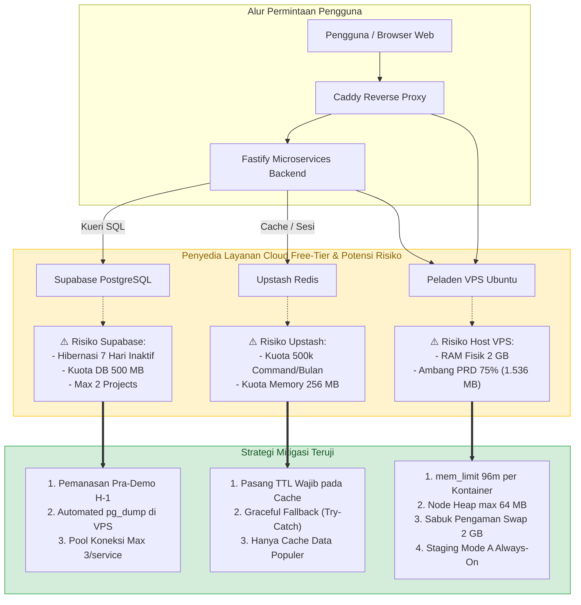

# Inventaris Batasan Layanan Free Hosting & Mitigasi Risiko (MJ-090 & MJ-164)

Dokumen ini mencatat batasan teknis (*quotas & limitations*) dari seluruh penyedia infrastruktur *free-tier* yang menopang arsitektur **Mojiji AnimeList**, potensi risiko kegagalan sistem, strategi mitigasi defensif, serta prosedur pemeriksaan rutin (*maintenance checklist*) untuk memastikan ketersediaan layanan tanpa henti (*zero-downtime*) dan kesuksesan evaluasi perkuliahan (UTS/UAS).

---

## 1. Peta Risiko Infrastruktur & Alur Penanganan Otomatis



---

## 2. Matriks Rinci Batasan Layanan, Risiko & Mitigasi

| Komponen & Provider | Kuota Paket Gratis (*Free Tier Limit*) | Dampak / Risiko Kegagalan | Strategi Mitigasi Proaktif Tim DevOps & Backend |
| :--- | :--- | :--- | :--- |
| **Supabase**<br>*(Database PostgreSQL Multi-Schema)* | • **Maksimal 2 project aktif** per akun organisasi.<br>• Kuota penyimpanan database: **500 MB**.<br>• **Auto-Pause (Hibernasi):** Proyek akan di-*pause* otomatis jika tidak ada kueri masuk selama **7 hari** berturut-turut.<br>• Tidak ada automated point-in-time backup harian gratis.<br>• Batas koneksi langsung (*direct connection pool*). | • Jika proyek terhibernasi saat sesi demo atau evaluasi dosen, backend melempar error `ECONNREFUSED` / `500 Internal Server Error`.<br>• Kehilangan data fatal jika skema rusak tanpa ada cadangan data. | 1. **Pemanasan Pra-Demo (Keep-Alive):** DevOps wajib memeriksa dashboard Supabase H-1 sebelum presentasi/demo. Jika berstatus *paused*, tekan tombol *Restore* dan jalankan kueri uji.<br>2. **Automated pg_dump di Host VPS:** Skrip pipeline deploy secara otomatis mengeksekusi dump skema dan data ke `/opt/mojiji/backups/` sebelum setiap rilis production.<br>3. **Connection Pool Management:** Parameter pool dibatasi `max: 3` koneksi per service melalui Supabase Session Pooler (port 5432). |
| **Upstash**<br>*(Redis Serverless Cache & Session)* | • Kuota permintaan: **500.000 commands / bulan** (~16.000 commands / hari).<br>• Penyimpanan data memori: **256 MB**.<br>• Batas transfer data: 100 MB per permintaan.<br>• Maksimal 1 database gratis per akun. | • Jika kuota bulanan habis, Upstash melempar exception `ERR max daily request limit exceeded`.<br>• Jika backend tidak menangani error ini, aplikasi dapat *crash*. | 1. **Cache TTL Wajib:** Seluruh penulisan cache wajib menyertakan durasi kedaluwarsa (misal: detail anime 24 jam, pencarian katalog 1 jam).<br>2. **Graceful Fallback:** Backend membungkus seluruh operasi Redis dalam blok `try-catch`. Jika Redis mengalami kegagalan/kuota habis, backend langsung mengambil data dari PostgreSQL atau API eksternal tanpa mengganggu pengalaman pengguna.<br>3. **Isolasi Prefix Key:** Menggunakan `stg:` untuk staging dan `prod:` untuk production guna menghindari tabrakan data dalam 1 database Upstash. |
| **Peladen VPS**<br>*(Host Docker & Caddy Reverse Proxy)* | • RAM Fisik: **2.048 MB (2 GB)**.<br>• vCPU: **2 Cores**.<br>• Swap Partition: **2.048 MB (2 GB)** aktif.<br>• Batas aman PRD: Konsumsi RAM host tidak boleh melampaui **75% (1.536 MB)**. | • Risiko *Out-Of-Memory (OOM)* jika container Node.js mengalami kebocoran memori (*memory leak*) hingga kernel mematikan proses utama. | 1. **Hard Limit Docker (`mem_limit: 96m`):** Plafon memori cgroup ketat pada setiap kontainer backend.<br>2. **Node.js Heap Capping:** Flag `NODE_OPTIONS="--max-old-space-size=64"` pada container.<br>3. **Caddy Reverse Proxy Limit:** Plafon `mem_limit: 64m`.<br>4. **Penyangga Swap 2 GB:** Partisi swap aktif dengan `swappiness=10` sebagai bantalan lonjakan beban sesaat.<br>5. **Mode A Always-On:** Berdasarkan pengukuran empiris live MJ-089, total konsumsi kontainer hanya **~91.6 MB**, sehingga staging aman menyala 24/7. |

---

## 3. Desain Pertahanan Mandiri: Graceful Fallback Backend

Contoh implementasi standar di sisi backend Fastify (`services/catalog-service`) untuk menangani potensi limit Upstash Redis:

```javascript
// Standar Defensive Caching pada Fastify Microservices
async function getCatalogDetail(id) {
  const cacheKey = `${process.env.REDIS_KEY_PREFIX || 'stg:'}catalog:${id}`;
  
  // 1. Coba ambil dari Cache (Upstash)
  try {
    const cachedData = await redisClient.get(cacheKey);
    if (cachedData) {
      return JSON.parse(cachedData);
    }
  } catch (err) {
    // Graceful Fallback: Jangan lempar error ke user jika Redis down/limit!
    fastify.log.warn({ err }, `[REDIS_FALLBACK] Gagal membaca cache untuk ID ${id}. Lanjut ke database.`);
  }

  // 2. Ambil dari sumber utama (Database Supabase / Provider Eksternal)
  const sourceData = await fetchFromDatabaseOrApi(id);

  // 3. Simpan ke Cache dengan TTL terukur (misal: 86400 detik = 24 jam)
  try {
    await redisClient.set(cacheKey, JSON.stringify(sourceData), 'EX', 86400);
  } catch (err) {
    fastify.log.warn({ err }, `[REDIS_FALLBACK] Gagal menyimpan cache untuk ID ${id}. Lanjutkan respons.`);
  }

  return sourceData;
}
```

---

## 4. Checklist Pemeliharaan Kuota Berkala (SOP DevOps MJ-164)

Jadwal pemeriksaan rutin bagi DevOps Engineer (Aji) untuk mencegah lonjakan kuota tak terduga:

### A. Pemeriksaan Mingguan (Setiap Hari Senin)
- [ ] **Supabase Storage:** Buka dashboard `https://supabase.com/dashboard/project/<project-id>/settings/usage`. Pastikan ukuran database masih berada di bawah 200 MB (ambang batas 40% dari kuota 500 MB).
- [ ] **Upstash Command Usage:** Buka console `https://console.upstash.com/`. Verifikasi jumlah total perintah bulanan masih di bawah 300.000 commands.
- [ ] **VPS Disk Storage:** Jalankan perintah `df -h` di VPS. Pastikan penggunaan partisi root (`/`) masih di bawah 70%.

### B. Prosedur Pemanasan Pra-Demo / Evaluasi Dosen (H-1)
- [ ] **Supabase Keep-Alive:** Buka aplikasi di browser `https://staging.mojiji.web.id` dan jalankan pencarian katalog untuk memicu kueri database Supabase.
- [ ] **Verifikasi Endpoint Health:** Pastikan `curl -s https://staging.mojiji.web.id/api/health` mengembalikan status `200 OK`.
- [ ] **Verifikasi Cadangan Database:** Pastikan berkas cadangan database terbaru telah tersedia di direktori `/opt/mojiji/backups/`.

---
*Dokumen ini merupakan deliverable resmi tiket **MJ-090** dan panduan mitigasi operasional jangka panjang pada tiket **MJ-164**.*
