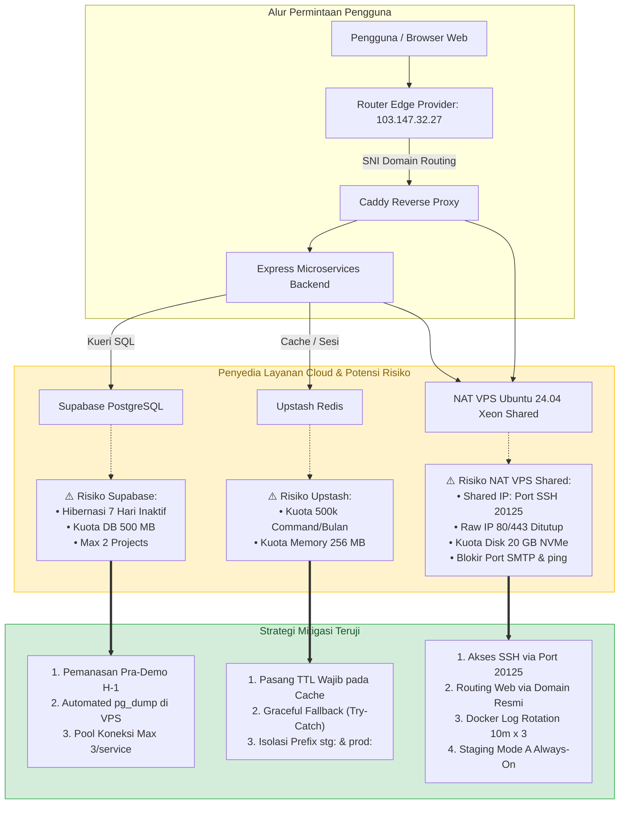

# Inventaris Batasan Layanan Free Hosting & Mitigasi Risiko (MJ-090 & MJ-164)

Dokumen ini mencatat batasan teknis (*quotas & limitations*) dari seluruh penyedia infrastruktur *free-tier* dan *shared hosting* yang menopang arsitektur **Mojiji AnimeList**, potensi risiko kegagalan sistem, strategi mitigasi defensif, serta prosedur pemeriksaan rutin (*maintenance checklist*) untuk memastikan ketersediaan layanan tanpa henti (*zero-downtime*) dan kesuksesan evaluasi perkuliahan (UTS/UAS).

---

## 1. Peta Risiko Infrastruktur & Alur Penanganan Otomatis



---

## 2. Matriks Rinci Batasan Layanan, Risiko & Mitigasi

| Komponen & Provider | Kuota Paket Gratis (*Free Tier Limit*) | Dampak / Risiko Kegagalan | Strategi Mitigasi Proaktif Tim DevOps & Backend |
| :--- | :--- | :--- | :--- |
| **Supabase**<br>*(PostgreSQL Multi-Schema)* | • **Maksimal 2 project aktif** per akun organisasi.<br>• Kuota penyimpanan database: **500 MB**.<br>• **Auto-Pause (Hibernasi):** Proyek akan di-*pause* otomatis jika tidak ada kueri masuk selama **7 hari** berturut-turut.<br>• Tidak ada automated point-in-time backup harian gratis.<br>• Batas koneksi langsung (*direct pool*). | • Jika proyek terhibernasi saat sesi demo atau evaluasi dosen, backend melempar error `ECONNREFUSED` / `500 Internal Server Error`.<br>• Kehilangan data fatal jika skema rusak tanpa ada cadangan data. | 1. **Pemanasan Pra-Demo (Keep-Alive):** DevOps memeriksa dashboard Supabase H-1 sebelum presentasi. Jika berstatus *paused*, tekan tombol *Restore* dan jalankan kueri uji.<br>2. **Automated pg_dump di Host VPS:** Skrip deploy secara otomatis mengeksekusi dump skema dan data ke folder cadangan sebelum setiap rilis production.<br>3. **Connection Pool Management:** Parameter pool dibatasi `max: 3` koneksi per service melalui Supabase Session Pooler (port 5432). |
| **Upstash**<br>*(Redis Serverless Cache & Session)* | • Kuota permintaan: **500.000 commands / bulan** (~16.000 commands / hari).<br>• Penyimpanan data memori: **256 MB**.<br>• Batas transfer data: 100 MB per permintaan.<br>• Maksimal 1 database gratis per akun. | • Jika kuota bulanan habis, Upstash melempar exception `ERR max daily request limit exceeded`.<br>• Jika backend tidak menangani error ini, aplikasi dapat *crash*. | 1. **Cache TTL Wajib:** Seluruh penulisan cache wajib menyertakan durasi kedaluwarsa (misal: detail anime 24 jam, pencarian katalog 1 jam).<br>2. **Graceful Fallback:** Backend membungkus seluruh operasi Redis dalam blok `try-catch`. Jika Redis mengalami kegagalan/kuota habis, backend langsung mengambil data dari PostgreSQL atau API eksternal tanpa mengganggu pengalaman pengguna.<br>3. **Isolasi Prefix Key:** Menggunakan `stg:` untuk staging dan `prod:` untuk production guna menghindari tabrakan data dalam 1 database Upstash. |
| **Peladen VPS**<br>*(NAT VPS Xeon Shared Ubuntu 24.04 LTS)* | • **Shared Public IP (`103.147.32.27`)**: Port SSH eksternal di-forward ke **`20125`**.<br>• **Port 80/443 via IP Ditutup**: Hanya bisa diakses melalui FQDN domain terdaftar.<br>• **Penyimpanan Ketat**: Kapasitas disk **20 GB NVMe**.<br>• **RAM Fisik**: 2.048 MB (2 GB) dengan Swap 2 GB.<br>• **Port Diblokir**: SMTP (25, 465, 587), FTP (21), cPanel (2082-2096), ICMP ping. | • Gagal login SSH jika tidak menyertakan port `20125`.<br>• Akses web via IP mentah gagal (HTTP error).<br>• Disk 20 GB penuh jika log Docker membengkak.<br>• Risiko kesalahpahaman dosen melihat indikator RAM panel (87%). | 1. **SSH Port Mapping:** Selalu gunakan perintah `ssh -p 20125 deploy@103.147.32.27`.<br>2. **Domain-Only Web Ingress:** Daftarkan `mojiji.web.id` dan `staging.mojiji.web.id` di panel provider dan arahkan A-record.<br>3. **Docker Log Rotation:** Batasi log kontainer di `daemon.json` (`max-size: 10m`, `max-file: 3`) dan bersihkan berkala (`docker system prune`).<br>4. **Klarifikasi Metrik RAM:** Dokumentasikan bahwa angka panel 87% mencakup buffer OS Linux, sedangkan beban riil kontainer hanya **~91.6 MB** (~4.6%). |

---

## 3. Desain Pertahanan Mandiri: Graceful Fallback Backend

Contoh implementasi standar di sisi backend Express (`services/catalog-service`) untuk menangani potensi limit Upstash Redis:

```javascript
// Standar Defensive Caching pada Express Microservices
async function getCatalogDetail(id) {
  const cacheKey = `${process.env.REDIS_KEY_PREFIX || 'stg:'}catalog:${id}`;
  
  // 1. Coba ambil dari Cache (Upstash)
  try {
    const cachedData = await redisClient.get(cacheKey);
    if (cachedData) {
      return JSON.parse(cachedData);
    }
  } catch (err) {
    // Graceful Fallback: Jangan lempar error ke user jika Redis down/limit!
    console.warn(`[REDIS_FALLBACK] Gagal membaca cache untuk ID ${id}. Lanjut ke database/API.`, err);
  }

  // 2. Ambil dari sumber utama (Tenrai API v1 / Database Supabase)
  const sourceData = await fetchFromDatabaseOrApi(id);

  // 3. Simpan ke Cache dengan TTL terukur (misal: 86400 detik = 24 jam)
  try {
    await redisClient.set(cacheKey, JSON.stringify(sourceData), 'EX', 86400);
  } catch (err) {
    console.warn(`[REDIS_FALLBACK] Gagal menyimpan cache untuk ID ${id}. Lanjutkan respons.`, err);
  }

  return sourceData;
}
```

---

## 4. Analisis Teknis: Indikator RAM Panel Provider (87%) vs Realita Kontainer

> [!NOTE] Penjelasan untuk Evaluasi Dosen (Joni Rodito, S.Kom):
> Saat membuka dashboard VPS provider (`mojiji #1966`), indikator RAM menampilkan angka **87%**.
> **Fakta Teknis:**
> * Hypervisor provider (KVM/Proxmox) membaca alokasi memori fisik pada level hardware host, di mana kernel Linux secara proaktif memanfaatkan sisa RAM untuk *page cache* dan *buffer I/O* (tercatat 830 MB pada kolom `buff/cache` perintah `free -m`).
> * Kernel Linux akan secara otomatis membebaskan ruang *buff/cache* ini dalam hitungan mikrodetik begitu aplikasi meminta memori tambahan.
> * Kolom **Available (945 MB / 48%)** membuktikan bahwa server masih memiliki ruang bebas fisik yang sangat lapang.
> * Konsumsi riil seluruh 5 kontainer aplikasi (API Gateway, User, Catalog, Tracker, Caddy) hanya memakan **~91.59 MiB** (sekitar **4,6%** dari total RAM 2 GB).
> * Dengan demikian, pengoperasian lingkungan Staging secara **Mode A (Always-On)** sepenuhnya aman dan stabil.

---

## 5. Checklist Pemeliharaan Kuota Berkala (SOP DevOps MJ-164)

Jadwal pemeriksaan rutin bagi DevOps Engineer (Aji) untuk mencegah lonjakan kuota tak terduga:

### A. Pemeriksaan Mingguan (Setiap Hari Senin)
- [ ] **Supabase Storage:** Buka dashboard `https://supabase.com/dashboard/project/<project-id>/settings/usage`. Pastikan ukuran database masih di bawah 200 MB (ambang batas 40% dari kuota 500 MB).
- [ ] **Upstash Command Usage:** Buka console `https://console.upstash.com/`. Verifikasi jumlah total perintah bulanan masih di bawah 300.000 commands.
- [ ] **VPS NVMe Storage:** Jalankan perintah `df -h` di VPS via port `20125`. Pastikan penggunaan partisi root (`/`) masih di bawah 70% dari kapasitas 20 GB.
- [ ] **Pembersihan Docker:** Jika disk mendekati 75%, jalankan `docker image prune -f` untuk menghapus image perantara yang tidak terpakai.

### B. Prosedur Pemanasan Pra-Demo / Evaluasi Dosen (H-1)
- [ ] **Supabase Keep-Alive:** Buka aplikasi di browser `https://staging.mojiji.web.id` dan jalankan pencarian katalog untuk memicu kueri database Supabase dan memastikan project aktif (*not paused*).
- [ ] **Verifikasi Endpoint Health:** Pastikan `curl -s https://staging.mojiji.web.id/api/health` mengembalikan status `200 OK`.
- [ ] **Verifikasi Cadangan Database:** Pastikan berkas cadangan database terbaru telah tersedia di direktori `/opt/mojiji/backups/` atau `/home/deploy/mojiji-staging/backups/`.

---
*Dokumen ini merupakan deliverable resmi tiket **MJ-090** dan panduan mitigasi operasional jangka panjang pada tiket **MJ-164**.*
