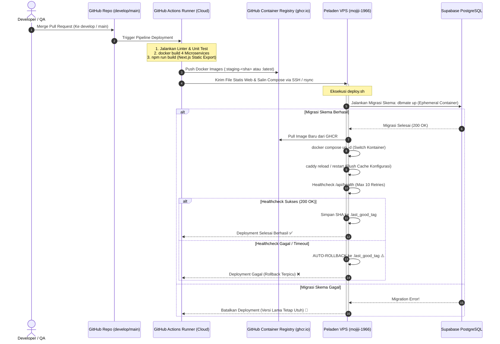
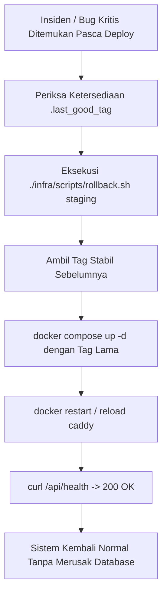

# Panduan Deployment, CI/CD Zero-Build & SOP Server (MJ-090)

Dokumen ini merupakan panduan operasional standar (*Standard Operating Procedure / SOP*) bagi seluruh anggota tim pengembang **Mojiji AnimeList** (DevOps, Backend, DBA, Frontend, QA). Panduan ini memuat tata letak arsitektur server VPS, alur otomatisasi deployment CI/CD tanpa beban di server (*Zero-Build Architecture*), penanganan *caching* & *hot-reload* web server, prosedur tanggap darurat (*rollback*), serta tata cara penelusuran log sistem.

---

## 1. Arsitektur Peladen (Server VPS) & Tata Letak Direktori

Peladen VPS Mojiji menggunakan sistem operasi **Ubuntu 22.04 LTS (x86_64)** dengan spesifikasi **2 vCPU Cores, 2 GB RAM fisik, dan 2 GB Swap**. Seluruh beban kerja aplikasi dijalankan di dalam kontainer Docker yang diisolasi per lingkungan (*staging* dan *production*).

### A. Kebijakan Keamanan Port Jaringan (Firewall UFW)
* **Port Publik Terbuka:** Hanya port **22** (SSH), **80** (HTTP), dan **443** (HTTPS).
* **Port Internal (Tertutup dari Internet):** Port microservices (`4000`, `4001`, `4002`, `4003`) **DILARANG KERAS** dipublikasikan ke internet (*no host binding*). Seluruh trafik luar wajib melewati **Caddy Reverse Proxy** melalui Docker network bridge internal (`mojiji_internal`).

### B. Struktur Direktori Server di Host VPS (`/opt/mojiji`)

```text
/opt/mojiji/
├── staging/                           # Lingkungan Staging (staging.mojiji.web.id)
│   ├── .env                           # Konfigurasi secret staging (chmod 600)
│   ├── docker-compose.server.yml      # Orkestrasi container staging
│   ├── web/                           # Berkas statis ekspor Next.js staging (/srv)
│   └── .last_good_tag                 # Catatan tag image stabil terakhir untuk rollback
│
├── production/                        # Lingkungan Production (mojiji.web.id)
│   ├── .env                           # Konfigurasi secret production (chmod 600)
│   ├── docker-compose.server.yml      # Orkestrasi container production
│   ├── web/                           # Berkas statis ekspor Next.js production (/srv)
│   └── .last_good_tag                 # Catatan tag image rilis stabil terakhir
│
├── backups/                           # Repositori Backup Otomatis Database
│   ├── mojiji_prod_backup_YYYYMMDD_HHMMSS.sql
│   └── (Folder di luar repo git dengan hak akses ketat deploy:deploy)
│
└── caddy/
    ├── Caddyfile                      # Konfigurasi reverse proxy & SSL otomatis
    └── volumes/
        └── caddy_data/                # Volume persistent sertifikat SSL Let's Encrypt
                                       # (PERINGATAN: Dilarang menghapus volume ini!)
```

---

## 2. Diagram Alur CI/CD Zero-Build Pipeline

Prinsip utama arsitektur deployment Mojiji AnimeList adalah **Zero-Build on VPS**. Server VPS berkapasitas 2 GB RAM **tidak pernah** menjalankan proses kompilasi berat seperti `docker build` atau `npm run build`. Seluruh kompilasi diselesaikan oleh runner GitHub Actions di cloud.



---

## 3. Detail Pelaksanaan Tahapan Deployment

### A. Deployment Lingkungan Staging (`staging.mojiji.web.id`)
1. **Pemicu (Trigger):** Setiap kali Pull Request di-merge ke branch **`develop`**.
2. **Tahapan di GitHub Actions Runner:**
   * Linting dan verifikasi kompilasi paket monorepo.
   * Pembuatan Docker Image backend dengan tag commit (`staging-<short-sha>`).
   * Ekspor frontend Next.js statis (`output: "export"` menghasilkan artefak di direktori `out/`).
   * Pengiriman berkas rilis dan artefak frontend ke server VPS melalui jalur aman SSH.
3. **Eksekusi di Peladen VPS (oleh Runner Pipeline):**
   * Migrasi skema database dijalankan otomatis terlebih dahulu:
     ```bash
     docker compose --env-file .env -f infra/compose/docker-compose.server.yml run --rm -e DATABASE_URL="$STAGING_DATABASE_URL" migrate --migrations-dir /db/migrations up
     ```
   * Jika migrasi berhasil, container aplikasi diperbarui:
     ```bash
     docker compose -p mojiji-staging --env-file /opt/mojiji/staging/.env -f /opt/mojiji/staging/docker-compose.server.yml up -d --remove-orphans
     ```
   * Penukaran file web statis di folder `/srv/staging`.
   * Memuat ulang konfigurasi web server Caddy:
     ```bash
     docker exec mojiji_caddy_server_staging caddy reload --config /etc/caddy/Caddyfile || docker restart mojiji_caddy_server_staging
     ```
   * Verifikasi kesehatan layanan (*healthcheck*) `/api/health`.

### B. Deployment Lingkungan Production (`mojiji.web.id`)
1. **Pemicu (Trigger):** Setelah seluruh Acceptance Criteria diverifikasi oleh QA (Nadia) di Staging, dibuat Pull Request resmi dari `develop` ke **`main`**. Merge ke `main` memicu `deploy-production.yml`.
2. **Prosedur Pengamanan Tambahan Production:**
   * **Backup Otomatis Wajib (`pg_dump`):** Sebelum migrasi dieksekusi, pipeline secara otomatis melakukan dump database production ke `/opt/mojiji/backups/mojiji_prod_backup_YYYYMMDD_HHMMSS.sql`. Jika proses backup gagal atau ukuran file kosong (0 byte), deploy langsung dibatalkan demi keamanan integritas data.
   * Eksekusi migrasi database `migrate up` pada database production.
   * Kontainer aplikasi beralih ke tag rilis baru secara bertahap (*zero-downtime*).
   * Verifikasi kesehatan layanan publik di `https://mojiji.web.id/api/health`.

---

## 4. Pelajaran Kritis Operasional: Caddy Configuration & In-Memory Cache

> [!WARNING] Catatan Penanganan Insiden Caddy (Incident Retrospective)
> Saat melakukan deployment perubahan konfigurasi Caddyfile atau penggantian berkas statis frontend:
> 1. **Perilaku Docker Compose:** Docker Compose hanya mendeteksi perubahan konfigurasi kontainer pada file YAML. Jika image tag kontainer Caddy (`caddy:2-alpine`) tidak berubah, Docker Compose akan menandai Caddy sebagai *up-to-date* dan **TIDAK AKAN me-restart kontainer Caddy**.
> 2. **In-Memory Cache Caddy:** Caddy memuat konfigurasi `Caddyfile` ke dalam memori RAM saat proses awal dinyalakan. Jika file `Caddyfile` yang di-mount berubah, Caddy tetap menggunakan konfigurasi lama di memori hingga diperintahkan *reload*.
> 3. **Solusi Standar:** Setiap skrip deployment (`deploy.sh` dan `staging-up.sh`) wajib menyertakan perintah eksplisit pemuatan ulang Caddy:
>    ```bash
>    docker exec mojiji_caddy_server_staging caddy reload --config /etc/caddy/Caddyfile 2>/dev/null || docker restart mojiji_caddy_server_staging
>    ```

---

## 5. Panduan Pemantauan & Pengecekan Log (Perintah Harian DevOps)

Seluruh anggota tim yang memiliki akses ke server dapat memeriksa status sistem menggunakan perintah-perintah standar berikut:

### A. Melihat Status Container
```bash
# Cek apakah container berjalan normal atau crash (restarting)
docker compose -p mojiji-staging ps
```

### B. Memeriksa Log Aplikasi (Troubleshooting Error)
Gunakan opsi `--tail 100` dan `-f` (*follow*) untuk memantau log secara real-time tanpa membebani memori terminal:
```bash
# Log API Gateway
docker compose -p mojiji-staging logs --tail 100 -f gateway

# Log User Service
docker compose -p mojiji-staging logs --tail 100 -f user-service

# Log Catalog Service
docker compose -p mojiji-staging logs --tail 100 -f catalog-service

# Log Tracker Service
docker compose -p mojiji-staging logs --tail 100 -f tracker-service

# Log Reverse Proxy Caddy
docker compose -p mojiji-staging logs --tail 100 -f caddy
```

### C. Memeriksa Konsumsi Memori & Kesehatan Server
```bash
# Cek statistik penggunaan RAM dan CPU per container
docker stats --no-stream

# Cek ketersediaan memori fisik & swap server host
free -m

# Cek sisa ruang penyimpanan disk VPS
df -h
```

### D. Merestart Container Tertentu yang Mengalami Kendala
Jika salah satu service mengalami *deadlock* atau *unresponsive*:
```bash
docker compose -p mojiji-staging restart <nama_service>
```

---

## 6. Prosedur Tanggap Darurat: Rollback Versi Aplikasi

Jika rilis terbaru menimbulkan bug kritis di lingkungan Staging maupun Production:



### A. Prosedur Rollback Cepat via Skrip VPS
1. Masuk ke terminal VPS via SSH:
   ```bash
   ssh deploy@mojiji.web.id
   ```
2. Jalankan skrip pemulihan darurat:
   ```bash
   cd /opt/mojiji
   ./infra/scripts/rollback.sh staging
   ```
3. Skrip akan secara otomatis membaca tag stabil dari `.last_good_tag`, menghidupkan kembali kontainer versi sebelumnya, memuat ulang Caddy, dan mengonfirmasi respons status `200 OK`.

### B. ⚠️ Filosofi Penanganan Database: Tidak Ada Rollback Skema Otomatis
* **Aturan Emas:** Skrip deployment dan rollback **DILARANG KERAS** menjalankan perintah `dbmate down` secara otomatis saat terjadi kegagalan aplikasi.
* **Alasan:** Menjalankan rollback skema otomatis (`DROP COLUMN` atau `DROP TABLE`) dapat melenyapkan data pengguna yang baru saja masuk secara permanen.
* **Standar Rekayasa Tim:** Seluruh migrasi DDL wajib bersifat *backward-compatible* (menambahkan kolom baru bersifat `NULLABLE` atau dengan `DEFAULT`). Jika terjadi kesalahan rancangan skema, solusinya adalah membuat tiket perbaikan cepat (*hotfix*) dengan file migrasi baru (*forward-fix migration*).

---

## 7. Tindak Lanjut Kolaborasi Tim (Handoff Antar-Peran)

Untuk menjaga kesinambungan antar-peran dalam tim Mojiji:
1. **Untuk Tim Backend (Dika & Syafii):**
   * Pastikan setiap service mengimplementasikan endpoint `/health` yang mengembalikan status `200 OK` dan payload JSON `{ "status": "ok" }`.
   * Pastikan *connection pool* PostgreSQL dibatasi maksimal 3 koneksi per service (`max: 3`).
2. **Untuk Tim DBA (Ryan):**
   * Seluruh berkas migrasi SQL baru di `database/migrations/` wajib memakai nama skema eksplisit (*fully qualified name*) seperti `tracker_service.trackers` dan dilarang menyertakan perintah `SET search_path`.
   * Skema baru harus kompatibel dengan versi aplikasi sebelumnya (*backward-compatible*).
3. **Untuk Tim Frontend (Rian):**
   * Pastikan build Next.js berformat ekspor statis (`output: "export"`) dan seluruh rute API backend diakses via relative path `/api/*` agar di-handle oleh Caddy tanpa CORS issue.
4. **Untuk Tim QA (Nadia):**
   * Verifikasi pengujian Staging dapat dilakukan kapan saja di `https://staging.mojiji.web.id` tanpa perlu meminta DevOps menyalakan server secara manual.

---
*Dokumen ini disusun oleh Aji (DevOps Engineer) sebagai pemenuhan Acceptance Criteria tiket **MJ-090** (Minggu 7 - Sprint 1).*
