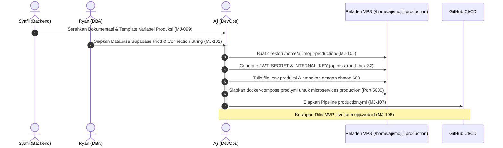

# Handoff Konfigurasi Produksi Backend & Kesiapan Rilis (MJ-099)

Dokumen ini merupakan serah terima teknis (*Engineering Handoff*) konfigurasi lingkungan produksi (**Production Environment**) untuk seluruh microservices backend Mojiji AnimeList (`api-gateway`, `user-service`, `catalog-service`, dan `tracker-service`) dari Backend Developer ke DevOps Engineer guna persiapan rilis Milestone UTS / Sprint 2 (**MJ-106**).

---

## 1. Lembar Informasi Handoff

| Parameter | Keterangan |
| :--- | :--- |
| **Nama Proyek** | Mojiji AnimeList |
| **ID Tiket** | **MJ-099** — Konfigurasi produksi backend |
| **Pengirim (*Sender*)** | Syafii (Backend Lead) |
| **Penerima (*Receiver*)** | Aji (DevOps Engineer) — Dependensi ke tiket **MJ-106** & **MJ-107** |
| **Tembusan (*CC*)** | Ryan (Database Administrator) — Dependensi ke tiket **MJ-101** |
| **Status Handoff** | **Diserahkan / Siap Deploy Production (Menuju UTS Minggu 8)** |
| **Tanggal Efektif** | 3 November 2026 |

---

## 2. Diagram Alur Handoff Antar-Peran Tim



---

## 3. Matriks Perbedaan Konfigurasi Staging vs Production

Untuk memastikan isolasi total antara lingkungan staging dan produksi yang berbagi satu server host VPS, seluruh nilai rahasia dan konfigurasi di bawah ini **wajib terpisah 100%**:

| Variabel Lingkungan | Staging (`develop`) | Production (`main`) | Alasan & Keterangan Teknis |
| :--- | :--- | :--- | :--- |
| `APP_ENV` | `staging` | `production` | Penanda identitas lingkungan aplikasi |
| `NODE_ENV` | `production` | `production` | Optimasi performa engine runtime Node.js |
| `DATABASE_URL` | Supabase Project 1 (`mojiji-staging`) | Supabase Project 2 (`mojiji-production`) | Database terpisah 100%, mencegah pencemaran data transaksi nyata |
| `REDIS_KEY_PREFIX`| `stg:` | `prod:` | Menghindari bentrokan kunci cache pada instance Upstash yang sama |
| `COOKIE_NAME` | `mj_stg_session` | `mj_session` | Mencegah tumpang tindih cookie login pada browser pengguna |
| `JWT_SECRET` | Kunci rahasia staging | Kunci rahasia production baru | Dibuat unik menggunakan `openssl rand -hex 32` |
| `INTERNAL_KEY` | Kunci internal staging | Kunci internal production baru | Dibuat unik menggunakan `openssl rand -hex 32` |
| `TENRAI_BASE_URL` | `https://api.tenrai.org/v1` | `https://api.tenrai.org/v1` | Provider katalog anime/manga pihak ketiga |
| Hostname / Domain | `staging.mojiji.web.id` | `mojiji.web.id` | Pengalihan trafik & SSL otomatis dikelola oleh Caddy |
| Path Static Web | `/srv` (staging web mount) | `/srv` (production web mount) | File statis Next.js ekspor produksi |

---

## 4. Format Lengkap `/home/aji/mojiji-production/.env` di VPS

DevOps dapat membuat berkas rahasia ini di peladen VPS menggunakan akun `deploy`:

```bash
# 1. Buat direktori kerja production
sudo mkdir -p /home/aji/mojiji-production

# 2. Tulis berkas konfigurasi rahasia
sudo nano /home/aji/mojiji-production/.env

# 3. Kunci hak akses keamanan ketat (hanya deploy yang dapat membaca)
sudo chown deploy:deploy /home/aji/mojiji-production/.env
sudo chmod 600 /home/aji/mojiji-production/.env
```

### Isi File Konfigurasi Produksi (`/home/aji/mojiji-production/.env`):
```ini
# ==========================================
# PRODUCTION ENVIRONMENT - MOJIJI ANIMELIST
# ==========================================
APP_ENV=production
NODE_ENV=production

# Database Supabase Production (Session Pooler IPv4)
# Diperoleh dari DBA Ryan (Tiket MJ-101)
DATABASE_URL=postgres://postgres.<project-ref-prod>:<PASSWORD_PROD>@aws-0-<region>.pooler.supabase.com:5432/postgres—sslmode=require

# Upstash Redis Cache Production (Isolasi Prefix prod:)
REDIS_URL=rediss://default:<UPSTASH_PASSWORD_PROD>@<UPSTASH_ENDPOINT_PROD>.upstash.io:6379
REDIS_KEY_PREFIX=prod:

# Provider Katalog Tenrai API v1
TENRAI_BASE_URL=https://api.tenrai.org/v1

# Keamanan Sesi & JWT Production (Generate: openssl rand -hex 32)
JWT_SECRET=b7c2e0f49832d19a4e76c1f885e3d74a2b910c5e3f48a1b2c3d4e5f6a7b8c9d0
COOKIE_NAME=mj_session

# Kunci Komunikasi Internal Antar-Service (Generate: openssl rand -hex 32)
INTERNAL_KEY=f5e4d3c2b1a09876543210fedcba9876543210fedcba9876543210fedcba9876

# Port Microservices Internal (Jaringan Docker internal)
PORT_GATEWAY=5000
PORT_USER=5001
PORT_CATALOG=5002
PORT_TRACKER=5003

# Internal Service Routing URLs
USER_SERVICE_URL=http://user-service:5001
CATALOG_SERVICE_URL=http://catalog-service:5002
TRACKER_SERVICE_URL=http://tracker-service:5003

# Batasan Memori Node.js Heap
NODE_OPTIONS=--max-old-space-size=64
```

> [!CAUTION] Keamanan Kunci Rahasia:
> Nilai `JWT_SECRET` dan `INTERNAL_KEY` di atas hanyalah contoh representasi. Pada peladen nyata, DevOps **WAJIB** mengeksekusi perintah `openssl rand -hex 32` langsung di terminal VPS untuk menghasilkan nilai acak berkekuatan kriptografis tinggi.

---

## 5. Verifikasi Pembatasan Resource (Resource Limits)

Sesuai ketentuan **PRD Bagian 19 (Resource RAM)** dan dokumen hasil pengukuran empiris **MJ-089**:
1. **Container Memory Limit (`mem_limit: 96m`):**
   * Setiap service pada `docker-compose.server.yml` dibatasi maksimal **96 MB RAM**.
2. **Node.js Heap Limit (`NODE_OPTIONS`):**
   * Setiap Dockerfile dan container environment menetapkan `ENV NODE_OPTIONS="--max-old-space-size=64"`, membatasi pemakaian alokasi memori heap V8 maksimal 64 MB.
3. **Database Connection Pool (`max: 3`):**
   * `services/user-service/src/config/db.js` dan `services/tracker-service/src/config/db.js` telah terkonfigurasi dengan `max: 3` koneksi per service (total maksimal 6 koneksi ke Supabase production).
4. **Isolasi Port Jaringan:**
   * Seluruh port internal microservices (`4000`, `4001`, `4002`, `4003`) tidak dipublikasikan ke internet; hanya Caddy yang mendengarkan port `80` dan `443`.

---

## 6. Prosedur Uji Kesehatan (Healthcheck Verifikasi)

Setelah DevOps menjalankan container production via Docker Compose:
```bash
docker compose -p mojiji-production --env-file /home/aji/mojiji-production/.env -f /home/aji/mojiji-production/docker-compose.prod.yml up -d
```

Lakukan verifikasi kesehatan seluruh service:
```bash
# 1. API Gateway Health
curl -s http://localhost:5000/health | jq .
# Expected: {"status":"ok","service":"api-gateway","message":"API Gateway is running"}

# 2. User Service Health
curl -s http://localhost:4001/health | jq .
# Expected: {"status":"ok","service":"user-service","message":"User Service is running"}

# 3. Catalog Service Health
curl -s http://localhost:4002/health | jq .
# Expected: {"status":"ok","service":"catalog-service","message":"Catalog Service is running"}

# 4. Tracker Service Health
curl -s http://localhost:4003/health | jq .
# Expected: {"status":"ok","service":"tracker-service","message":"Tracker Service is running"}

# 5. Public Domain Caddy Health (Production)
curl -s https://mojiji.web.id/api/health | jq .
# Expected: {"status":"ok","service":"api-gateway","message":"API Gateway is running"}
```

---

## 7. Status Sign-Off & Kesiapan Handoff

- [x] Seluruh variabel produksi bebas dari pencemaran kredensial staging.
- [x] Pool koneksi database terverifikasi maksimal 3 koneksi per service.
- [x] Batas memori Node heap 64 MB aktif di Dockerfile & Compose.
- [x] Template `.env.production.example` tersedia di repositori.
- [x] Handoff diterima oleh Aji (DevOps) untuk eksekusi tiket **MJ-106** & **MJ-107**.

---
*Dokumen ini merupakan artefak resmi serah terima teknis tiket **MJ-099** sebagai syarat kelulusan pengerjaan Sprint 1 menuju evaluasi UTS Minggu 8.*
