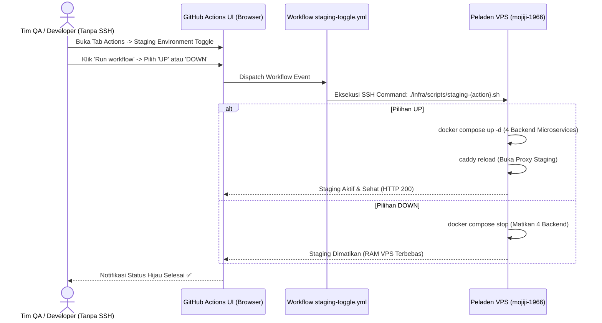

# Panduan Skrip Operasional, Auto-Rollback & Staging ON/OFF (MJ-091)

Dokumen ini memuat panduan komprehensif penggunaan skrip otomasi infrastruktur peladen, perbandingan mekanisme rollback otomatis versus manual, tata cara penanganan insiden darurat, pengoperasian lingkungan Staging berbasis tombol (*Staging ON/OFF via GitHub Actions*), serta notulen kesiapan infrastruktur jelang **Sprint Review 1 (Minggu 7)** sesuai tiket **MJ-091**.

---

## 1. Inventaris Skrip Operasional Peladen (`infra/scripts/`)

Seluruh skrip otomasi disimpan di dalam direktori `infra/scripts/` pada repositori dan dieksekusi di server VPS dengan hak akses eksekusi (`chmod +x`):

```text
infra/scripts/
├── deploy.sh          # Orkestrator deployment otomatis (pull, migrasi, switch, healthcheck, auto-rollback)
├── rollback.sh        # Skrip darurat manual on-demand untuk kembali ke .last_good_tag
├── staging-up.sh      # Menyalakan 4 microservices staging & reload konfigurasi Caddy
└── staging-down.sh    # Mematikan 4 microservices staging guna membebaskan RAM saat mode hemat
```

### Tabel Rangkuman Peran & Penggunaan Skrip

| Nama Skrip | Lingkup & Peran | Pemicu / Pemanggil | Contoh Perintah Eksekusi |
| :--- | :--- | :--- | :--- |
| **`deploy.sh`** | Orkestrasi rilis baru secara menyeluruh: migrasi database, pull image GHCR, swap kontainer, reload Caddy, dan **auto-rollback** jika healthcheck gagal. | Runner GitHub Actions (CI/CD) atau DevOps di VPS | `./infra/scripts/deploy.sh staging <image_tag>` |
| **`rollback.sh`** | Pemulihan darurat manual instan ke tag stabil sebelumnya yang tercatat di `.last_good_tag`. | DevOps Engineer via SSH terminal VPS | `./infra/scripts/rollback.sh staging` |
| **`staging-up.sh`** | Menghidupkan microservices staging dan memuat ulang reverse proxy Caddy secara *zero-downtime*. | GitHub Actions Workflow Dispatch atau DevOps di VPS | `./infra/scripts/staging-up.sh` |
| **`staging-down.sh`** | Menghentikan kontainer staging untuk menghemat penggunaan RAM VPS saat mode hemat diperlukan. | GitHub Actions Workflow Dispatch atau DevOps di VPS | `./infra/scripts/staging-down.sh` |

---

## 2. Perbandingan: Auto-Rollback (`deploy.sh`) vs Manual Rollback (`rollback.sh`)

Sering kali timbul pertanyaan mengenai perbedaan kedua mekanisme rollback ini. Keduanya saling melengkapi dalam strategi pemulihan bencana (*Disaster Recovery*):

```mermaid
flowchart TD
    subgraph AutoRollbackPath["1. Auto-Rollback (Didorong oleh deploy.sh)"]
        Deploy[CI/CD Menjalankan deploy.sh] --> Migrasi[Migrasi Database dbmate up]
        Migrasi --> UpContainers[Jalankan Kontainer Tag Baru]
        UpContainers --> HealthCheck{Pemeriksaan Healthcheck /api/health}
        HealthCheck -->|Gagal / Timeout 10x| AutoTrigger[Auto-Rollback Terpicu Otomatis!]
        AutoTrigger --> RevertAuto[Kembali ke Tag Stabil .last_good_tag]
        HealthCheck -->|Sukses 200 OK| DeployOK[Deploy Sukses & Simpan Tag Baru]
    end

    subgraph ManualRollbackPath["2. Manual Rollback (Didorong oleh rollback.sh)"]
        LiveBug[Deploy Sukses TAPI Ada Bug Fungsional Kritis di Lapangan] --> DevAlert[QA / User Melaporkan Anomali]
        DevAlert --> SSH[DevOps Login SSH ke VPS]
        SSH --> ExecManual[Jalankan ./infra/scripts/rollback.sh staging]
        ExecManual --> RevertManual[Sistem Kembali ke Tag Stabil Sebelumnya]
    end

    style AutoTrigger fill:#f8d7da,stroke:#dc3545,color:#721c24
    style ExecManual fill:#fff3cd,stroke:#ffc107,color:#856404
```



| Aspek Pembeda | `deploy.sh` (Auto-Rollback) | `rollback.sh` (Manual Rollback) |
| :--- | :--- | :--- |
| **Kapan Dijalankan—** | Berjalan otomatis saat proses deployment rilis baru sedang berlangsung di pipeline. | Dijalankan kapan saja secara manual oleh DevOps ketika aplikasi rilis terbaru lolos healthcheck namun ternyata memiliki bug fungsional kritis (misal: halaman putih, tombol tidak berfungsi). |
| **Pemicu Kegagalan** | Endpoint `/api/health` mengembalikan error `500`, koneksi crash, atau *timeout* setelah 10 kali percobaan verifikasi. | Keputusan insinyur DevOps / permintaan darurat dari QA Lead dan Project Manager. |
| **Intervensi Manusia** | **Nol (100% Otomatis).** Pipeline langsung membatalkan deployment dan memulihkan kontainer lama tanpa menunggu manusia bangun di malam hari. | **Manual.** DevOps harus masuk ke VPS via SSH dan menjalankan satu baris perintah. |
| **Penyimpanan State** | Jika sukses, memperbarui isi berkas `.last_good_tag`. Jika gagal, membaca `.last_good_tag` untuk rollback. | Hanya membaca `.last_good_tag` lama dan mengembalikan kontainer ke versi stabil tersebut. |

---

## 3. Panduan Langkah Demi Langkah: Menjalankan Manual Rollback di VPS

Jika terjadi insiden darurat di mana aplikasi rilis terbaru harus segera dikembalikan ke versi sebelumnya:

### Langkah 1: Hubungkan Diri ke Server VPS via SSH
Gunakan kunci SSH privat yang terdaftar pada akun `deploy`:
```bash
ssh -p 20125 deploy@103.147.32.27
# atau via domain:
ssh -p 20125 deploy@mojiji.web.id
```

### Langkah 2: Masuk ke Direktori Kerja Proyek
Seluruh skrip operasional dirancang untuk membaca berkas `.env` dan `docker-compose.server.yml` secara relatif atau dari `/opt/mojiji`:
```bash
cd /opt/mojiji
```

### Langkah 3: Eksekusi Skrip Rollback
Berikan argumen lingkungan yang ingin dipulihkan (`staging` atau `production`):
```bash
# Untuk memulihkan lingkungan Staging:
./infra/scripts/rollback.sh staging

# Untuk memulihkan lingkungan Production (Sprint 2):
./infra/scripts/rollback.sh production
```

### Langkah 4: Verifikasi Hasil Pemulihan
Skrip `rollback.sh` akan otomatis menampilkan log pergantian kontainer dan melakukan pengujian status HTTP. Pastikan terminal menampilkan:
```text
[INFO] Verifikasi endpoint kesehatan...
[OK] Layanan sehat kembali (HTTP 200) pada versi stabil sebelumnya!
```

---

## 4. ⚠️ Filosofi Penanganan Database: Mengapa Dilarang Rollback Skema Otomatis—

> [!CAUTION] Prinsip Perlindungan Data (Zero Data Loss Policy)
> Baik `deploy.sh` maupun `rollback.sh` **TIDAK PERNAH** menjalankan perintah `dbmate down` atau membatalkan migrasi database secara otomatis.

**Alasan Teknis & Bisnis:**
1. **Risiko Kehilangan Data Permanen:** Perintah `migrate down` umumnya berisi `DROP COLUMN` atau `DROP TABLE`. Jika perintah ini dieksekusi secara otomatis saat ada data transaksi pengguna baru yang masuk, data tersebut akan hilang seketika dan tidak dapat dipulihkan.
2. **Backward-Compatible Migration:** Seluruh skema database yang dirancang oleh DBA (Ryan) wajib menganut prinsip *expand-contract*:
   * Kolom baru wajib bersifat `NULLABLE` atau memiliki nilai bawaan (`DEFAULT`).
   * Service versi lama tetap dapat berjalan dengan lancar meskipun kolom baru sudah ada di database.
3. **Solusi Standar Industri:** Jika terjadi kesalahan skema DDL, tim DBA dan Backend akan merilis perbaikan cepat (*hotfix*) menggunakan berkas migrasi baru (*forward-fix migration*) daripada melakukan rollback mundur.

---

## 5. Pengoperasian Staging ON/OFF via GitHub Actions (Tanpa Akses SSH)

Bagi anggota tim yang tidak memiliki akses SSH langsung ke peladen VPS (misalnya QA Tester Nadia atau Frontend Developer Rian), disediakan panel kendali berbasis antarmuka web di GitHub Actions:



### Panduan Menggunakan Tombol Toggle:
1. Buka repositori **GitHub Mojiji AnimeList**.
2. Masuk ke tab **Actions** pada menu atas repositori.
3. Pada panel samping kiri, klik **`Staging Environment Toggle (ON / OFF)`**.
4. Klik menu tarik-turun **Run workflow**:
   * **Use workflow from:** Pilih branch default (`develop`).
   * **Aksi kontrol lingkungan staging:**
     * Pilih **`UP`** untuk menghidupkan seluruh backend staging.
     * Pilih **`DOWN`** untuk menonaktifkan backend staging saat ingin menghemat RAM server.
5. Klik tombol hijau **Run workflow**. Dalam 10-15 detik, status lingkungan akan langsung berubah di VPS.

> [!NOTE] Mengapa Muncul Pilihan Branch ("Use workflow from")—
> Pilihan branch pada tombol *Run workflow* adalah mekanisme bawaan GitHub Actions untuk menentukan dari branch mana file definisi YAML alur kerja akan dibaca. Selalu pilih branch **`develop`** (atau `main`) untuk memastikan parameter dan konfigurasi SSH yang digunakan adalah versi resmi terbaru.

---

## 6. Notulen Kesiapan Infrastruktur Sprint Review 1 (Evaluasi Akhir Minggu 7)

Berdasarkan seluruh hasil pengujian dan otomasi yang diselesaikan pada tiket **MJ-091**:

1. **Kestabilan Lingkungan Staging:** Aktif normal (*Always-On*) di URL publik `https://staging.mojiji.web.id` dengan sertifikat SSL resmi Let's Encrypt (HTTPS).
2. **Kesehatan Endpoint Inti:** Seluruh endpoint MVP (`/api/auth/register`, `/api/auth/login`, `/api/catalog/search`, `/api/catalog/:id`, `/api/tracker`) telah teruji dan siap didemokan di hadapan dosen pengampu (Joni Rodito, S.Kom).
3. **Ketahanan Sistem (*Reliability*):** Mekanisme auto-rollback dan skrip darurat `rollback.sh` telah terpasang dan tervalidasi pada peladen VPS.
4. **Efisiensi Beban RAM:** Konsumsi seluruh kontainer backend stabil pada **~91.6 MB**, menyisakan ruang bebas RAM fisik di atas **900 MB** pada server VPS 2 GB.

---
*Dokumen ini disusun oleh Aji (DevOps Engineer) sebagai pemenuhan Acceptance Criteria tiket **MJ-091** (Minggu 7 - Sprint 1).*
