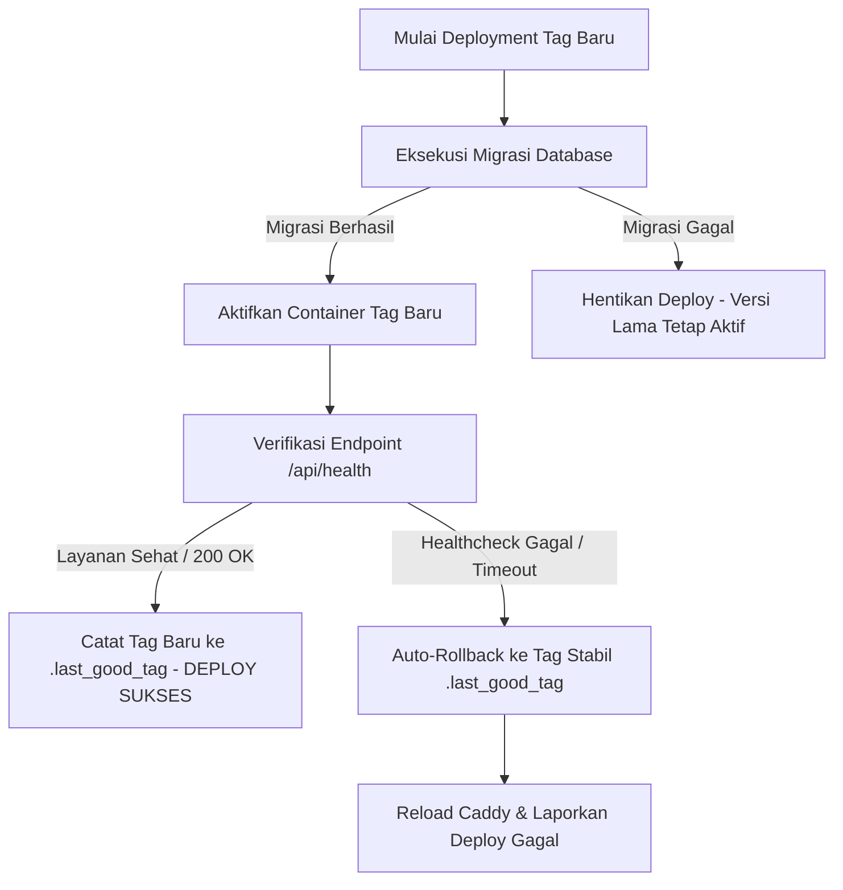

# Panduan Operasional Skrip, Otomasi Rollback & Staging ON/OFF (MJ-091)

Dokumen ini memuat panduan penggunaan skrip otomasi infrastruktur peladen, tata cara pengujian *rollback* darurat, pengoperasian lingkungan Staging berbasis tombol (*Staging ON/OFF*), serta notulen kesiapan lingkungan jelang **Sprint Review Minggu 7**.

---

## 1. Inventaris Skrip Operasional Peladen (`infra/scripts/`)

Seluruh skrip otomasi disimpan di dalam direktori `infra/scripts/` pada repositori dan dieksekusi di server VPS:

| Nama Skrip | Fungsi & Deskripsi | Contoh Perintah Eksekusi |
| :--- | :--- | :--- |
| **`staging-up.sh`** | Menyalakan seluruh container lingkungan staging dan memuat ulang konfigurasi Caddy secara *zero-downtime*. | `./infra/scripts/staging-up.sh` |
| **`staging-down.sh`** | Menghentikan 4 microservices backend staging guna membebaskan memori RAM VPS saat mode hemat diperlukan. | `./infra/scripts/staging-down.sh` |
| **`rollback.sh`** | Mengembalikan kontainer microservices secara instan ke tag rilis stabil sebelumnya yang tercatat di `.last_good_tag`. | `./infra/scripts/rollback.sh` |
| **`deploy.sh`** | Skrip orkestrasi lengkap: pull image, migrasi database, start container, reload caddy, verifikasi healthcheck, dan auto-rollback jika gagal. | `./infra/scripts/deploy.sh staging <tag>` |

---

## 2. Pengoperasian Staging ON/OFF via GitHub Actions (Tanpa Akses SSH)

Anggota tim (Tester/QA, Frontend, Backend) yang tidak memiliki akses SSH langsung ke VPS dapat menyalakan atau mematikan lingkungan staging melalui antarmuka web GitHub:

1. Buka repositori **GitHub Mojiji AnimeList**.
2. Masuk ke tab **Actions** di menu atas.
3. Pada panel kiri, pilih alur kerja **`Staging Environment Toggle (ON / OFF)`**.
4. Klik tombol **Run workflow**:
   * Pilih opsi **`UP`** untuk menyalakan staging (menjalankan `staging-up.sh`).
   * Pilih opsi **`DOWN`** untuk mematikan backend staging (menjalankan `staging-down.sh` guna menghemat beban RAM).
5. Klik tombol hijau **Run workflow**. Server VPS akan menjalankan perintah tersebut dalam hitungan detik.

---

## 3. Prosedur & Hasil Uji Latihan Rollback (Emergency Verification)

Untuk memenuhi kriteria tiket **MJ-091**, simulasi *rollback* aplikasi telah dirancang dengan mekanisme pengamanan berlapis:

### Prinsip Keamanan Data Saat Rollback:
* **Rollback Hanya untuk Kontainer Aplikasi:** Rollback memulihkan container `api-gateway`, `user-service`, `catalog-service`, dan `tracker-service` ke tag rilis sebelumnya.
* **Tidak Ada Rollback Skema Database Otomatis:** Perintah `migrate down` sengaja **tidak dijalankan** otomatis saat terjadi kegagalan aplikasi guna menghindari risiko terhapusnya data riil pengguna secara tidak sengaja. Perbaikan skema database wajib diselesaikan melalui migrasi perbaikan maju (*forward-fix migration*).

---

## 4. Notulen Kesiapan Sprint Review 1 (Evaluasi Akhir Minggu 7)

Menjelang agenda evaluasi **Sprint Review 1 & Increment 1**:
1. **Status Lingkungan Staging:** Aktif normal (*Always-On*) di URL publik `https://staging.mojiji.web.id`.
2. **Kesehatan Endpoint Backend:** Seluruh endpoint inti MVP (Register, Login, Catalog Search, Detail Anime, Tracker Status Update) telah diverifikasi via Postman Collection.
3. **Ketersediaan Data Demo:** Database Supabase Staging telah terisi data uji awal katalog anime dan akun pengguna demo.
4. **Kapasitas Server VPS:** Beban seluruh kontainer staging stabil pada angka **~92 MB**, menyisakan ruang bebas RAM fisik di atas **900 MB** pada server host VPS 2 GB.

---
*Dokumen ini disusun oleh Aji (DevOps Engineer) sebagai pemenuhan Acceptance Criteria tiket **MJ-091** (Minggu 7).*

