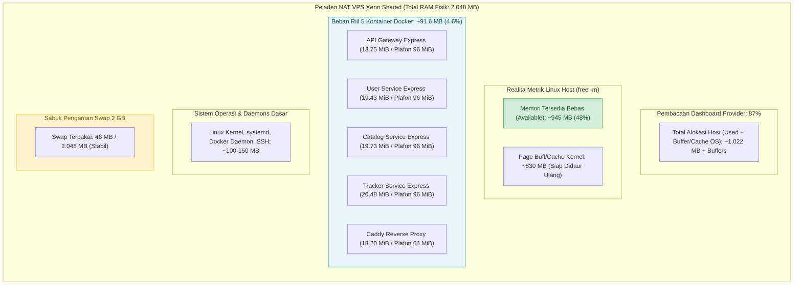
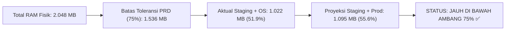
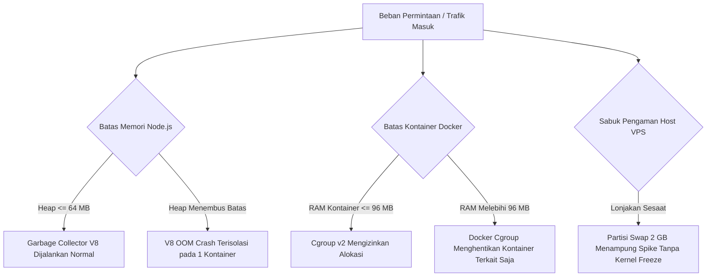

# Laporan Pengukuran RAM & Kebijakan Alokasi Memori (MJ-089)

Dokumen ini mencatat metodologi, hasil pengukuran empiris *live* di peladen NAT VPS Xeon Shared, perbandingan anggaran teoritis versus data riil, penetapan batas (*resource limits*) per kontainer Docker, analisis perbedaan pembacaan RAM panel provider (87%) versus metrik internal Linux, serta keputusan resmi operasional lingkungan Staging (**Mode A: Always-On**) untuk proyek **Mojiji AnimeList** sesuai tiket **MJ-089**.

---

## 1. Spesifikasi Perangkat Keras & Konfigurasi Host VPS

Pengukuran memori dilakukan langsung pada peladen VPS (*Virtual Private Server*) Ubuntu yang dipersiapkan untuk menjalankan seluruh ekosistem backend Mojiji AnimeList:

* **Identitas Peladen:** `mojiji` (`#1966`) - Cluster Xeon Shared Indonesia (Jakarta)
* **Sistem Operasi:** Ubuntu 24.04 LTS (Noble Numbat - x86_64)
* **Processor (vCPU):** 2 Cores vCPU (Intel Xeon Shared)
* **Total RAM Fisik:** 2.048 MB (2.0 GB / terdeteksi 1.967 MB oleh kernel Linux)
* **Partisi Virtual Memory (Swap):** 2.048 MB (2.0 GB) aktif dengan parameter kernel `vm.swappiness=10`
* **Penyimpanan:** 20 GB NVMe Disk
* **Alamat IP & Port:** Shared IP `103.147.32.27` dengan SSH Port NAT `20125`
* **Docker Runtime:** Docker Engine Community v27+ dengan driver isolasi memori *cgroups v2*

---

## 2. Visualisasi Alokasi & Arsitektur Proteksi Memori



---

## 3. Data Pengukuran Empiris Live VPS (Snapshot Aktual)

Pengukuran dilakukan saat lingkungan Staging berjalan penuh (*live traffic test*):

### A. Metrik Memori Server Host (`free -m`)
Eksekusi perintah `free -m` pada terminal host VPS menghasilkan data riil berikut:

| Kategori Memori | Total (MB) | Terpakai (*Used*) | Bebas (*Free*) | Bersama (*Shared*) | Buffer/Cache | Tersedia (*Available*) |
| :--- | :---: | :---: | :---: | :---: | :---: | :---: |
| **RAM Fisik** | **1.967 MB** | 1.022 MB | 114 MB | 1 MB | 830 MB | **945 MB** |
| **Swap Partition** | **2.048 MB** | 46 MB | 2.001 MB | - | - | - |

> [!NOTE] Penjelasan Metrik Linux:
> Kolom **Available (945 MB)** adalah indikator kesehatan terpenting. Nilai ini menunjukkan memori riil yang dapat langsung dialokasikan oleh kernel Linux untuk aplikasi baru tanpa perlu melakukan swapping paksa. Angka *buffer/cache* (830 MB) secara otomatis akan dilepaskan oleh OS jika aplikasi membutuhkan RAM tambahan.

### B. Metrik Kontainer Docker Riil (`docker stats --no-stream`)
Hasil inspeksi langsung terhadap kontainer yang sedang berjalan di VPS:

| Nama Kontainer | Konsumsi Riil (RAM) | Batas Plafon (`mem_limit`) | Persentase Pemakaian | CPU Usage |
| :--- | :---: | :---: | :---: | :---: |
| `mojiji_api_gateway_staging` | **13.75 MiB** | 96 MiB | 14.32% | 0.00% |
| `mojiji_user_service_staging` | **19.43 MiB** | 96 MiB | 20.24% | 0.00% |
| `mojiji_catalog_service_staging` | **19.73 MiB** | 96 MiB | 20.55% | 0.00% |
| `mojiji_tracker_service_staging` | **20.48 MiB** | 96 MiB | 21.33% | 0.00% |
| `mojiji_caddy_server_staging` | **18.20 MiB** | 64 MiB | 28.44% | 0.01% |
| **TOTAL SEMUA KONTAINER** | **91.59 MiB** | **448 MiB** | **20.44% (Rata-rata)** | - |

> [!TIP] Efisiensi Node.js Express & Zero-Build:
> Konsumsi memori 4 microservices backend hanya menyentuh **~73 MiB**, jauh lebih hemat dibanding estimasi awal. Hal ini disebabkan oleh:
> 1. Framework **Express.js v5** yang teroptimasi secara modular dengan overhead memori minimal.
> 2. Skrip migrasi Dbmate hanya berjalan sebagai kontainer sesaat (*ephemeral run --rm*) dan langsung mati setelah migrasi selesai.
> 3. Frontend Next.js disajikan berupa berkas statis oleh Caddy tanpa runtime Node.js Next SSR di VPS.

### C. Klarifikasi Indikator RAM Panel Provider (87%) vs Realita Kontainer
Saat membuka panel kontrol VPS (`mojiji #1966`), indikator visual menampilkan angka **RAM 87%**. Fenomena ini sering menimbulkan kekhawatiran semu (*false alarm*).

**Penyebab & Penjelasan Teknis:**
1. **Perilaku Hypervisor Host:** Dashboard web provider mengukur memori fisik yang dialokasikan dari sisi luar virtual machine (KVM/Proxmox). Di Linux, prinsip dasarnya adalah *"Unused RAM is wasted RAM"*, sehingga kernel secara agresif menggunakan sisa memori sebagai cache disk (*page cache*) untuk mempercepat I/O (tercatat 830 MB buffer/cache).
2. **Kapasitas Bebas Riil:** Dari sudut pandang sistem operasi, ruang memori yang dapat langsung diberikan ke aplikasi baru adalah **945 MB (48%)**.
3. **Beban Kontainer Hanya 4.6%:** Seluruh 5 kontainer backend dan web server Mojiji hanya menghabiskan **91.59 MiB** (~4.6% dari kapasitas 2 GB). Server berada dalam kondisi sangat sehat, stabil, dan dingin.

---

## 4. Perbandingan Anggaran Teoritis vs Pengukuran Riil

| Komponen | Anggaran Teori Awal | Pengukuran Riil Live | Deviasi / Selisih | Keterangan |
| :--- | :---: | :---: | :---: | :--- |
| **4 Microservices Staging** | 235 MB | 73.39 MB | -161.61 MB (Lebih hemat 68%) | Node heap Express idle sangat efisien |
| **Caddy Reverse Proxy** | 35 MB | 18.20 MB | -16.80 MB (Lebih hemat 48%) | Single binary Go sangat efisien menangani routing |
| **Total Beban Kontainer** | 270 MB | 91.59 MB | -178.41 MB (Lebih hemat 66%) | Sangat aman untuk multi-environment |

---

## 5. Analisis Ambang Batas Keamanan PRD (75% Threshold)

Ketentuan dalam Dokumen PRD Mojiji Bab 19 menyatakan:
* **Kapasitas RAM Fisik:** 2.048 MB
* **Batas Toleransi Maksimum (75%):**  
  $$75\% \times 2.048\text{ MB} = 1.536\text{ MB}$$
* **Ruang Kosong Wajib (*Safety Headroom* 25%):** 512 MB

### Proyeksi Dua Lingkungan (Staging + Production Aktif Bersamaan):
Ketika lingkungan Production diluncurkan pada Sprint 2 (Minggu 8):
$$\text{Proyeksi Kontainer Prod} = \approx 91.6\text{ MB}$$
$$\text{Total Kontainer (Staging + Prod + Caddy)} = 91.6\text{ MB} + 73.4\text{ MB} \approx 165\text{ MB}$$
$$\text{Total Penggunaan Memori Host (OS + Prod + Staging)} \approx 1.022\text{ MB} + 73.4\text{ MB} = 1.095\text{ MB}$$
$$\text{Persentase Penggunaan terhadap Total RAM} = \frac{1.095\text{ MB}}{1.967\text{ MB}} \times 100\% = 55.67\%$$



---

## 6. Keputusan Resmi: Mode A (Always-On)

Sesuai kriteria evaluasi tiket **MJ-089**:
* Jika beban memori $> 75\%$ (1.536 MB) $\rightarrow$ Gunakan **Mode B (On-Demand)**.
* Jika beban memori $\le 75\%$ (1.536 MB) $\rightarrow$ Gunakan **Mode A (Always-On)**.

### 🟢 KEPUTUSAN OPERASIONAL: **MODE A (ALWAYS-ON)** DISETUJUI
1. **Status Operasional:** Staging beroperasi secara **permanen (24/7)** di `https://staging.mojiji.web.id`.
2. **Justifikasi Teknis:**
   * Penggunaan memori riil hanya berada pada kisaran **51% - 56%**, meninggalkan ruang bebas (*headroom*) sebesar **~945 MB**.
   * Mematikan staging tidak mendesak karena sisa memori fisik sangat melimpah untuk menampung lonjakan trafik demo.
3. **Keuntungan Tim:**
   * QA Tester (Nadia) dapat melakukan pengujian fungsionalitas kapan pun tanpa dependensi menyalakan server secara manual.
   * Developer (Dika & Syafii) dapat segera melihat hasil Pull Request setelah di-merge ke branch `develop`.

> [!NOTE] Ketersediaan Skrip Darurat (Mode B):
> Meskipun beroperasi dalam Mode A, skrip penghematan memori `staging-down.sh` dan alur kerja GitHub Actions `staging-toggle.yml` tetap dipertahankan sebagai Standar Operasional Prosedur (SOP) darurat jika di kemudian hari tim melakukan stress test atau terjadi anomali beban memori di luar batas wajar.

---

## 7. Mekanisme Proteksi Memori & Pencegahan Out-Of-Memory (OOM)

Untuk memastikan sistem tidak mengalami *crash* mendadak:



1. **Docker Hard Limit (`mem_limit: 96m`):** Setiap microservice dibatasi maksimal 96 MB pada level cgroup kernel Linux. Jika terjadi kebocoran memori pada salah satu service, hanya kontainer tersebut yang dimatikan oleh daemon Docker tanpa menumbangkan seluruh server VPS.
2. **Node.js Heap Management (`NODE_OPTIONS="--max-old-space-size=64"`):** Memaksa mesin V8 melakukan garbage collection agresif sebelum memori heap melampaui 64 MB.
3. **Database Connection Pool Limiting (`max: 3`):** Membatasi alokasi koneksi PostgreSQL ke Supabase maksimal 3 koneksi per microservice guna menghemat alokasi memori buffer socket di sisi backend.
4. **Buffer Swap Aktif (`2 GB`, swappiness 10):** Menjaga server tetap responsif dan memberi waktu bagi DevOps untuk melakukan investigasi jika terjadi lonjakan memori tak terduga.
5. **Docker Log Rotation (`max-size: 10m`, `max-file: 3`):** Mencegah berkas log JSON kontainer memenuhi ruang RAM dan disk NVMe 20 GB host.

---

## 8. Panduan Perintah Pemantauan Harian DevOps

Untuk memantau stabilitas memori di server VPS via SSH Port `20125`:

```bash
# 1. Cek ringkasan penggunaan RAM dan Swap fisik server
free -m

# 2. Pantau penggunaan resource kontainer secara instan
docker stats --no-stream

# 3. Pantau kontainer yang memakan memori terbesar secara terus-menerus
docker stats --format "table {{.Name}}\t{{.CPUPerc}}\t{{.MemUsage}}\t{{.MemPerc}}"

# 4. Cek apakah ada peristiwa OOM Killer yang dipicu oleh kernel Linux
sudo dmesg -T | grep -i -E "oom|killed process"
```

---
*Dokumen ini disusun oleh Aji (DevOps Engineer) sebagai bukti kepatuhan terhadap Acceptance Criteria tiket **MJ-089** (Minggu 7 - Sprint 1).*
