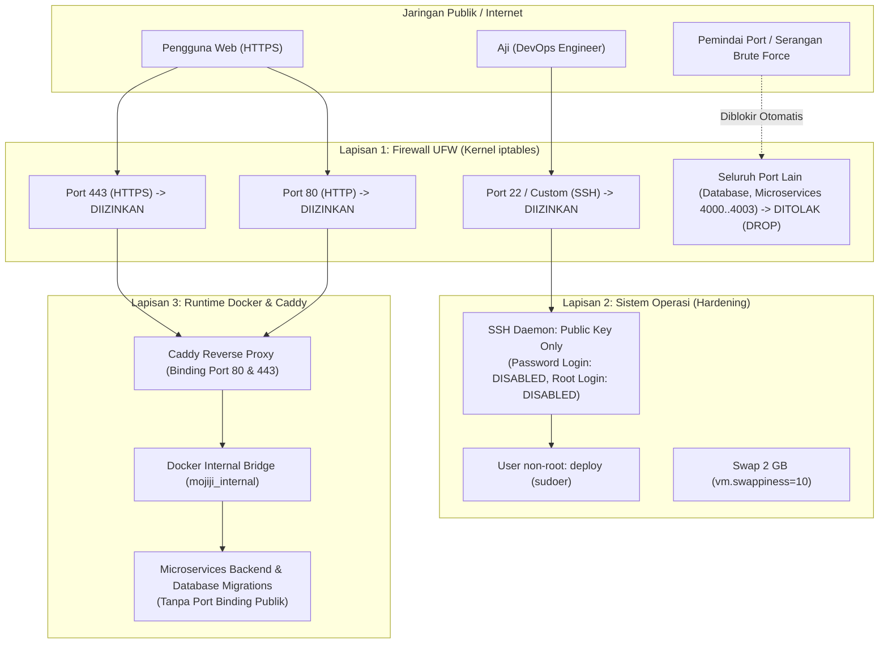

# Setup, Hardening & Keamanan Peladen VPS (MJ-053)

Dokumen ini memuat prosedur penyusunan peladen (*server provisioning*), penguatan keamanan (*server hardening*), alokasi memori virtual (*swap*), dan konfigurasi Docker Engine pada peladen VPS **Ubuntu 22.04 LTS** proyek **Mojiji AnimeList** sesuai tiket **MJ-053**.

---

## 1. Topologi Keamanan Jaringan Peladen

Peladen VPS dilindungi oleh kebijakan keamanan jaringan berlapis menggunakan firewall **UFW (*Uncomplicated Firewall*)** dan otentikasi kunci kriptografi SSH:



---

## 2. Spesifikasi Teknis Peladen Live

Berdasarkan inspeksi sistem live peladen `mojiji-1966`:
* **Sistem Operasi:** Ubuntu 22.04 LTS (x86_64)
* **Kapasitas CPU:** 2 vCPU Cores
* **Memori Fisik (RAM):** 2.048 MB (2 GB)
* **Memori Virtual (Swap):** 2.048 MB (2 GB) dengan `vm.swappiness=10`
* **Penyimpanan:** NVMe SSD dengan partisi root terenkripsi

---

## 3. Langkah Penyusunan & Hardening Peladen

### A. Pembuatan Pengguna Terbatas (`deploy`)
Dilarang keras menjalankan aplikasi harian menggunakan akun `root`. Dibuat akun khusus bernama `deploy`:
```bash
# Membuat user non-root
adduser deploy

# Memberikan akses sudo terbatas
usermod -aG sudo deploy

# Menyiapkan direktori kunci SSH
mkdir -p /home/deploy/.ssh
chmod 700 /home/deploy/.ssh

# Memasukkan Public Key DevOps ke authorized_keys
cat aji_ed25519.pub >> /home/deploy/.ssh/authorized_keys
chmod 600 /home/deploy/.ssh/authorized_keys
chown -R deploy:deploy /home/deploy/.ssh
```

### B. Penguncian Akses SSH Daemon (*SSH Hardening*)
> [!WARNING]
> Sebelum mematikan otentikasi kata sandi, wajib menguji koneksi `ssh deploy@IP` di jendela terminal terpisah untuk memastikan kunci publik berfungsi!

Ubah konfigurasi pada berkas `/etc/ssh/sshd_config`:
```ini
# Menonaktifkan login langsung akun root
PermitRootLogin no

# Mematikan otentikasi kata sandi (mencegah serangan brute-force)
PasswordAuthentication no

# Mengizinkan otentikasi kunci publik
PubkeyAuthentication yes

# Membatasi percobaan otentikasi
MaxAuthTries 3
```
Terapkan perubahan dengan memuat ulang SSH daemon:
```bash
sudo systemctl restart ssh
```

### C. Konfigurasi Firewall UFW
Terapkan prinsip *Least Privilege* pada port jaringan publik:
```bash
# Menyetel kebijakan default: tolak seluruh trafik masuk, izinkan keluar
sudo ufw default deny incoming
sudo ufw default allow outgoing

# Hanya membuka port yang sah
sudo ufw allow OpenSSH
sudo ufw allow 80/tcp
sudo ufw allow 443/tcp

# Mengaktifkan firewall
sudo ufw enable
```

---

## 4. Konfigurasi Virtual Memory (Swap 2 GB)

Untuk mencegah server mati mendadak saat terjadi lonjakan proses sesaat (*Out-Of-Memory Killer*):

```bash
# 1. Alokasikan file swap berukuran 2 GB
sudo fallocate -l 2G /swapfile

# 2. Kunci hak akses hanya untuk root
sudo chmod 600 /swapfile

# 3. Format sebagai area swap Linux
sudo mkswap /swapfile

# 4. Aktifkan swap
sudo swapon /swapfile

# 5. Pasang permanen di /etc/fstab
echo '/swapfile none swap sw 0 0' | sudo tee -a /etc/fstab

# 6. Atur swappiness ke angka 10 (hanya gunakan swap saat RAM hampir habis)
sudo sysctl vm.swappiness=10
echo 'vm.swappiness=10' | sudo tee -a /etc/sysctl.conf
```

---

## 5. Instalasi Docker Engine & Rotasi Log Daemon

### A. Instalasi Docker Compose Plugin
```bash
# Tambahkan deploy ke grup docker agar tidak membutuhkan sudo setiap saat
sudo usermod -aG docker deploy
```

### B. Konfigurasi Rotasi Log Otomatis (`daemon.json`)
> [!IMPORTANT]
> Secara default, Docker menyimpan log kontainer tanpa batas hingga disk penuh. Berkas `/etc/docker/daemon.json` wajib disetel agar log kontainer berputar otomatis dan dibatasi maksimal 30 MB per kontainer:

```json
{
  "log-driver": "json-file",
  "log-opts": {
    "max-size": "10m",
    "max-file": "3"
  }
}
```
Muat ulang Docker daemon:
```bash
sudo systemctl restart docker
```

---

## 6. Verifikasi Akhir Kesiapan Peladen

Jalankan serangkaian uji kesehatan server:
1. **Verifikasi Swap & Memori:**
   ```bash
   free -m
   ```
   *(Harus menunjukkan baris Swap total ~2.047 MB).*
2. **Verifikasi Firewall:**
   ```bash
   sudo ufw status verbose
   ```
   *(Status `active`, hanya port 22, 80, 443 berstatus `ALLOW IN`).*
3. **Uji Runtime Docker:**
   ```bash
   docker run --rm hello-world
   ```
   *(Menghasilkan pesan sukses `Hello from Docker!`).*

---
*Dokumen ini disusun oleh Aji (DevOps Engineer) sebagai pemenuhan Acceptance Criteria tiket **MJ-053** (Minggu 5).*

