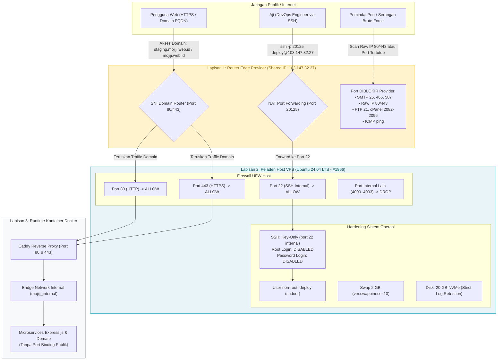

# Setup, Hardening & Keamanan Peladen VPS (MJ-053)

Dokumen ini memuat prosedur resmi penyusunan peladen (*server provisioning*), penguatan keamanan (*server hardening*), alokasi memori virtual (*swap*), konfigurasi Docker Engine, serta adaptasi arsitektur jaringan pada peladen **NAT VPS Xeon Shared (Ubuntu 24.04 LTS)** untuk proyek **Mojiji AnimeList** sesuai tiket **MJ-053**.

---

## 1. Topologi Keamanan Jaringan & Arsitektur NAT Shared Hosting

Peladen VPS Mojiji beroperasi di atas infrastruktur **Xeon Shared (NAT VPS)** dengan satu alamat IPv4 publik bersama (*Shared Public IP*) yang dikelola melalui router edge provider di data center Jakarta:



---

## 2. Spesifikasi Teknis Peladen VPS Live

Berdasarkan data operasional aktual pada dashboard peladen `mojiji (#1966)`:

| Parameter | Spesifikasi Peladen | Keterangan Operasional |
| :--- | :--- | :--- |
| **Identitas Server** | `mojiji` (`#1966`) | Cluster Xeon Shared Indonesia (Jakarta) |
| **Sistem Operasi** | **Ubuntu 24.04 LTS (Noble Numbat)** | Linux x86_64, Kernel 6.8+ |
| **Processor (vCPU)** | **2 Cores vCPU** | Intel Xeon Shared Processor |
| **Memori Fisik (RAM)** | **2.048 MB (2 GB)** | Terdeteksi ~1.967 MB oleh kernel |
| **Memori Virtual (Swap)** | **2.048 MB (2 GB)** | Aktif pada `/swapfile` dengan `vm.swappiness=10` |
| **Penyimpanan Disk** | **20 GB NVMe Disk** | Partisi root SSD NVMe performa tinggi |
| **Alamat IP Publik** | **`103.147.32.27`** | Shared Public IPv4 bersama |
| **Port Akses SSH Publik** | **`20125`** | NAT Forwarding ke port 22 lokal di VPS |
| **Akses Web HTTP/HTTPS** | **Domain-Only (Port 80 & 443)** | Akses via Raw IP dinonaktifkan oleh provider |

---

## 3. Langkah Penyusunan & Hardening Peladen

### A. Pembuatan Pengguna Terbatas (`deploy`)
Dilarang keras menjalankan kontainer atau alur CI/CD menggunakan akun `root`. Dibuat akun khusus bernama `deploy`:
```bash
# 1. Membuat akun deploy baru
sudo adduser deploy

# 2. Menambahkan ke grup sudo dan docker
sudo usermod -aG sudo deploy
sudo usermod -aG docker deploy

# 3. Menyiapkan direktori kunci SSH terlindungi
sudo mkdir -p /home/deploy/.ssh
sudo chmod 700 /home/deploy/.ssh

# 4. Mendaftarkan Public Key DevOps
sudo cat aji_ed25519.pub >> /home/deploy/.ssh/authorized_keys
sudo chmod 600 /home/deploy/.ssh/authorized_keys
sudo chown -R deploy:deploy /home/deploy/.ssh
```

### B. Penguncian Akses SSH Daemon (*SSH Hardening*)
> [!WARNING] Uji Koneksi Sebelum Restart SSH!
> Sebelum me-restart SSH daemon, uji koneksi di jendela terminal terpisah dengan perintah:
> `ssh -p 20125 deploy@103.147.32.27`

Konfigurasi pada berkas `/etc/ssh/sshd_config.d/99-hardening.conf` atau `/etc/ssh/sshd_config`:
```ini
# Port internal tetap mendengarkan port 22 (NAT provider memetakan 20125 -> 22)
Port 22

# Nonaktifkan login langsung root
PermitRootLogin no

# Matikan otentikasi password (mencegah brute force)
PasswordAuthentication no

# Wajibkan otentikasi kunci publik
PubkeyAuthentication yes

# Batasi percobaan otentikasi gagal
MaxAuthTries 3

# Nonaktifkan X11 forwarding yang tidak diperlukan
X11Forwarding no
```

Muat ulang konfigurasi SSH:
```bash
sudo systemctl restart ssh
```

---

## 4. Konfigurasi Firewall UFW pada Lingkungan NAT VPS

Meskipun router edge provider telah menyaring port publik, peladen host tetap wajib menjalankan UFW sebagai pertahanan lapis kedua (*defense-in-depth*):

```bash
# 1. Setel kebijakan default: tolak semua yang masuk, izinkan semua yang keluar
sudo ufw default deny incoming
sudo ufw default allow outgoing

# 2. Izinkan port SSH internal (port 22 yang menerima forward dari port 20125)
sudo ufw allow 22/tcp comment 'SSH Internal NAT'

# 3. Izinkan port Web untuk trafik domain Caddy
sudo ufw allow 80/tcp comment 'Caddy HTTP'
sudo ufw allow 443/tcp comment 'Caddy HTTPS'

# 4. Aktifkan firewall
sudo ufw --force enable

# 5. Verifikasi status
sudo ufw status verbose
```

---

## 5. Alokasi Memori Virtual (Swap 2 GB)

Untuk mencegah sistem mengalami pembekuan (*freeze*) saat terjadi lonjakan proses sesaat pada RAM fisik 2 GB:

```bash
# 1. Alokasikan berkas swap 2 GB
sudo fallocate -l 2G /swapfile

# 2. Kunci izin berkas swap (hanya root yang dapat membaca)
sudo chmod 600 /swapfile

# 3. Format dan aktifkan partisi swap
sudo mkswap /swapfile
sudo swapon /swapfile

# 4. Daftarkan secara permanen di /etc/fstab
echo '/swapfile none swap sw 0 0' | sudo tee -a /etc/fstab

# 5. Optimasi kernel swappiness (prioritaskan RAM, swap hanya cadangan)
echo 'vm.swappiness=10' | sudo tee -a /etc/sysctl.conf
echo 'vm.vfs_cache_pressure=50' | sudo tee -a /etc/sysctl.conf
sudo sysctl -p
```

---

## 6. Konfigurasi Docker Daemon & Rotasi Log (Disk 20 GB Protection)

Kapasitas penyimpanan server adalah **20 GB NVMe Disk**. Jika log kontainer Docker tidak dibatasi, berkas log JSON dapat membengkak hingga memenuhi seluruh disk dalam beberapa minggu.

Konfigurasikan `/etc/docker/daemon.json`:
```json
{
  "log-driver": "json-file",
  "log-opts": {
    "max-size": "10m",
    "max-file": "3"
  },
  "storage-driver": "overlay2"
}
```

Terapkan konfigurasi:
```bash
sudo systemctl restart docker
```

> [!TIP] Pemeliharaan Disk Rutin:
> DevOps menjalankan perintah berikut sebulan sekali untuk menghapus image dan build cache yang menggantung:
> ```bash
> docker system prune -af --volumes
> ```

---

## 7. Prosedur Akses Terminal Harian DevOps

Untuk masuk ke peladen VPS Mojiji, selalu sertakan parameter port **`20125`**:

```bash
# Opsi 1: Menggunakan domain terdaftar
ssh -p 20125 deploy@mojiji.web.id

# Opsi 2: Menggunakan IP Publik langsung
ssh -p 20125 deploy@103.147.32.27
```

---
*Dokumen ini disusun oleh Aji (DevOps Engineer) sebagai bukti pemenuhan Acceptance Criteria tiket **MJ-053** (Minggu 4 - Setup VPS).*
