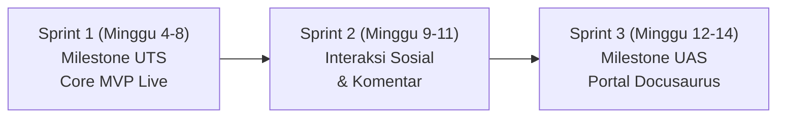

# Product Requirement Document (PRD): Mojiji AnimeList

Dokumen ini merupakan intisari spesifikasi kebutuhan produk (*Product Requirement Document*) untuk aplikasi web **Mojiji AnimeList**. Dokumen induk lengkap dalam format terformat tersedia di [Mini_PRD_MOJIJI.docx](file:///s:/kuliah/mojiji-animelist/docs/prd/Mini_PRD_MOJIJI.docx).

---

## 1. Ringkasan Eksekutif Produk

* **Nama Produk:** Mojiji AnimeList
* **Tipe Aplikasi:** Web Application (Responsive Mobile & Desktop)
* **Target Pengguna:** Penggemar anime & manga di Indonesia yang membutuhkan pelacak koleksi tontonan yang cepat, bebas iklan, dan modern.
* **Evaluasi Akademik:** Mata Kuliah Pemrograman Web Framework (Semester 5, STMIK Bina Patria, Dosen: Joni Rodito, S.Kom).

---

## 2. Roadmap Milestone Proyek

* **Sprint 1 (Milestone UTS):** Fondasi autentikasi, katalog Tenrai API, pencarian, detail, tracker koleksi pribadi, dan live deployment di domain publik `https://mojiji.web.id`.
* **Sprint 2 (Pengembangan Lanjutan):** Fitur interaksi sosial, komentar anime, profil pengguna lanjutan, dan personalisasi preferensi.
* **Sprint 3 (Milestone UAS / Final Project):** Stabilisasi penuh, inisialisasi portal dokumentasi terpadu Docusaurus di monorepo, dan evaluasi akhir.

---

## 3. Matriks User Story & Ketercapaian MVP (Sprint 1)

| Story ID | User Story | Prioritas | Status Sprint 1 |
| :--- | :--- | :---: | :---: |
| **US-001** | Sebagai pengguna, saya dapat melihat katalog anime terkurasi di beranda (Trending, Upcoming, Top). | Must | 🟢 **Selesai 100%** |
| **US-002** | Sebagai pengguna baru, saya dapat mendaftarkan akun (Register) dengan email dan password. | Must | 🟢 **Selesai 100%** |
| **US-003** | Sebagai pengguna terdaftar, saya dapat masuk (Login) dan sesi tersimpan aman via Cookie HttpOnly. | Must | 🟢 **Selesai 100%** |
| **US-004** | Sebagai pengguna terotentikasi, saya dapat keluar (Logout) dan sesi dibersihkan. | Must | 🟢 **Selesai 100%** |
| **US-005** | Sebagai pengguna, saya dapat mencari anime secara cepat berdasarkan judul. | Must | 🟢 **Selesai 100%** |
| **US-006** | Sebagai pengguna, saya dapat menyaring (filter) anime berdasarkan genre, status rilis, dan tipe media. | Should | 🟢 **Selesai 100%** |
| **US-007** | Sebagai pengguna, saya dapat melihat informasi detail anime (sinopsis, skor, studio, staf, trailer embed). | Must | 🟢 **Selesai 100%** |
| **US-008** | Sebagai pengguna, saya dapat menambahkan anime ke daftar koleksi pribadi (Tracker). | Must | 🟢 **Selesai 100%** |
| **US-009** | Sebagai pengguna, saya dapat memperbarui progres episode, skor rating pribadi, dan status tonton. | Must | 🟢 **Selesai 100%** |

---

## 4. Evaluasi Rencana vs Realisasi (Plan vs Actual)

Tabel berikut dievaluasi pada akhir setiap fase rilis:

| Fase Milestone | Rencana Fitur (Plan) | Realisasi Aktual (Actual) | Evaluasi & Alasan (Reason) |
| :--- | :--- | :--- | :--- |
| **Sprint 1 (UTS)** | Register, Login, Pencarian, Detail, Tracker | **Selesai 100% (US-001 s.d. US-009) & Live di Produksi (`https://mojiji.web.id`, tag `v1.0.0-mvp`).** Fitur: Auth, Beranda, Katalog/Explore, Pencarian, Detail Lengkap, Tracker Interaktif. Lolos verifikasi Newman. | **Tercapai tepat waktu.** Kendala teknis RAM peladen 1 GB & reload Caddy berhasil diatasi dengan optimasi reverse proxy dinamis & Next.js static export. |
| **Sprint 2** | Komentar, Profil, Dark/Light Mode, Reminder | *(Akan dievaluasi di akhir Sprint 2)* | — |
| **Final Sprint (UAS)** | Inisialisasi Portal Docusaurus, Fitur Sosial, Deployment Final | *(Akan dievaluasi di akhir Sprint 3)* | — |
