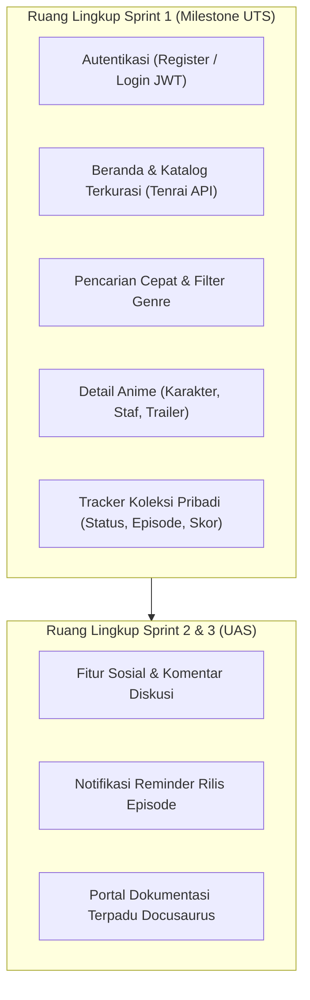

# Inisiasi Proyek: Mojiji AnimeList

Dokumen ini merupakan piagam inisiasi proyek (*Project Charter & Initiation*) untuk aplikasi web **Mojiji AnimeList**, disusun pada fase Sprint 0 (Pra-Pengembangan) sebagai fondasi seluruh siklus hidup pengembangan sistem.

---

## 1. Latar Belakang & Pernyataan Masalah (Problem Statement)
Penggemar anime dan manga sering kali menghadapi kendala saat melacak progres tontonan lintas musim rilis:
- Antarmuka platform pelacak yang sudah ada sering kali terasa padat (*cluttered*), berat dimuat pada koneksi terbatas, serta dipenuhi iklan yang mengganggu kenyamanan navigasi.
- Belum tersedianya aplikasi pelacak berbahasa Indonesia yang modern, responsif di ponsel, serta memiliki tema gelap terkurasi (*Dark Glow*) dengan integrasi metadata industri anime yang komprehensif.

## 2. Visi & Tujuan Produk (Vision & Objectives)
- **Visi:** Menghadirkan aplikasi web pelacak anime (*Anime & Manga Tracker*) yang cepat, minimalis, elegan, dan andal bagi komunitas penggemar anime Indonesia.
- **Tujuan Khusus Milestone UTS (Sprint 1):**
  - Mewujudkan Minimum Viable Product (MVP) yang mencakup alur vertikal utuh: Autentikasi Pengguna, Penjelajahan Katalog Terkurasi, Pencarian Cepat, Tampilan Detail Lengkap, dan Pengelolaan Progres Koleksi Pribadi (Tracker).
  - Mengimplementasikan arsitektur berdaya guna tinggi di lingkungan peladen terbatas (VPS Xeon 1 vCPU / 1 GB RAM) dengan konsumsi memori rendah (< 100 MB).

## 3. Pemilihan Tumpukan Teknologi (Tech Stack Rationale)

| Layer Sistem | Teknologi Terpilih | Alasan & Rasionalisasi Teknis |
| :--- | :--- | :--- |
| **Frontend** | **Next.js 15 (App Router)** | Mendukung *static export* HTML/CSS/JS murni (`output: 'export'`), kompilasi kilat Turbopack, serta responsivitas tinggi tanpa overhead server Node.js. |
| **State Management**| **Zustand** | Mengelola *global state* antarmuka (filter katalog, tema dark mode, dan tracker store) secara reaktif dan ringan tanpa *boilerplate* Redux. |
| **Styling & UI** | **Tailwind CSS & Shadcn UI** | Komponen UI modular bertema *Dark Glow* (#0F172A, aksen #6D4AFF) dengan kontras warna aksesibilitas WCAG standar. |
| **Backend API** | **Express.js (Microservices)** | Arsitektur layanan modular terisolasi (User Service, Catalog Service, Tracker Service) di belakang reverse proxy API Gateway. |
| **Database** | **PostgreSQL (Supabase)** | Basis data relasional tangguh dengan pemisahan skema (*multi-schema: auth, catalog, tracker*), connection pooling, dan versi migrasi terkontrol Dbmate. |
| **Data Provider** | **Tenrai API v1** | Penyedia metadata anime terkurasi (karakter, staf pengisi suara, relasi musim, tautan streaming, dan trailer embed). |
| **Web Server & SSL** | **Caddy Server 2** | Reverse proxy modern dengan otomasi penerbitan sertifikat SSL/TLS HTTPS Let's Encrypt serta penyajian berkas statis berkecepatan tinggi. |
| **CI/CD & DevOps** | **Docker & GitHub Actions** | Pipeline integrasi berkelanjutan otomatis untuk staging dan rilis produksi dengan *dynamic container auto-detection*. |

## 4. Batasan Ruang Lingkup Rilis (Scope Boundary)

---

## 5. Kriteria Keberhasilan Inisiasi (Initiation Sign-Off)
- [x] Repositori monorepo resmi dibuat di GitHub (`aji-banyu/mojiji-animelist`).
- [x] Struktur branching GitFlow disepakati (`main`, `develop`, feature/fix/docs/chore).
- [x] Dokumen Mini PRD awal dirancang dan disetujui bersama tim.
- [x] Papan kerja GitHub Projects ("Mojiji Kanban") diinisialisasi untuk 6 peran pengembang.
