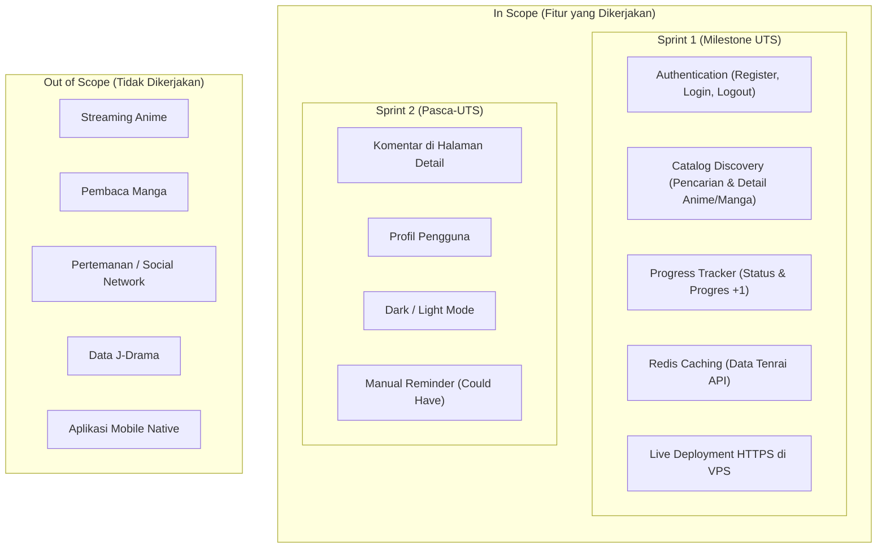

# Inisiasi Proyek: MOJIJI (Web Tracking Anime & Manga)

Dokumen ini merupakan piagam inisiasi proyek (*Project Initiation Document*) yang disusun pada fase **Project Planning (Minggu 3)** sesuai dengan **Mini PRD Revisi 4 (Versi 1.4)** untuk mata kuliah Pemrograman Web Framework (Semester 5, STMIK Bina Patria, Dosen: Joni Rodito, S.Kom).

---

## 1. Problem Statement (Pernyataan Masalah)
Berdasarkan Mini PRD Bagian 6:
* **Current Condition:** Penggemar Anime dan Manga saat ini mencatat progres tontonan/bacaan secara manual (melalui aplikasi catatan ponsel atau *spreadsheet*) atau menggunakan platform besar yang terasa berat dimuat, penuh iklan, dan sarat fitur yang tidak esensial.
* **Problem:** Proses pencatatan progres menjadi lambat, merepotkan, dan data tontonan tersebar di berbagai tempat tanpa sinkronisasi yang praktis.
* **Impact:** Pengguna sering lupa sudah menonton sampai episode berapa atau membaca sampai chapter berapa, menjadi malas mencatat, dan terganggu oleh antarmuka yang membingungkan.

---

## 2. Product Overview & Objective (Tujuan Produk)
Berdasarkan Mini PRD Bagian 5 & 7:
* **Deskripsi Produk:** **MOJIJI** adalah aplikasi web responsif untuk melacak (*tracking*) progres menonton Anime dan membaca Manga. Pengguna dapat mencari judul, melihat detail lengkap, lalu mencatat status dan progres episode/chapter hanya dengan **1–2 klik**. Data judul diintegrasikan dari **Tenrai API v1**.
* **Karakteristik Utama:** Berfungsi murni sebagai **jurnal pribadi** dengan tampilan bersih, cepat, dan modern. Aplikasi ini **tidak menyediakan layanan streaming anime maupun pembaca manga**.
* **Tujuan Utama:**
  1. Mempermudah pencatatan progres Anime dan Manga hanya dengan 1–2 klik (tombol `+1`).
  2. Mempermudah pengguna menemukan informasi judul anime/manga secara akurat.
  3. Memberikan ruang berbagi opini melalui fitur komentar (Sprint 2).
  4. Menjaga aplikasi tetap cepat dan stabil dengan *caching* Redis pada data Tenrai API.
  5. Membangun fondasi arsitektur microservices yang ringan dan efisien untuk spesifikasi peladen VPS (2 GB RAM fisik + 2 GB Swap).

---

## 3. Batasan Ruang Lingkup (Scope Boundary)
Berdasarkan Mini PRD Bagian 9 & 11:

---

## 4. Tumpukan Teknologi Resmi (Tech Stack)
Berdasarkan Mini PRD Bagian 3:

| Area | Teknologi | Alasan Pemilihan Berdasarkan PRD |
| :--- | :--- | :--- |
| **UI/UX Design** | **Figma** | Membuat wireframe, alur pengguna (*user flow*), dan *style guide* sebelum tahap koding dimulai. |
| **Frontend** | **Next.js 15 (React) + Shadcn UI + Zustand** | Diekspor sebagai situs statis (*static export* / `output: 'export'`); tidak membutuhkan proses server Node.js di peladen sehingga menghemat RAM VPS. |
| **Backend** | **Node.js + Express (Microservices)** | Sesuai arahan dosen penguji; ringan, modular, dan cepat dijalankan. |
| **Database** | **PostgreSQL (Supabase)** | Basis data relasional tangguh; menggunakan 2 project Supabase terpisah (proyek 1 untuk *staging*, proyek 2 untuk *production*). |
| **Database Migration** | **Dbmate** | Pengelolaan perubahan skema berbasis berkas SQL bernomor yang dapat direproduksi (*idempotent*): lokal → staging → production. |
| **Caching Layer** | **Redis (Upstash)** | Menyimpan hasil respons Tenrai API agar akses kilat (< 300 ms) dan tidak terkena *rate limit*. |
| **API Architecture** | **REST API** | Kontrak komunikasi data standar antara Next.js client dan backend microservices. |
| **Data Eksternal** | **Tenrai API v1** | Penyedia metadata anime & manga (pengganti Jikan API); gratis, stabil, tanpa autentikasi login. |
| **Reverse Proxy** | **Caddy Server 2** | Penerbitan sertifikat SSL HTTPS otomatis Let's Encrypt; menyajikan situs statis dan meneruskan `/api` ke API Gateway. |
| **CI/CD** | **GitHub Actions + GHCR** | Kompilasi build di cloud GitHub (bukan di VPS), lalu deploy otomatis tanpa membebani CPU peladen. |
| **Spesifikasi Server** | **1 VPS 2 GB RAM fisik (+ 2 GB Swap)** | Staging dan production berjalan di VPS yang sama dengan konfigurasi Docker Compose terpisah. |

---

## 5. Timeline Sprint & Rilis
Berdasarkan Mini PRD Bagian 1 & 2:
* **Minggu 3 (Project Planning):** Penyusunan Mini PRD dan Product Backlog.
* **Minggu 4 (Sprint Planning):** Pembuatan Sprint Backlog (tiket `MJ-001` dst.) di papan GitHub Projects (Mojiji Kanban).
* **Minggu 5 (Foundation):** Project Skeleton, Register/Login dasar, VPS & HTTPS Caddy siap, database staging siap.
* **Minggu 6 (Core Feature):** Vertical Slice: Login → Cari → Detail → Tambah ke Tracker di lingkungan staging.
* **Minggu 7 (Sprint Review):** Increment 1: Tracker lengkap, cache Redis aktif, dan pengukuran pemakaian RAM server.
* **Minggu 8 (Milestone UTS):** **MVP live di URL publik (`https://mojiji.web.id`) pada lingkungan production VPS.**
* **Minggu 9–11 (Sprint 2):** Fitur Komentar, Halaman Profil, Dark/Light Mode, dan Manual Reminder.
* **Minggu 12–14 (Final Sprint & UAS):** Stabilisasi penuh, inisialisasi portal dokumentasi Docusaurus di monorepo, dan rilis Final Product.
