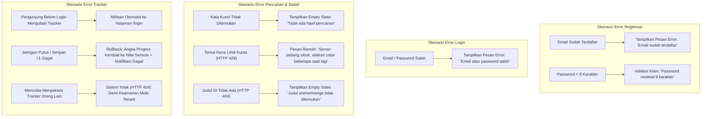

# Alur Pengguna (User Flow) Inti & Struktur Layar MVP — Mojiji AnimeList

* **Ticket ID:** `MJ-002`
* **Minggu:** 3 (Project Planning)
* **Role / PIC:** UI/UX Designer / Ican
* **Status:** Final & Terverifikasi
* **Dependensi:** `MJ-001` (Setup Figma tim dan style guide)
* **Tautan Kanvas Figma:** [MOJIJI Design Canvas (Node 603-167)](https://www.figma.com/design/VOMA5k5k3d6oSUpKONJPpF/MOJIJI?node-id=603-167&t=aPgqBjBmzo28waIf-1)

---

## 1. Pendahuluan

Dokumen ini mendefinisikan arsitektur navigasi, diagram alur pengalaman pengguna (*User Flow*), serta penanganan skenario kegagalan (*failure paths*) untuk produk minimum yang layak (**Minimum Viable Product / MVP**) pada fase Sprint 1 proyek **Mojiji AnimeList**.

Tujuan utama dari alur pengguna ini adalah menjamin **kecepatan dan kemudahan**: pengguna dapat mencari judul anime atau manga, memeriksa informasi detail, dan mencatat status tontonan/bacaan mereka hanya dalam **1–2 kali klik**.

---

## 2. Diagram Alur Pengguna Inti MVP (Core User Flow)

Berikut adalah diagram alur pengguna sukses (*happy path*) dari saat pengunjung pertama kali tiba hingga berhasil mengelola progres di dashboard pelacak:

```mermaid
flowchart TD
    Start(["Mulai: Pengunjung Buka Web Mojiji"]) --> Landing["Landing Page & Hero Slider (/home)"]
    
    %% Alur Autentikasi
    Landing --> ChooseAuth{"Sudah Punya Akun?"}
    ChooseAuth -- Belum --> RegisterPage["Halaman Register (/register)"]
    RegisterPage --> InputRegister["Isi Form: Username, Email, Password (min. 8 char)"]
    InputRegister --> SubmitRegister{"Validasi & Submit Register"}
    SubmitRegister -- Sukses --> RedirectLogin["Notifikasi Sukses -> Alihkan ke /login"]
    
    ChooseAuth -- Sudah --> LoginPage["Halaman Login (/login)"]
    RedirectLogin --> LoginPage
    LoginPage --> InputLogin["Isi Form: Email & Password"]
    InputLogin --> SubmitLogin{"Autentikasi Gateway (/api/auth/login)"}
    SubmitLogin -- Sukses --> AuthActive["Sesi Aktif (Cookie httpOnly) -> Masuk ke Dashboard / Katalog"]

    %% Alur Pencarian Katalog
    AuthActive --> CatalogSearch["Halaman Jelajah & Pencarian (/explore atau /search)"]
    CatalogSearch --> SearchInput["Ketik Kata Kunci Judul (Debounce 400ms, min. 3 huruf)"]
    SearchInput --> ToggleType["Pilih Tab: Anime atau Manga"]
    ToggleType --> FetchCatalog["Query ke Catalog Service via Tenrai API & Redis Cache"]
    FetchCatalog --> ShowResults["Tampil Grid Kartu Hasil Pencarian"]

    %% Alur Detail & Tambah Tracker
    ShowResults --> ClickCard["Klik Kartu Anime / Manga"]
    ClickCard --> DetailPage["Halaman Detail (/detail?type=&id=)"]
    DetailPage --> ViewDetail["Tinjau Sinopsis, Skor MAL, Status, Total Episode/Chapter"]
    ViewDetail --> ClickAddTracker["Klik Tombol 'Tambah ke Tracker'"]
    ClickAddTracker --> SelectStatus["Pilih Status Awal: Plan / Watching / Completed / On Hold / Dropped"]
    SelectStatus --> SaveTracker{"Simpan ke Tracker Service (/api/tracker)"}
    SaveTracker -- Sukses --> ShowToast["Muncul Notifikasi Sukses & Tombol Berubah ke Status Aktif"]

    %% Alur Dashboard & Progres +1
    ShowToast --> OpenDashboard["Buka Halaman Dashboard Tracker (/tracker)"]
    OpenDashboard --> FilterStatus["Filter Tab Status / Cari Judul di Tracker Pribadi"]
    FilterStatus --> ClickIncrement["Klik Cepat Tombol '+1' Progres"]
    ClickIncrement --> OptimisticUI["Optimistic UI: Angka Progres Langsung Bertambah di Layar (+1)"]
    OptimisticUI --> SyncIncrement{"Simpan Progres (/api/tracker/:id/increment)"}
    SyncIncrement -- Berhasil --> ProgresUpdated["Progres Tersimpan & Bar Progres Diperbarui"]
    
    %% Alur Selesai / Logout
    ProgresUpdated --> UserMenu["Menu Profil di Navbar"]
    UserMenu --> LogoutAction["Klik Logout (/api/auth/logout)"]
    LogoutAction --> End(["Sesi Berakhir -> Kembali ke Mode Tamu"])
```

---

## 3. Jalur Gagal & Penanganan Error Ramah (Failure Paths)

Sesuai kriteria *Acceptance Criteria* resmi di PRD Poin 14, setiap skenario kegagalan wajib ditangani secara elegan tanpa merusak antarmuka atau menampilkan layar kosong:

---

## 4. Daftar Halaman & Struktur Rute MVP

Berikut adalah daftar halaman web resmi pada MVP Sprint 1 beserta hak akses dan komponen antarmukanya:

| Rute URL | Nama Halaman | Status Autentikasi | Komponen Antarmuka Utama |
| :--- | :--- | :--- | :--- |
| **`/` / `/home`** | Home / Landing Page | Publik | Hero banner carousel (`HeroBanner.jsx`), slider rekomendasi tren, navigasi navbar. |
| **`/login`** | Halaman Masuk | Tamu (Guest Only) | Form email & password, tombol login, tombol masuk Google, tautan daftar. |
| **`/register`** | Halaman Pendaftaran | Tamu (Guest Only) | Form username, email, password (indikator kekuatan kata sandi), tautan login. |
| **`/explore` / `/search`**| Jelajah & Pencarian | Publik | Input pencarian (`SearchInput.jsx`), tab switch Anime/Manga, grid kartu katalog (`CatalogCard.js`), paginasi. |
| **`/detail?type=&id=`** | Detail Judul | Publik | Poster cover, badge skor MyAnimeList, sinopsis, metadata episode/volume, tombol "Tambah ke Tracker" & pemilihan status. |
| **`/tracker` / `/dashboard`** | Dashboard Tracker | **Wajib Login (Protected)** | Filter tab status (Plan, Watching, Done, Hold, Drop), grid kartu pelacak (`TrackerCards.jsx`), tombol cepat `+1`, modal ubah status & hapus. |
| **`/profile`** | Profil Pengguna | **Wajib Login (Protected)** | Informasi akun (`/api/users/me`), username, email, tanggal bergabung, ringkasan statistik tontonan/bacaan. |

---

## 5. Keputusan Desain Terkait Arsitektur Sistem

1. **Rute Statis Berbasis Query Parameter:**
   * Halaman detail menggunakan format query `/detail?type=anime&id=20` (bukan dynamic route server `/anime/[id]`). Keputusan ini wajib ditaati untuk mendukung build statis (`output: 'export'`) Next.js yang disajikan langsung oleh Caddy Server tanpa proses server-side rendering, sehingga menghemat konsumsi memori VPS 2 GB.
2. **Pola Optimistic UI pada Tombol `+1`:**
   * Ketika pengguna menekan tombol `+1` di kartu tracker, angka episode/chapter langsung naik secara instan pada antarmuka. Jika permintaan latar belakang gagal (misal koneksi terputus), sistem secara otomatis mengembalikan (*rollback*) angka ke kondisi semula dan memunculkan toast pesan kesalahan.
3. **Pemisahan Status Navigasi Tamu vs Login:**
   * Pada status tamu (*unauthenticated*), navbar menampilkan tombol **Masuk** dan **Daftar**.
   * Pada status login (*authenticated*), navbar menampilkan menu profil pengguna, akses langsung ke **Dashboard Tracker**, dan tombol **Logout**.

---

## 6. Status Verifikasi Penerimaan (Acceptance Criteria Tiket MJ-002)

- [x] Diagram alur core user flow MVP (*Register → Login → Cari → Detail → Tracker*) selesai dirancang.
- [x] Diagram jalur gagal (*failure paths*) dan penanganan pesan error ramah terdokumentasi lengkap.
- [x] Daftar halaman resmi MVP beserta pemetaan rute query statis telah ditetapkan.
- [x] Dokumen siap ditinjau oleh tim Frontend (Dika), Backend (Syafii), dan QA (Nadia).
